# Blazor-Blogs Update Plan

| | |
|---|---|
| **Status** | Draft for implementation |
| **Date** | 2026-11-11 |
| **Audience** | A developer or agent who has not seen the planning discussion |
| **Scope** | Nine workstreams delivered as 33 numbered tasks, four of them split into lettered parts, 39 pull requests in all (section 14) |
| **Branch** | All work merges into an integration branch, `release/10`. `main` is updated once, at the end (D34) |

Conventions used in this document:

- Links such as [MainLayout.razor](../BlazorBlogs/Components/Layout/MainLayout.razor#L28-L30) point at the code that proves a statement. Line numbers are as of commit `e916e03`.
- **(assumed)** marks a statement that was not verified by reading code or official documentation. Each one has a task whose "done when" check verifies it.
- **(reference repo)** marks a fact read from the owner's other repository, *Blazor-Data-Orchestrator*, which is outside this repository and therefore not linkable. Paths are relative to that repository's root.
- **(docs)** marks a fact taken from official documentation on 2026-11-11; the URL follows.
- Placeholders such as `<site>`, `<rg>`, `<token>` stand for real values. This document contains no secrets, hostnames or personal data, and none may be added.

---

## 1. Summary

Blazor-Blogs is a single-project Blazor Server blog engine on .NET 10 with ASP.NET Core Identity, a hand-rolled SQL upgrade wizard, a newsletter module and a file-downloads page. This plan covers:

| # | Workstream | One-line outcome |
|---|---|---|
| P | Platform | Solution targets .NET 11. |
| A | Aspire | `aspire run` starts the site plus a SQL Server container. One command, `aspire deploy`, provisions Azure SQL (Basic tier) and a Windows, code-deployed App Service (B1) and pushes the code. The `.sql` scripts and wizard still own the schema. Updates never delete or overwrite user content (uploads, post images, download files, database rows). The legacy "Deploy to Azure" template is brought up to date. |
| F | Foundation | Null-safe settings access, a public base-URL setting, a test project, CI, and a connection string that updates cannot overwrite, with install and upgrade verified for every kind of existing site. |
| E | Editor | The deprecated Quill-based editor is replaced by Radzen's HTML editor everywhere. |
| R | Redesign | Every screen gets a modern, consistent look from one set of design tokens: public pages with a top bar and card layout, administration pages with a side menu and card sections (section 5.14). |
| G | Google sign-in | Administrators enter Google OAuth credentials in the Settings page; visitors can sign in with Google or with a password. |
| B | Banner | The "Application Header" (the feature the owner calls the Banner) always renders, is responsive, and is edited with upload, preview and an on/off switch. |
| N | Newsletter | Self-service subscribe, unsubscribe and resubscribe that work from any email link without signing in; send pipeline defects fixed; an interrupted send can be resumed. |
| D | Paid downloads | Administrators price a download; buyers pay through Stripe Checkout, with tax calculated by Stripe, as a signed-in user or as a guest; files are no longer publicly reachable. |

---

## 2. Goals and non-goals

### Goals

| ID | Goal |
|---|---|
| G1 | All projects target `net11.0` and the existing feature set still works. |
| G2 | One command (`aspire run`) gives a working local site and database on a clean machine that has a container runtime. |
| G3 | Deployed site is an Azure App Service **web app running code on Windows**, not a container. Deployed database is **Azure SQL Database**, not a container. Both use the lowest tier that never stops or pauses on its own. Provisioning and code deployment are one command. |
| G4 | Schema changes are still delivered as versioned files in `BlazorBlogs/SQLScripts` and executed by the existing wizard. No EF migrations. |
| G5 | Google sign-in works beside username and password, configured the same way as the reference repo: in an admin page, stored in the settings store, effective without a restart. |
| G6 | The Application Header shows on every page (including `/Account/*`), and an administrator can add an image and see the result without typing HTML or reloading. |
| G7 | A subscriber can unsubscribe in two clicks from any newsletter and resubscribe from the same page. No database write happens on a plain GET. |
| G8 | A visitor can buy a priced download with or without an account, and cannot obtain a paid file without paying. |
| G9 | Stripe keys and Google keys are configured in the application, not in source files. |
| G10 | Deploying an application update never deletes or overwrites user content: download files, images uploaded through the File Manager, blog-post images, or database rows (blog posts, users, purchases). |
| G11 | Blazor-Blogs is open source and installed on many sites. Fresh installs and upgrades through the wizard keep working for every existing kind of site: self-hosted (IIS), sites created with the "Deploy to Azure" button, and the new Aspire deployments. An update can no longer overwrite the stored connection string. |
| G12 | An administrator whose browser is cut off during a newsletter send can resume it without duplicates. |
| G13 | Content written with the old editor displays and edits correctly in the new one. |
| G14 | All screens share one modern, professional visual language, work at phone width, and meet WCAG 2.1 AA contrast and 44 px touch targets. |

### Non-goals

| Area | Not in this plan |
|---|---|
| Platform | Replacing `System.Drawing.Common`, `Toolbelt.Blazor.HeadElement` or `WilderMinds.MetaWeblog`. Upgrading `Radzen.Blazor` beyond what the .NET 11 build or the HTML editor requires. |
| Aspire | Container Apps, Kubernetes, Linux App Service, deployment slots, custom domains, Application Insights dashboards, more than one site instance, blob or Azure Files storage for user content. |
| Google | Other providers (Microsoft, GitHub). Mapping the Google profile picture. |
| Banner | Multiple banners, scheduling, rotation, per-page targeting, a visitor "dismiss" button, HTML sanitisation of administrator input. |
| Newsletter | Anonymous (non-account) subscribers, double opt-in, a background sending service (sending stays in the administrator's browser session, D31), open and click tracking, bounce processing, renaming the misspelled `NewslettersCampain` table or classes. |
| Paid downloads | Subscriptions, bundles, quantities, coupons, invoices, in-app refunds (refunds are issued in the Stripe dashboard and synchronised by webhook), three-decimal currencies, dispute handling, file types other than `.zip`. Tax is calculated and collected by Stripe Tax; registering with tax authorities, filing, and collecting customer tax IDs are not part of this plan. |
| Editor | Rewriting stored content. Sanitising administrator-authored HTML. |

---

## 3. Decisions

Decisions marked **Owner** were made by the repository owner during planning. The rest were made by the planner and can be revisited.

| # | Decision | Rejected alternative | Why | By |
|---|---|---|---|---|
| D35 | The redesign is implemented with plain CSS custom properties (design tokens) in `wwwroot/app.css` and scoped `.razor.css` files, keeping Bootstrap for the grid and Radzen for complex controls, themed through the tokens. Fonts: Inter (body) and Space Grotesk (headings), self-hosted under `wwwroot/fonts`. One accent colour, configurable as a setting. | A new CSS framework (Tailwind, MudBlazor); Google Fonts CDN. | Smallest change to a working app; self-hosting avoids a third-party request and works offline/intranet. | Owner (redesign requested); planner (approach) |
| D34 | Every task's pull request targets an integration branch, `release/10`. `main` receives one merge, after T30. | Merge each task to `main`. | Sites created with the "Deploy to Azure" button build directly from `main` ([azuredeploy.json:176-178](../azuredeploy.json#L176-L178)); a `main` that is half-way through this plan (for example, .NET 11 before the template says `v11.0`) would break them on their next sync. | Planner |
| D1 | One combined plan, eight workstreams (the editor workstream was added after the first draft). | One plan per feature. | All workstreams share the version-script chain, `Settings.razor` and `Program.cs`; separate plans would collide. | Owner |
| D2 | "Banner" means the existing Application Header. Keep free-form HTML; fix rendering and editing. | Structured banner form; multi-banner table with scheduling. | Smallest change that meets "easy to use"; no data migration. | Owner |
| D3 | Paid downloads can be bought by signed-in users **and** by guests. | Signed-in only. | More sales; owner accepted the larger scope. | Owner |
| D4 | Newsletter subscribers remain registered users. | Anonymous email signup with double opt-in. | No new subscriber table; no spam-signup surface. | Owner |
| D5 | Website deployment: `aspire deploy` provisions Azure SQL natively and a Windows App Service through a custom Bicep template; code is zip-deployed by the same command (D30). Task T08 proves it; fallback is D5-F. | Aspire's built-in App Service integration. | That integration is Linux and container-only **(docs)**, and the app needs Windows (D6). | Owner |
| D5-F | Fallback if T08 fails: `azd` with hand-written Bicep under `infra/` and `host: appservice`; Aspire used for local run only. | n/a | Fully documented path; loses "database derived from the app model" on deploy. | Owner |
| D6 | App Service plan is Windows. | Linux plan. | `System.Drawing` is used for thumbnails ([FileSelector.razor](../BlazorBlogs/Components/Pages/FileSelector.razor#L171-L197)) and newsletter images ([NewsletterParser.cs](../BlazorBlogs/Data/Models/NewsletterParser.cs#L384-L389)); `System.Drawing.Common` is Windows-only **(docs)** <https://learn.microsoft.com/dotnet/core/compatibility/core-libraries/7.0/system-drawing>. | Planner |
| D7 | Google sign-in for an unknown person: link to an existing confirmed account with the same Google-verified email, otherwise create the account when `AllowRegistration` is `True`. | Link-only (reference repo behaviour); stock "associate your account" form. | One click for visitors of a public blog. | Owner |
| D8 | Google credentials live in the `Settings` table under the reference repo's key names and are edited in the Settings page. | Aspire parameters or `appsettings.json`. | Owner asked to follow the reference repo, which stores them in its settings store and edits them in an admin page **(reference repo)**. | Planner |
| D9 | Stripe integration is hosted Stripe Checkout in `payment` mode with inline `price_data`. | Payment Links; embedded Payment Element. | No card data touches the site; no product catalogue to keep in sync; one redirect. | Planner |
| D10 | Stripe secret key and webhook secret are rows in `Settings`, shown as write-only password inputs. | Environment variables or Key Vault only. | Owner asked that Stripe be configurable in the app; matches how `SMTPPassword` is stored today ([GeneralSettingsService.cs](../BlazorBlogs/Data/GeneralSettingsService.cs#L116-L127)). They are kept out of the `GeneralSettings` object that every page loads. | Planner |
| D11 | Price is one `decimal(10,2)` column on `Files`; `0` means free. One site-wide currency. | Separate paid flag; Stripe Price IDs per file; per-file currency. | Fewest moving parts. | Planner |
| D12 | Fulfilment happens in the webhook **and** on the success page, through one idempotent method. | Webhook only; success page only. | Webhook is reliable but late and absent in local development; success page is immediate but skipped if the buyer closes the tab. | Planner |
| D13 | A fully refunded purchase loses download access. | Keep access after refund. | Expected behaviour for digital goods. | Planner |
| D14 | All download files move out of `wwwroot` to a private folder; downloads go through one endpoint keyed by `FileId`. | Move only paid files. | Today every file is reachable anonymously (section 4.5); one code path; a file can change between free and paid without moving. | Planner |
| D15 | Free files keep the "must be signed in" rule, now enforced on the server. | Make free files public. | Preserves current visible behaviour ([FileDownloads.razor](../BlazorBlogs/Components/Pages/FileDownloads.razor#L16-L23)). | Planner |
| D16 | Email-link tokens (newsletter preferences, guest downloads) are opaque 256-bit random values stored in the database. | HMAC-signed or Data Protection tokens. | No key management, revocable by clearing the column, no custom cryptography. | Planner |
| D17 | Newsletter preference changes are form POSTs on a static server-rendered page. | Interactive Blazor page. | No write on GET; works without a SignalR circuit in mail-client browsers. | Planner |
| D18 | Old `/NewsletterUnsubscribe/{UserId}` links redirect to the new preferences page. | Remove the route. | Emails already sent contain that link. | Planner |
| D19 | New services are new classes; `BlogsService`'s constructor is not changed. Where an existing `BlogsService` method would need a new collaborator, the caller does that step instead (for example, the page deletes the physical file after `DeleteFilesAsync` removes the row). | Add dependencies to `BlogsService`. | It is constructed by hand at [UploadController.cs:160](../BlazorBlogs/Controllers/UploadController.cs#L160). | Planner |
| D20 | Each workstream that changes schema adds its own script; version numbers follow merge order. | One shared `10.00.00.sql`. | The wizard only runs scripts newer than the stored version ([InstallWizardExecuteScripts.razor:73](../BlazorBlogs/Components/Pages/InstallUpgrade/InstallWizardExecuteScripts.razor#L73)), so a script edited after a developer has run it is never re-run. | Planner |
| D21 | Add an xUnit project `BlazorBlogs.Tests`. | Manual testing only. | The solution has no tests ([BlazorBlogs.sln](../BlazorBlogs.sln)); payment and unsubscribe logic need regression protection. | Planner |
| D22 | New date columns store UTC and end in `Utc`. | `DateTime.Now` as elsewhere. | Token expiry must not depend on server time zone. | Planner |
| D23 | Third-party packages are upgraded only where the .NET 11 build or EF Core 11 requires it. The one exception is `Blazored.TextEditor`, which is removed (D32). | Upgrade everything to latest. | Radzen 13 is a major version; isolate risk. | Planner |
| D26 | Azure tiers: App Service plan `B1` and Azure SQL Database `Basic` (DTU model). | Free or Shared App Service plans; Aspire's default serverless free-offer database. | The owner asked for the lowest tier that does not stop on its own. Always On needs Basic or higher **(docs)** <https://learn.microsoft.com/azure/app-service/configure-common>. The DTU model has provisioned compute only, so it never auto-pauses; serverless (Aspire's default) does **(docs)** <https://learn.microsoft.com/azure/azure-sql/database/serverless-tier-overview>. | Owner |
| D27 | User content on Azure is kept on the App Service's own persistent storage (`%HOME%\data`), single instance. | Azure Blob Storage or an Azure Files mount. | Owner accepted local storage. | Owner |
| D28 | The legacy `azuredeploy.json` template is updated, not retired. | Remove the "Deploy to Azure" button. | Existing documentation and users depend on it. | Owner |
| D29 | The install wizard writes the connection string to `appsettings.Local.json`, a file that is never in a package or in source control. The shipped `appsettings.json` carries an empty connection string. A one-time start-up step copies an existing site's connection string into the new file. | Keep writing `appsettings.json`. | Every update package contains `appsettings.json`, so copying an update over a site wipes its connection string (section 4.9). | Owner (direction); planner (design) |
| D30 | `aspire deploy` also publishes and zip-deploys the code, through a custom pipeline step, so deployment is one command. The stand-alone script remains for code-only updates. | Two commands only. | Owner asked for one command and for the alternative to be explained (section 5.4). | Owner |
| D31 | Newsletter sending stays inside the administrator's browser session and is made resumable. | A background service that keeps sending after the browser closes. | Owner's choice: the administrator keeps the window open, and can resume if cut off. | Owner |
| D32 | `Blazored.TextEditor` (Quill) is replaced by `RadzenHtmlEditor` in all four places it is used, behind one shared wrapper component. | Keep the deprecated package; a different editor library. | The package is deprecated and unlisted (section 4.8); Radzen is already a dependency. | Owner |
| D33 | Stripe automatic tax is enabled on every Checkout Session by default. Tax code and tax behaviour are settings. | No tax handling. | Owner requires it. | Owner |
| D25 | User content is protected from deployments by three independent layers (section 5.10): the published package contains no file under a user-content folder; the deploy script never cleans the target; and on Azure the content lives outside the deployed folder, under one configurable root. | Rely on the `--clean false` deploy flag alone. | The owner requires that updates never overwrite user content (G10). A flag protects only people who use the script, and the repository currently ships two files inside `wwwroot/uploads` that every deployment would overwrite (section 4.9). | Owner requirement; design by planner |
| D24 | The install wizard's connection-string form is disabled when the host supplies the connection string. The application detects this itself (an environment variable supplies `DefaultConnection`); `Install:AllowDatabaseConfiguration=false` is an explicit override. | Leave as is; rely on a flag only. | Today the form appears to any visitor whenever the database is unreachable ([MainLayout.razor:60-70](../BlazorBlogs/Components/Layout/MainLayout.razor#L60-L70)), which any outage or transient fault can cause. Existing button-created sites never receive new app settings unless their template is redeployed, so a flag alone would not protect them. | Planner |

---

## 4. Current state

### 4.1 Solution and platform

| Fact | Evidence |
|---|---|
| One project, no tests, classic `.sln`. | [BlazorBlogs.sln](../BlazorBlogs.sln) |
| `net10.0`, nullable disabled. | [BlazorBlogs.csproj:4-5](../BlazorBlogs/BlazorBlogs.csproj#L4-L5) |
| Package list and versions. | [BlazorBlogs.csproj:24-47](../BlazorBlogs/BlazorBlogs.csproj#L24-L47) |
| Global interactive server rendering, except pages marked `[ExcludeFromInteractiveRouting]`. | [App.razor:21](../BlazorBlogs/Components/App.razor#L21), [App.razor:74-75](../BlazorBlogs/Components/App.razor#L74-L75) |
| `/Account/*` pages opt out of interactive routing, so they are static server-rendered and `OnAfterRenderAsync` never runs on them. | [Account/Pages/_Imports.razor:2](../BlazorBlogs/Components/Account/Pages/_Imports.razor#L2) |
| The install wizard also opts out of interactive routing but then declares `@rendermode InteractiveServer` on the page itself, so it **is** interactive. | [InstallUpgrade/_Imports.razor:2](../BlazorBlogs/Components/Pages/InstallUpgrade/_Imports.razor#L2), [InstallWizard.razor:1](../BlazorBlogs/Components/Pages/InstallUpgrade/InstallWizard.razor#L1) |
| Components that query in `OnInitializedAsync` own their own service scope (`OwningComponentBase`), so they do not share a `DbContext` with the layout. | [NavMenu.razor:4](../BlazorBlogs/Components/Layout/NavMenu.razor#L4), [LoginDisplay.razor:3](../BlazorBlogs/Components/Layout/LoginDisplay.razor#L3), [Settings.razor:301-302](../BlazorBlogs/Components/Pages/Settings.razor#L301-L302) |
| `NavigateTo` during static rendering works by throwing `NavigationException`, which the framework turns into a redirect. | [IdentityRedirectManager.cs:29-32](../BlazorBlogs/Components/Account/IdentityRedirectManager.cs#L29-L32) |
| MVC controllers and Identity minimal endpoints are mapped. | [Program.cs:89](../BlazorBlogs/Program.cs#L89), [Program.cs:115-121](../BlazorBlogs/Program.cs#L115-L121) |
| Two `DbContext`s share `ConnectionStrings:DefaultConnection`; environment variables override `appsettings.json`. | [Program.cs:33-34](../BlazorBlogs/Program.cs#L33-L34), [Program.cs:52-58](../BlazorBlogs/Program.cs#L52-L58) |
| Identity requires a confirmed account. | [Program.cs:62-71](../BlazorBlogs/Program.cs#L62-L71) |
| Only role is `Administrators`, a literal repeated per file. | [NavMenu.razor:101](../BlazorBlogs/Components/Layout/NavMenu.razor#L101), [UploadController.cs:33](../BlazorBlogs/Controllers/UploadController.cs#L33) |
| Admin pages are guarded by `AuthorizeView` plus a role check in markup, not by `[Authorize]`. | [Settings.razor:24-27](../BlazorBlogs/Components/Pages/Settings.razor#L24-L27), [Logs.razor:17-20](../BlazorBlogs/Components/Pages/Logs.razor#L17-L20) |
| Audit log is the `Logs` table via `CreateLogAsync`; each page copies a private `LogAction` helper. | [BlogsService.cs:1121-1126](../BlazorBlogs/Data/BlogsService.cs#L1121-L1126), [FileDownloads.razor:378-397](../BlazorBlogs/Components/Pages/FileDownloads.razor#L378-L397) |
| Repository instruction: use Azure tools and best practices for Azure work. | [.github/copilot-instructions.md](../.github/copilot-instructions.md) |
| A legacy ARM template deploys App Service plus Azure SQL and still says `v9.0`. | [azuredeploy.json:150-164](../azuredeploy.json#L150-L164) |

### 4.2 Settings and schema upgrades

| Fact | Evidence |
|---|---|
| `Settings` is a name/value table (`SettingName nvarchar(150)`, `SettingValue nvarchar(4000) NOT NULL`), seeded with 14 rows. | [00.20.00.sql:153-180](../BlazorBlogs/SQLScripts/00.20.00.sql#L153-L180) |
| `GetGeneralSettingsAsync` dereferences `FirstOrDefault(...)` for every row except `GoogleTrackingID`, so a missing row throws. | [GeneralSettingsService.cs:20-55](../BlazorBlogs/Data/GeneralSettingsService.cs#L20-L55), guard at [43-50](../BlazorBlogs/Data/GeneralSettingsService.cs#L43-L50) |
| One `UpdateXAsync` method per setting, synchronous inside. | [GeneralSettingsService.cs:200-211](../BlazorBlogs/Data/GeneralSettingsService.cs#L200-L211) |
| Pattern for adding a row idempotently. | [01.00.80.sql:5-8](../BlazorBlogs/SQLScripts/01.00.80.sql#L5-L8) |
| Every script ends by setting `VersionNumber`. | [09.00.00.sql:5-7](../BlazorBlogs/SQLScripts/09.00.00.sql#L5-L7) |
| The code-side version constant. | [MainLayout.razor:49](../BlazorBlogs/Components/Layout/MainLayout.razor#L49) |
| Scripts are listed in a hard-coded dictionary and run with `ExecuteSqlRawAsync` as one batch each. | [InstallWizardExecuteScripts.razor:150-173](../BlazorBlogs/Components/Pages/InstallUpgrade/InstallWizardExecuteScripts.razor#L150-L173), [line 84](../BlazorBlogs/Components/Pages/InstallUpgrade/InstallWizardExecuteScripts.razor#L84) |
| Scripts are read from `ContentRootPath\SQLScripts` and must be copied to output. | [InstallWizardExecuteScripts.razor:139-147](../BlazorBlogs/Components/Pages/InstallUpgrade/InstallWizardExecuteScripts.razor#L139-L147), [BlazorBlogs.csproj:101-103](../BlazorBlogs/BlazorBlogs.csproj#L101-L103) |
| If settings cannot be read the runner assumes version `00.00.00` and replays every script. | [InstallWizardExecuteScripts.razor:47-56](../BlazorBlogs/Components/Pages/InstallUpgrade/InstallWizardExecuteScripts.razor#L47-L56) |
| Start-up checks in the layout: cannot connect → `INSTALL`; no version row → `RUNSCRIPTS`; no admin → `CreateAdministrator`. | [MainLayout.razor:55-104](../BlazorBlogs/Components/Layout/MainLayout.razor#L55-L104) |
| The "database behind code" check runs only in `OnAfterRenderAsync`, so it never fires on `/Account/*`. That is what lets an administrator sign in at `/Account/Login` before an upgrade. | [MainLayout.razor:106-137](../BlazorBlogs/Components/Layout/MainLayout.razor#L106-L137) |
| The wizard's own "verify administrator" form never initialises its `Input` model and reads the cascading `HttpContext` inside an interactive page; it is expected to fail **(assumed; not run)**. | [InstallWizardLoginAdministrator.razor:44-60](../BlazorBlogs/Components/Pages/InstallUpgrade/InstallWizardLoginAdministrator.razor#L44-L60) |
| Four places build a `BlazorBlogsContext` for the application database by hand from the connection string, bypassing the options registered in `Program.cs`. (A fifth, [ImportBlogsDatabaseConfiguration.razor:278-281](../BlazorBlogs/Components/Pages/Importer/ImportBlogsDatabaseConfiguration.razor#L278-L281), tests an external import database and is left alone.) | [BlogsService.cs:1196-1199](../BlazorBlogs/Data/BlogsService.cs#L1196-L1199), [BlogsService.cs:1230-1235](../BlazorBlogs/Data/BlogsService.cs#L1230-L1235), [InstallWizardExecuteScripts.razor:77-80](../BlazorBlogs/Components/Pages/InstallUpgrade/InstallWizardExecuteScripts.razor#L77-L80), [InstallWizardDatabaseConfiguration.razor:220-223](../BlazorBlogs/Components/Pages/InstallUpgrade/InstallWizardDatabaseConfiguration.razor#L220-L223) |
| `IsDatabaseSetUpAsync` treats every exception as "not set up", and `RUNSCRIPTS` mode has no sign-in requirement. | [BlogsService.cs:1228-1258](../BlazorBlogs/Data/BlogsService.cs#L1228-L1258), [InstallWizard.razor:99-102](../BlazorBlogs/Components/Pages/InstallUpgrade/InstallWizard.razor#L99-L102) |
| `INSTALL` shows a form that writes a connection string into `appsettings.json`. | [InstallWizard.razor:94-97](../BlazorBlogs/Components/Pages/InstallUpgrade/InstallWizard.razor#L94-L97), [InstallWizardDatabaseConfiguration.razor:240-254](../BlazorBlogs/Components/Pages/InstallUpgrade/InstallWizardDatabaseConfiguration.razor#L240-L254) |

Rules for every new script, derived from the runner and from G10: additive only (no `DROP`, `TRUNCATE` or `DELETE` against existing tables; no narrowing of existing columns); no `GO`; no `{` or `}` characters (they are format placeholders to `ExecuteSqlRaw`); a statement that references a column added earlier in the same script must be wrapped in `EXEC('...')`; every statement guarded so a replay is harmless.

### 4.3 Application Header ("Banner")

| Fact | Evidence |
|---|---|
| README advertises "Dynamic Header and Logo". No file contains the word "banner". | [README.md:36](../README.md#L36) |
| Rendered as unsanitised markup in a fixed 50 % wide `div`. | [MainLayout.razor:28-30](../BlazorBlogs/Components/Layout/MainLayout.razor#L28-L30) |
| Settings are loaded only in `OnAfterRenderAsync`, and `StateHasChanged()` is called only when Disqus is enabled. On static pages `OnAfterRenderAsync` never runs. Result: the header is absent from prerendered HTML, absent on `/Account/*`, and appears on interactive pages only if another render happens later. | [MainLayout.razor:106-127](../BlazorBlogs/Components/Layout/MainLayout.razor#L106-L127) |
| Edited as a raw `<textarea>` by default; a link switches to a Quill editor whose image button opens `FileSelector`. | [Settings.razor:49-102](../BlazorBlogs/Components/Pages/Settings.razor#L49-L102), [line 286](../BlazorBlogs/Components/Pages/Settings.razor#L286) |
| Switching to the rich editor loads the stored HTML into Quill; Quill is expected to drop markup it does not support **(assumed)**. | [Settings.razor:356-360](../BlazorBlogs/Components/Pages/Settings.razor#L356-L360) |
| "Blank" is detected only as the literal `<p><br></p>`. | [Settings.razor:406-410](../BlazorBlogs/Components/Pages/Settings.razor#L406-L410) |
| A save error is shown as a success toast. | [Settings.razor:376-379](../BlazorBlogs/Components/Pages/Settings.razor#L376-L379) |
| The layout keeps its own copy of settings; nothing notifies it after a save. | [MainLayout.razor:52](../BlazorBlogs/Components/Layout/MainLayout.razor#L52) |
| `FileSelector` lists images under `wwwroot/uploads` and returns a relative path; it has no upload control. | [FileSelector.razor:62](../BlazorBlogs/Components/Pages/FileSelector.razor#L62), [164-220](../BlazorBlogs/Components/Pages/FileSelector.razor#L164-L220) |
| Upload exists only on the File Manager page, posting to `api/upload/multiple`. | [FileManager.razor:13-17](../BlazorBlogs/Components/Pages/FileManager.razor#L13-L17), [UploadController.cs:59-116](../BlazorBlogs/Controllers/UploadController.cs#L59-L116) |
| Logo is a bare `` with no `alt` or size limit, loaded in `OnInitializedAsync` (so it does render reliably). | [NavMenu.razor:7-12](../BlazorBlogs/Components/Layout/NavMenu.razor#L7-L12), [113-117](../BlazorBlogs/Components/Layout/NavMenu.razor#L113-L117) |
| A scoped state object with a `StateChanged` event already exists as a pattern. | [DisqusState.cs:8-35](../BlazorBlogs/Classes/DisqusState.cs#L8-L35) |

### 4.4 Newsletter

| Fact | Evidence |
|---|---|
| Tables `Newsletters`, `NewslettersCampain`, `NewslettersLogs` (no date or user-id column on logs). | [04.00.00.sql:8-14](../BlazorBlogs/SQLScripts/04.00.00.sql#L8-L14), [29-34](../BlazorBlogs/SQLScripts/04.00.00.sql#L29-L34), [49-54](../BlazorBlogs/SQLScripts/04.00.00.sql#L49-L54) |
| Subscription flag is `AspNetUsers.NewsletterSubscriber bit NULL`, mapped as `bool` on the Identity user and `bool?` on the database-first entity. | [00.10.00.sql:114](../BlazorBlogs/SQLScripts/00.10.00.sql#L114), [ApplicationUser.cs:12](../BlazorBlogs/Data/Models/ApplicationUser.cs#L12), [AspNetUsers.cs:30](../BlazorBlogs/Data/Models/AspNetUsers.cs#L30) |
| Only an administrator can set the flag. Registration and the account pages have no control for it. | [Administration.razor:119-128](../BlazorBlogs/Components/Pages/Administration.razor#L119-L128), [Register.razor:61-68](../BlazorBlogs/Components/Account/Pages/Register.razor#L61-L68), [Manage/Index.razor](../BlazorBlogs/Components/Account/Pages/Manage/Index.razor), [ManageNavMenu.razor:6-19](../BlazorBlogs/Components/Account/Shared/ManageNavMenu.razor#L6-L19) |
| Recipients are confirmed users with the flag set, returned as lower-cased **user names**; mail is addressed to the user name. | [BlogsService.cs:594-615](../BlazorBlogs/Data/BlogsService.cs#L594-L615), [682-690](../BlazorBlogs/Data/BlogsService.cs#L682-L690) |
| A recipient is skipped if **any** log row exists for the campaign, including error rows, so failures are never retried. | [BlogsService.cs:619-634](../BlazorBlogs/Data/BlogsService.cs#L619-L634), [NewsletterCampainEdit.razor:92-105](../BlazorBlogs/Components/Pages/Newsletter/NewsletterCampainEdit.razor#L92-L105) |
| Sending runs inside the administrator's circuit, one per second, with no re-entrancy guard and no completion message. | [NewsletterCampainEdit.razor:124-179](../BlazorBlogs/Components/Pages/Newsletter/NewsletterCampainEdit.razor#L124-L179) |
| Links are built from the administrator's own browser address. | [NewsletterCampainEdit.razor:145](../BlazorBlogs/Components/Pages/Newsletter/NewsletterCampainEdit.razor#L145) |
| The unsubscribe link carries the raw Identity user id, or nothing if the lookup failed. | [NewsletterParser.cs:312](../BlazorBlogs/Data/Models/NewsletterParser.cs#L312), [BlogsService.cs:669-675](../BlazorBlogs/Data/BlogsService.cs#L669-L675) |
| If building the HTML fails the method returns `null`; the mail is then sent **without** the unsubscribe link and logged as sent. | [NewsletterParser.cs:324-327](../BlazorBlogs/Data/Models/NewsletterParser.cs#L324-L327), [EmailService.cs:140-153](../BlazorBlogs/Data/EmailService.cs#L140-L153), [BlogsService.cs:692-695](../BlazorBlogs/Data/BlogsService.cs#L692-L695) |
| The plain-text part never contains the link. | [EmailService.cs:134-138](../BlazorBlogs/Data/EmailService.cs#L134-L138) |
| No mail headers are ever set. | [EmailService.cs:99-155](../BlazorBlogs/Data/EmailService.cs#L99-L155) |
| The unsubscribe page writes to the database inside `OnInitializedAsync` of a GET, ignores the result, shows nothing for an unknown id, and offers no way back. | [NewsletterUnsubscribe.razor:1](../BlazorBlogs/Components/Pages/Newsletter/NewsletterUnsubscribe.razor#L1), [24-38](../BlazorBlogs/Components/Pages/Newsletter/NewsletterUnsubscribe.razor#L24-L38) |
| Test sends write campaign log rows, decrement the counter and always report success. | [NewsletterCampainEdit.razor:115-122](../BlazorBlogs/Components/Pages/Newsletter/NewsletterCampainEdit.razor#L115-L122), [169-172](../BlazorBlogs/Components/Pages/Newsletter/NewsletterCampainEdit.razor#L169-L172) |
| Saving a user in the admin page always overwrites the flag with the value shown in the popup. | [Administration.razor:257](../BlazorBlogs/Components/Pages/Administration.razor#L257) |
| `/newsletter` loads data before the role check. | [NewsletterHome.razor:21-26](../BlazorBlogs/Components/Pages/Newsletter/NewsletterHome.razor#L21-L26), [line 97](../BlazorBlogs/Components/Pages/Newsletter/NewsletterHome.razor#L97) |
| Email API: `SendMailAsync` and `SendMailAlternateViewAsync` return `""` on success or an error string. | [EmailService.cs:23](../BlazorBlogs/Data/EmailService.cs#L23), [line 43](../BlazorBlogs/Data/EmailService.cs#L43) |

### 4.5 File downloads

| Fact | Evidence |
|---|---|
| `Files(FileId, FileName, FilePath, CreateDate, DownloadCount)`. `FileName` is the display title; `FilePath` is the uploaded file name. | [00.20.00.sql:137-150](../BlazorBlogs/SQLScripts/00.20.00.sql#L137-L150), [Files.cs](../BlazorBlogs/Data/Models/Files.cs), [BlazorBlogsContext.cs:220-233](../BlazorBlogs/Data/BlazorBlogsContext.cs#L220-L233) |
| `FilesDTO.FileId` is a `string`. | [FilesDTO.cs:14](../BlazorBlogs/Data/Models/FilesDTO.cs#L14) |
| Upload: administrators only, accepts only the client-reported type `application/x-zip-compressed`, writes to `wwwroot\files\<original name>` overwriting any existing file, then inserts a row. | [UploadController.cs:121-170](../BlazorBlogs/Controllers/UploadController.cs#L121-L170) |
| Download endpoint is anonymous, takes a raw file name, and combines it into a path without validation (path traversal). | [FileController.cs:23-36](../BlazorBlogs/Controllers/FileController.cs#L23-L36) |
| Files are also served directly by static-file middleware at `/files/<name>`. | [Program.cs:112](../BlazorBlogs/Program.cs#L112) |
| The only login gate is in the page markup. Counting and logging happen in the page, not the endpoint. | [FileDownloads.razor:36-43](../BlazorBlogs/Components/Pages/FileDownloads.razor#L36-L43), [327-338](../BlazorBlogs/Components/Pages/FileDownloads.razor#L327-L338) |
| `UpdateFilesAsync` overwrites `DownloadCount` from a stale DTO. | [BlogsService.cs:916-952](../BlazorBlogs/Data/BlogsService.cs#L916-L952) |
| `DeleteFilesAsync` constructs a controller by hand to delete the physical file. | [BlogsService.cs:956-980](../BlazorBlogs/Data/BlogsService.cs#L956-L980), [FileController.cs:39-51](../BlazorBlogs/Controllers/FileController.cs#L39-L51) |
| No Stripe or payment code exists. | Search of `*.cs`, `*.razor`, `*.json`, `*.sql`, `*.csproj` for `stripe`, `price`, `purchase` returned nothing. |

### 4.6 External sign-in

| Fact | Evidence |
|---|---|
| The stock external-login pages exist. | [ExternalLogin.razor](../BlazorBlogs/Components/Account/Pages/ExternalLogin.razor), [ExternalLoginPicker.razor](../BlazorBlogs/Components/Account/Shared/ExternalLoginPicker.razor) |
| The picker lists every registered scheme and is **not** placed on the login page. | [ExternalLoginPicker.razor:41](../BlazorBlogs/Components/Account/Shared/ExternalLoginPicker.razor#L41), [Login.razor:16-58](../BlazorBlogs/Components/Account/Pages/Login.razor#L16-L58) |
| The callback signs in an already-linked user, otherwise shows an "associate" form that creates an unconfirmed account and sends a confirmation email. | [ExternalLogin.razor:99-131](../BlazorBlogs/Components/Account/Pages/ExternalLogin.razor#L99-L131), [133-175](../BlazorBlogs/Components/Account/Pages/ExternalLogin.razor#L133-L175) |
| The challenge endpoint. | [IdentityComponentsEndpointRouteBuilderExtensions.cs:25-42](../BlazorBlogs/Components/Account/IdentityComponentsEndpointRouteBuilderExtensions.cs#L25-L42) |
| External cookie scheme is already the default sign-in scheme; no provider is registered. | [Program.cs:45-50](../BlazorBlogs/Program.cs#L45-L50) |
| `AllowRegistration` only hides links; nothing blocks `/Account/Register`. | [NavMenu.razor:85-92](../BlazorBlogs/Components/Layout/NavMenu.razor#L85-L92) |

### 4.7 Reference repository pattern (to follow for Google and Aspire)

All **(reference repo)**; paths relative to that repository. `Web/` means `src/BlazorOrchestrator.Web/`.

| Topic | What it does | Where |
|---|---|---|
| Google registration | Always registers the scheme with placeholder credentials; real values are injected by an `IPostConfigureOptions<GoogleOptions>` store. | `Web/Program.cs` lines 34-79, 146-153 |
| Keys | `Authentication:Google:ClientId`, `Authentication:Google:ClientSecret`, `Authentication:Google:Enabled`. | `Web/Constants/AuthSettingKeys.cs` lines 9-11 |
| Storage and UI | Values are rows in the settings store, edited on the admin page; secret box is blank on load and blank means "keep". Saving evicts the options cache, so no restart. | `Web/Services/AuthenticationSettingsService.cs`, `Web/Services/ExternalAuthOptionsStore.cs`, `Web/Components/Pages/Admin/AdminHome.razor` |
| Enablement | Button shown and challenge allowed only when enabled and both values present. | `Web/Models/AuthProviderConfig.cs` lines 9-12 |
| Google options | Maps the verified-email flag to a custom claim; `SaveTokens = false`; `prompt=login`. Callback path is the default `/signin-google`. | `Web/Services/ExternalAuthOptionsStore.cs` lines 100-119 |
| Accounts | Never auto-creates; links by verified email; rejects unconfirmed or locked-out accounts. This plan differs on auto-create only (D7). | `Web/Services/ExternalLoginService.cs` lines 66-121 |
| AppHost database | `AddAzureSqlServer(...).RunAsContainer(c => ... WithDataVolume ... WithLifetime(Persistent))`, then `AddDatabase`. | `src/BlazorOrchestrator.AppHost/Program.cs` lines 87-97 |
| Web consumes | Plain `GetConnectionString(name)` plus `UseSqlServer`; `AddServiceDefaults()`; `MapDefaultEndpoints()`. | `Web/Program.cs` lines 26, 102-112, 400 |
| SQL packages | `Microsoft.Data.SqlClient` 7.1.0 and `Microsoft.Data.SqlClient.Extensions.Azure` 7.1.0. | `Web/BlazorOrchestrator.Web.csproj` |
| Deployment | Azure Container Apps through `azd`. **Not followed** here (G3). | `azure.yaml`, `wiki-content/Deployment.md` |
| Aspire version | 13.5.4 packages and SDK, `net10.0`. | project files |

### 4.8 Platform facts from documentation

| Fact | Source **(docs)** |
|---|---|
| .NET 11.0.0 (SDK 11.0.100) released 2026-11-10; STS. | <https://dotnet.microsoft.com/en-us/download/dotnet/11.0> |
| Migration guide and breaking changes. | <https://learn.microsoft.com/aspnet/core/migration/100-to-110>, <https://learn.microsoft.com/aspnet/core/breaking-changes/11/overview>, <https://learn.microsoft.com/ef/core/what-is-new/ef-core-11.0/breaking-changes> |
| Entra authentication for SqlClient needs the package `Microsoft.Data.SqlClient.Extensions.Azure`. | <https://learn.microsoft.com/aspnet/core/breaking-changes/11/sqlclient-azure-extensions-required> |
| Aspire 13.6.x; AppHost uses `Aspire.AppHost.Sdk`; templates accept `--framework net11.0` (default `net10.0`). | <https://aspire.dev/get-started/aspire-sdk/> |
| `aspire init` adds a project-based AppHost to an existing solution and writes `aspire.config.json`. | <https://aspire.dev/reference/cli/commands/aspire-init/> |
| Aspire's App Service integration provisions a **Linux** plan and a container registry, builds and pushes **container images**. | <https://aspire.dev/deployment/azure/app-service/> |
| `AddAzureSqlServer("x").RunAsContainer()` then `.AddDatabase("y")`. Deployed: Entra-only authentication, managed-identity administrator, connection string `Server=tcp:<fqdn>,1433;Encrypt=True;Authentication="Active Directory Default";...` with no user name or password. | <https://aspire.dev/integrations/cloud/azure/azure-sql-database/azure-sql-database-host/> |
| Custom Bicep: `AddBicepTemplate(name, path).WithParameter(...).GetOutput(...)`; parameters may be secrets, outputs of other resources, or a connection-string resource; templates must declare `param location string`. | <https://aspire.dev/integrations/cloud/azure/customize-resources/> |
| Custom deployment steps: `builder.Pipeline.AddStep(name, action, dependsOn:, requiredBy:)`. | <https://aspire.dev/get-started/pipelines/> **(assumed URL; content read through the Aspire documentation tool, page slug `pipelines-and-app-topology`)** |
| Zip deployment unpacks into `site\wwwroot` and includes "deletion of files left over from a previous deployment"; `az webapp deploy` has a `--clean` switch whose default depends on artifact type. | <https://learn.microsoft.com/azure/app-service/deploy-zip>, <https://learn.microsoft.com/cli/azure/webapp> |
| Google: package `Microsoft.AspNetCore.Authentication.Google` 11.0.0; default callback `/signin-google`. | <https://learn.microsoft.com/aspnet/core/security/authentication/social/google-logins?view=aspnetcore-11.0> |
| Package compatibility on nuget.org: `Z.EntityFramework.Plus.EFCore` 11.106.0 targets `net11.0` and EF Core 11; `Radzen.Blazor` 13.0.0 adds `net11.0`; `Blazored.TextEditor` is deprecated; `Toolbelt.Blazor.HeadElement` last released in 2022. | nuget.org package pages |

### 4.9 Where user content lives today

| Content | Location | Written by |
|---|---|---|
| Blog posts, users, settings, newsletters | SQL database | EF Core |
| Images picked in editors, logo | `wwwroot/uploads/**` | [UploadController.cs:96-101](../BlazorBlogs/Controllers/UploadController.cs#L96-L101), managed in [FileManager.razor:142](../BlazorBlogs/Components/Pages/FileManager.razor#L142), listed in [FileSelector.razor:77-78](../BlazorBlogs/Components/Pages/FileSelector.razor#L77-L78) |
| Blog-post images from Live Writer and the importer | `wwwroot/blogs/**` | [MetaWeblogService .cs:388-389](../BlazorBlogs/Controllers/MetaWeblogService%20.cs#L388-L389), [ImportBlogsEdit.razor:382-383](../BlazorBlogs/Components/Pages/Importer/ImportBlogsEdit.razor#L382-L383) |
| Download files | `wwwroot/files/*` | [UploadController.cs:131-135](../BlazorBlogs/Controllers/UploadController.cs#L131-L135) |
| Connection string (self-hosted) | `appsettings.json` | install wizard (section 4.2) |
| Everything under the content root | any path | `UploadController.UpgradeAsync` (`POST api/upload/upgrade`, administrators): extracts an uploaded zip over the content root with overwrite, including `appsettings.json` and `wwwroot/uploads`. Its Settings-page UI is half-removed and links to a controller that does not exist. [UploadController.cs:174-273](../BlazorBlogs/Controllers/UploadController.cs#L174-L273), [Settings.razor:226-258](../BlazorBlogs/Components/Pages/Settings.razor#L226-L258), [Settings.razor:436-453](../BlazorBlogs/Components/Pages/Settings.razor#L436-L453) |

| Fact | Evidence |
|---|---|
| The repository tracks two files inside a user-content folder, so every publish contains them and every deployment overwrites a same-named file on the server. One is the default logo. | [wwwroot/uploads/logo.png](../BlazorBlogs/wwwroot/uploads/logo.png), [wwwroot/uploads/BlazorHelpWebsite.png](../BlazorBlogs/wwwroot/uploads/BlazorHelpWebsite.png), seed value at [00.20.00.sql:176](../BlazorBlogs/SQLScripts/00.20.00.sql#L176) |
| The wizard menu hard-codes that logo path. | [InstallWizardNavMenu.razor:3](../BlazorBlogs/Components/Pages/InstallUpgrade/InstallWizardNavMenu.razor#L3) |
| Every location is computed from `WebRootPath`, and relative URLs are produced by string-replacing `WebRootPath` out of a physical path. | [FileSelector.razor:190-191](../BlazorBlogs/Components/Pages/FileSelector.razor#L190-L191), [FileManager.razor:249-250](../BlazorBlogs/Components/Pages/FileManager.razor#L249-L250) |
| `appsettings.json` is part of the publish output, so a deployment to a self-hosted site replaces the connection string the wizard wrote. | [InstallWizardDatabaseConfiguration.razor:240-254](../BlazorBlogs/Components/Pages/InstallUpgrade/InstallWizardDatabaseConfiguration.razor#L240-L254) |

### 4.10 Connection string and the wizard

| Fact | Evidence |
|---|---|
| The tracked `appsettings.json` contains a non-empty `ConnectionStrings:DefaultConnection`, so a developer's connection string is part of every package. | [appsettings.json](../BlazorBlogs/appsettings.json) (value not reproduced here) |
| The wizard writes to `appsettings.json` in the process's **current directory**, not the content root. | [InstallWizardDatabaseConfiguration.razor:245](../BlazorBlogs/Components/Pages/InstallUpgrade/InstallWizardDatabaseConfiguration.razor#L245) |
| The connection string is read once at start-up and captured by both context registrations; the wizard therefore restarts the site after an `INSTALL`. | [Program.cs:52-58](../BlazorBlogs/Program.cs#L52-L58), [InstallWizard.razor:148-158](../BlazorBlogs/Components/Pages/InstallUpgrade/InstallWizard.razor#L148-L158) |
| Before that restart, the script runner reads the version through the injected (stale) service, fails, and falls back to `00.00.00`. A fresh install depends on that fallback. | [InstallWizardExecuteScripts.razor:47-56](../BlazorBlogs/Components/Pages/InstallUpgrade/InstallWizardExecuteScripts.razor#L47-L56) |
| The scripts themselves run on a context built from the current configuration value, so they do see the new connection string. | [InstallWizardExecuteScripts.razor:63](../BlazorBlogs/Components/Pages/InstallUpgrade/InstallWizardExecuteScripts.razor#L63), [77-80](../BlazorBlogs/Components/Pages/InstallUpgrade/InstallWizardExecuteScripts.razor#L77-L80) |
| `IWritableOptions<ConnectionStrings>` is registered and injected in two components but its `Update` method is never called. | [Program.cs:37](../BlazorBlogs/Program.cs#L37), [ConfigureWritable.cs:59-76](../BlazorBlogs/Classes/ConfigureWritable.cs#L59-L76) |
| Sites created by the "Deploy to Azure" template get their connection string as an App Service connection string, which reaches the app as an environment variable and already wins over the file. | [azuredeploy.json:181-194](../azuredeploy.json#L181-L194), [Program.cs:33-34](../BlazorBlogs/Program.cs#L33-L34) |

### 4.11 Rich-text editor

| Fact | Evidence |
|---|---|
| `Blazored.TextEditor` 1.1.2 is referenced and imported globally. | [BlazorBlogs.csproj:26](../BlazorBlogs/BlazorBlogs.csproj#L26), [_Imports.razor:15](../BlazorBlogs/Components/_Imports.razor#L15) |
| Quill 1.3.6 styles and scripts are loaded from a CDN on every page. | [App.razor:13-14](../BlazorBlogs/Components/App.razor#L13-L14), [App.razor:24-26](../BlazorBlogs/Components/App.razor#L24-L26) |
| Six editor instances in four files: blog summary and content, importer summary and content, newsletter content, application header. | [BlogAdministration.razor:44](../BlazorBlogs/Components/Pages/BlogAdministration.razor#L44), [line 98](../BlazorBlogs/Components/Pages/BlogAdministration.razor#L98), [ImportBlogsEdit.razor:67](../BlazorBlogs/Components/Pages/Importer/ImportBlogsEdit.razor#L67), [line 121](../BlazorBlogs/Components/Pages/Importer/ImportBlogsEdit.razor#L121), [NewsletterEdit.razor:44](../BlazorBlogs/Components/Pages/Newsletter/NewsletterEdit.razor#L44), [Settings.razor:56](../BlazorBlogs/Components/Pages/Settings.razor#L56) |
| Each instance sits beside a raw `<textarea>` with a "[Rich Text Editor]" / "[Raw HTML Editor]" toggle; content enters the editor as markup in `EditorContent` and leaves through `GetHTML()`. | [BlogAdministration.razor:38-41](../BlazorBlogs/Components/Pages/BlogAdministration.razor#L38-L41), [76-78](../BlazorBlogs/Components/Pages/BlogAdministration.razor#L76-L78), [283-297](../BlazorBlogs/Components/Pages/BlogAdministration.razor#L283-L297) |
| Images are inserted by a toolbar button that opens `FileSelector`, then `InsertImage(url)`. | [BlogAdministration.razor:413-423](../BlazorBlogs/Components/Pages/BlogAdministration.razor#L413-L423) |
| Stored content is displayed as raw markup with no Quill wrapper element, so Quill's own stylesheet (whose content rules are scoped to its editor container **(assumed)**) does not style displayed posts today. | [ViewBlogPost.razor:36](../BlazorBlogs/Components/Pages/ViewBlogPost.razor#L36), [Index.razor:48](../BlazorBlogs/Components/Pages/Index.razor#L48), [NewsletterView.razor:12](../BlazorBlogs/Components/Pages/Newsletter/NewsletterView.razor#L12) |
| `RadzenHtmlEditor` is not used anywhere yet; `Radzen.Blazor` 11.2.3 is referenced. | [BlazorBlogs.csproj:40](../BlazorBlogs/BlazorBlogs.csproj#L40) |
| Radzen editor API: `@bind-Value`; child tool components define the toolbar; `RadzenHtmlEditorCustomTool` with `CommandName` raises `Execute`; `SaveSelectionAsync`, `RestoreSelectionAsync`, `ExecuteCommandAsync(HtmlEditorCommands.InsertHtml, html)`. | **(docs)** Radzen documentation tool, component `RadzenHtmlEditor`, features "Execute (Custom Tool Dialog)" and "Custom Tools Set" |

### 4.12 Legacy "Deploy to Azure" template

| Fact | Evidence |
|---|---|
| SQL authentication: administrator login and password parameters, embedded in the connection string. | [azuredeploy.json:17-28](../azuredeploy.json#L17-L28), [line 190](../azuredeploy.json#L190) |
| Database is Standard `S1`. | [azuredeploy.json:71-73](../azuredeploy.json#L71-L73) |
| Plan SKU list includes Free (`F1`) and Shared (`D1`); default `B1`. | [azuredeploy.json:35-51](../azuredeploy.json#L35-L51) |
| Site: web sockets on, `netFrameworkVersion` `v9.0`, no Always On, no app settings. | [azuredeploy.json:160-166](../azuredeploy.json#L160-L166) |
| Code arrives by source-control deployment: App Service clones the repository's `main` branch and builds it. | [azuredeploy.json:168-180](../azuredeploy.json#L168-L180) |

Azure guidance applied (from the Azure best-practices tool required by the repository instruction): infrastructure as Bicep under `infra/`; managed identity instead of stored database credentials; preview a deployment before applying it; test the returned URL after deployment.

---

## 5. Design

### 5.1 Structure

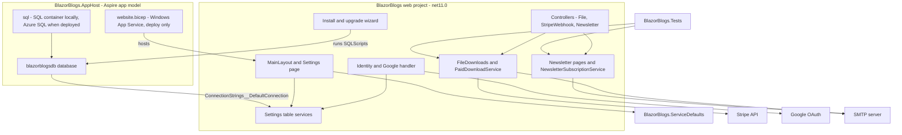

### 5.2 Target solution layout

```text
Blazor-Blogs/
  BlazorBlogs.sln                      (modified: 3 new projects)
  global.json                          (new: SDK 11.0.100, rollForward latestFeature)
  aspire.config.json                   (new: points at the AppHost)
  BlazorBlogs/                         (web, net11.0)
  BlazorBlogs.AppHost/                 (new, Aspire.AppHost.Sdk, net11.0)
  BlazorBlogs.ServiceDefaults/         (new, net11.0)
  BlazorBlogs.Tests/                   (new, xUnit, net11.0)
  infra/website.bicep                  (new)
  deploy/Deploy-Website.ps1            (new)
  .github/workflows/ci.yml             (new)
  Docs/
```

### 5.3 Workstream P: .NET 11

| Item | Change |
|---|---|
| Target framework | `net11.0` in [BlazorBlogs.csproj:4](../BlazorBlogs/BlazorBlogs.csproj#L4). |
| Microsoft packages at `10.0.11` | Move to the `11.0.x` release of each. If `Microsoft.AspNetCore.AzureAppServices.HostingStartup` has no 11.0 release **(assumed it has)**, remove it. |
| `Microsoft.VisualStudio.Web.CodeGeneration.Design` | Remove (scaffolding tool, not used at run time **(assumed)**). |
| `Z.EntityFramework.Plus.EFCore` | `11.106.0` (must match EF Core major). |
| New package | `Microsoft.Data.SqlClient.Extensions.Azure` (needed for the Azure SQL connection string, section 4.8). |
| Other third-party packages | Unchanged unless the build fails (D23). |
| Antiforgery | .NET 11 changes antiforgery handling **(docs, section 4.8; exact effect on MVC `[ApiController]` POST actions assumed)**. `RadzenUpload` posts to `api/upload/*` without a token ([FileDownloads.razor:90-94](../BlazorBlogs/Components/Pages/FileDownloads.razor#L90-L94)). After retargeting, test both uploads; if they return 400, add `[IgnoreAntiforgeryToken]` to `UploadController` (it already requires the `Administrators` role). |
| EF Core 11 | Default SQL Server compatibility level is 160 **(docs)**. Add optional config key `Database:CompatibilityLevel` and pass it to `UseCompatibilityLevel` when set, for self-hosted SQL Server older than 2022. |

### 5.4 Workstream A: Aspire, Azure SQL, App Service

#### Local run

| Piece | Design |
|---|---|
| AppHost | Created with `aspire init` (or `dotnet new aspire-apphost -f net11.0`). Packages: `Aspire.Hosting.Azure.Sql`. |
| Database resource | `AddAzureSqlServer("sql").RunAsContainer(c => c.WithDataVolume().WithLifetime(ContainerLifetime.Persistent))`, then `.AddDatabase("blazorblogsdb")`. Same shape as the reference repo (section 4.7). Aspire generates the `sa` password and keeps it in AppHost user secrets **(assumed; T06 verifies the password survives a restart with the persistent volume)**; do not put it in a file. |
| Web resource | `AddProject<Projects.BlazorBlogs>("blazorblogs").WithReference(db, connectionName: "DefaultConnection").WaitFor(db)`. The web project keeps reading `GetConnectionString("DefaultConnection")` ([Program.cs:52](../BlazorBlogs/Program.cs#L52)); no Aspire client package is added, as in the reference repo. |
| Wizard guard | AppHost sets `Install__AllowDatabaseConfiguration=false` on the web resource (D24). |
| ServiceDefaults | `dotnet new aspire-servicedefaults -f net11.0`; web project references it and calls `builder.AddServiceDefaults()` and `app.MapDefaultEndpoints()`. |
| First run | Database exists but is empty → layout sends the browser to `installwizard/RUNSCRIPTS` → all scripts run → `CreateAdministrator`. No connection form. Aspire creating the empty database in the container is **(assumed)**; T06 verifies. |

AppHost sketch (shape only, not final code):

```csharp
var builder = DistributedApplication.CreateBuilder(args);

var sql = builder.AddAzureSqlServer("sql")
    .ConfigureInfrastructure(infra =>
    {
        var database = infra.GetProvisionableResources().OfType<SqlDatabase>().Single();
        database.Sku = new SqlSku { Name = "Basic", Tier = "Basic" };   // D26; also clear the free-offer properties (assumed names)
    })
    .RunAsContainer(c => c.WithDataVolume().WithLifetime(ContainerLifetime.Persistent));
var db = sql.AddDatabase("blazorblogsdb");

if (builder.ExecutionContext.IsRunMode)
{
    builder.AddProject<Projects.BlazorBlogs>("blazorblogs")
        .WithReference(db, connectionName: "DefaultConnection")
        .WaitFor(db)
        .WithEnvironment("Install__AllowDatabaseConfiguration", "false");
}
else
{
    var identity = builder.AddAzureUserAssignedIdentity("blazorblogs-identity");   // (assumed API)
    // sql.ConfigureInfrastructure(...): make `identity` the server's Entra administrator (T08)
    builder.AddBicepTemplate("website", "../infra/website.bicep")
        .WithParameter("websiteName", builder.AddParameter("websiteName"))
        .WithParameter("appServiceSku", builder.AddParameter("appServiceSku"))
        .WithParameter("identityId", identity.GetOutput("id"))                     // (assumed output names)
        .WithParameter("identityClientId", identity.GetOutput("clientId"))
        .WithParameter("sqlConnectionString", db);

    // D30: one command. Runs after provisioning; see "Code deployment" below.
    builder.Pipeline.AddStep("deploy-website-code", async context => { /* publish, check, zip, deploy */ },
        dependsOn: [/* the step that provisions `website` (name found in T08) */],
        requiredBy: WellKnownPipelineSteps.Deploy);
}
builder.Build().Run();
```

The `ConfigureInfrastructure` pattern is from the Aspire Azure SQL page **(docs)** <https://aspire.dev/integrations/cloud/azure/azure-sql-database/azure-sql-database-host/>; the pipeline API is from <https://aspire.dev/deployment/pipelines/> **(docs; the pipeline APIs are marked experimental and raise diagnostic `ASPIREPIPELINES001`, which the AppHost project must suppress)**.

#### Deployment

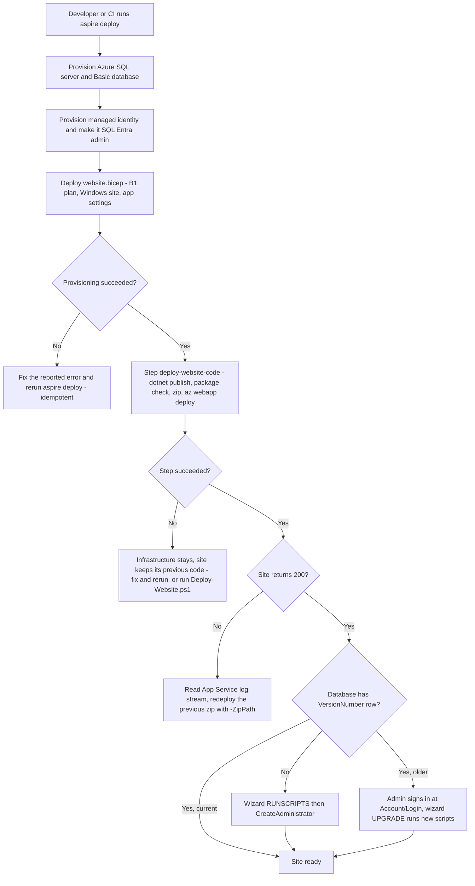

| Piece | Design |
|---|---|
| Why the web project is added only in run mode | Aspire has no code-based App Service target; a project with no compute environment has undefined deploy behaviour **(assumed)**. Keeping it out of the publish model avoids that. |
| Database access | The site runs as a user-assigned managed identity that is the SQL server's Entra administrator, so it can run DDL in the wizard. Aspire's automatic `db_owner` grant only applies to compute it deploys itself **(assumed)**, hence this approach. |
| Connection string | Passed into `website.bicep` from the `db` resource and stored as App Service connection string `DefaultConnection`. App setting `AZURE_CLIENT_ID` selects the user-assigned identity for the `Active Directory Default` credential **(assumed; T08 verifies the site connects)**. |
| Tiers (D26) | App Service plan `B1` with Always On; Azure SQL Database `Basic`. Aspire's default database SKU is the serverless free offer, which auto-pauses **(docs)**, so the AppHost overrides it. `Basic` is limited to 2 GB **(assumed)**; a site that outgrows it changes the SKU name in one place. |
| Code deployment (D30) | One implementation, two entry points. `deploy/Deploy-Website.ps1` does the work: `dotnet publish -c Release`, verify the output contains no user-content path (section 5.10), zip into `artifacts/site-<yyyyMMdd-HHmmss>.zip` (folder git-ignored), `az webapp deploy --type zip --clean false`. The zips are kept so a previous one can be redeployed with `-ZipPath`. The AppHost pipeline step `deploy-website-code` runs that same script after provisioning, passing the resource group and the `websiteName` output of the Bicep template, so `aspire deploy` alone provisions and deploys. |
| User content (D27) | Stored outside the deployed folder on Azure, on the site's own persistent storage: `website.bicep` sets `Storage__UserContentPath` to `%HOME%\data\BlazorBlogs` (section 5.10). `%HOME%\data` being persistent and untouched by deployments is **(assumed)**; T08 verifies. |
| Database | `aspire deploy` is rerun for every release. It must leave an existing database and its rows in place **(assumed: incremental deployment)**; T08 verifies by deploying twice. Upgrade scripts are additive only (section 4.2 rules). |
| Preview | Before the first real deployment run `aspire publish` and inspect `aspire-output/*.bicep`, then `az deployment group what-if` with the generated templates. |
| HTTPS scheme | `ASPNETCORE_FORWARDEDHEADERS_ENABLED=true` so Google redirect URIs and generated links use `https`. Needed on Windows App Service **(assumed)**; harmless if not. |

The two ways to deploy, as the owner asked to have both explained:

| | One command (chosen, D30) | Two steps (the other option) |
|---|---|---|
| What you run | `aspire deploy` | `aspire deploy` for infrastructure, then `./deploy/Deploy-Website.ps1 -ResourceGroup <rg> -WebsiteName <site>` for code |
| What happens | Provisions or updates Azure SQL, the identity and the App Service, then publishes and zip-deploys the code. | The same two things, started separately. |
| Good for | First deployment; any release that changes infrastructure; people who want one thing to remember. | Code-only updates (faster: no Bicep deployment); CI pipelines that separate "infrastructure" from "release"; someone who may deploy code but has no rights to change infrastructure; redeploying an older zip to roll back. |
| Cost of choosing it | Every code update also re-evaluates the infrastructure templates (slower, needs infrastructure permissions). Depends on Aspire's pipeline API, which is experimental. | Two things to remember; possible to update infrastructure and forget the code. |
| Availability in this plan | Default, documented first in the README. | Still available: the script is the implementation the pipeline step calls, so it always works on its own. |

Six unknowns that T08 must close, with the action if each fails:

| # | Unknown | If it fails |
|---|---|---|
| U1 | `aspire deploy` completes with a model containing only SQL, an identity and a Bicep template. | Use fallback D5-F. |
| U2 | The identity can be made the SQL Entra administrator through `ConfigureInfrastructure`. | Use fallback D5-F, where hand-written Bicep sets the server's Entra administrator to the site identity directly. (Nobody can sign in as Aspire's generated administrator identity to run a grant by hand.) |
| U3 | Windows App Service offers the .NET 11 runtime (`netFrameworkVersion: 'v11.0'`). | Publish self-contained `win-x64` (`-SelfContained` switch). |
| U4 | After uploading an image, a blog-post image and a download file, a second code deployment leaves all three byte-identical, both with the script's `--clean false` and with a deliberate `--clean true`. | Stop. G10 is not met; do not ship deployment until a storage location that survives is found (Azure Files mount or blob storage). |
| U5 | Running `aspire deploy` a second time leaves the database rows in place, including after the SKU override. | Use fallback D5-F with Bicep in incremental mode, verified the same way. |
| U6 | A custom pipeline step can be ordered after the `website` template is provisioned and can read its `websiteName` output and the resource group. | Keep the two-step flow as the documented default and wrap both commands in one script, `deploy/Deploy-All.ps1`, so there is still one command. |

### 5.5 Workstream F: foundation

| Piece | Design |
|---|---|
| Null-safe settings | Add `GetSettingAsync(name, default)` and `SetSettingAsync(name, value)` (upsert) to `GeneralSettingsService`. Every setting introduced by this plan is read through them, so a database that has not yet run the new script does not crash before the upgrade redirect. |
| `SiteBaseUrl` | New setting, edited in the Settings page. `SiteUrlService.GetBaseUrlAsync(fallback)` returns it with a trailing slash, or the fallback when blank. Used for newsletter links, Stripe return URLs, guest download links and the "redirect URI" hints. |
| Shared context options | New static helper `BlazorBlogsDbOptions.Configure(DbContextOptionsBuilder builder, string connectionString, IConfiguration configuration, bool retry = true)` applies `UseSqlServer` with the optional compatibility level and, when `retry` is true, `EnableRetryOnFailure(maxRetryCount: 2, maxRetryDelay: 2 seconds, errorNumbersToAdd: null)`. It is used by both registrations in `Program.cs` **and** by the four hand-built application-database contexts listed in section 4.2 (six uses in all), so every connection behaves the same. Connectivity probes pass `retry: false` so a down database is reported at once: the layout's `CanConnect` check ([MainLayout.razor:62](../BlazorBlogs/Components/Layout/MainLayout.razor#L62)) moves to a hand-built non-retrying context, as does the wizard's "is this connection valid" test. No explicit transactions were found in the code read **(assumed none exist; a retrying strategy conflicts with user transactions)**. |
| Database unavailable | The connection form is hidden when the host manages the connection: `ConnectionStringStore.IsHostManaged` is true when an environment variable named `ConnectionStrings__DefaultConnection`, `SQLAZURECONNSTR_DefaultConnection`, `SQLCONNSTR_DefaultConnection` or `CUSTOMCONNSTR_DefaultConnection` exists, **or** `Install:AllowDatabaseConfiguration` is `false`. Then `installwizard/INSTALL` renders "The database is not available. Retry." (a link that reloads `/`) instead of the form. Otherwise (self-hosted with a file) the form is shown as today. |
| Start-up checks finish before the page starts | `MainLayout` renders `@Body` and the header only after its checks have completed without a redirect (a `ready` flag). Today the page inside `@Body` starts initialising while the layout is still checking; once new columns are mapped on existing entities (T16, T21), a page that queries them against a database that has not been upgraded yet would throw before the layout could redirect to the wizard. |
| Transient faults must not look like "not installed" | `IsDatabaseSetUpAsync` returns `false` only when the `Settings` table is missing (SQL error 208) or the `VersionNumber` row is absent; any other exception propagates. `MainLayout` treats a propagated exception like "cannot connect". The script runner reads the stored version through a context **built from the current configuration value** (as it already does to run the scripts), not through the injected service, which still holds the pre-wizard connection during an `INSTALL` (section 4.10). The read is extracted from the Razor component into a small class, `SchemaVersionReader`, so it can be tested. Four outcomes: `Settings` table missing → `00.00.00` (fresh install); row found → that version; table present but `VersionNumber` row absent → error "the database is in an unexpected state", nothing run; any other failure → show the error and run nothing. |
| Signing in before an upgrade | The upgrade redirect is **not** issued for paths under `Account/` (section 5.7), so an administrator can still sign in. In `UPGRADE` mode, a visitor who is not an administrator sees a link "Sign in as an administrator to upgrade" to `Account/Login?ReturnUrl=installwizard/UPGRADE` in place of the `InstallWizardLoginAdministrator` component, which is deleted. |
| Tests and CI | `BlazorBlogs.Tests` (xUnit). Tests that touch the database run against a real SQL Server: by default LocalDB, or whatever `BLAZORBLOGS_TEST_CONNECTION` points at. A fixture creates a uniquely named database per test class by executing the real files in `SQLScripts` in order (which also tests the scripts) and drops it afterwards. SQLite is not used: the code relies on SQL Server error numbers, raw `UPDATE … WHERE` statements and hand-built SQL Server contexts. A "transient failure" is simulated with a connection string to a server name that does not resolve, with a one-second timeout. `ci.yml` runs on `windows-latest` (LocalDB and `System.Drawing` both need Windows; LocalDB being present on that runner is **(assumed)**, otherwise the workflow installs it), on push and pull request to `release/10` and `main`. |

Start-up decision after this plan:

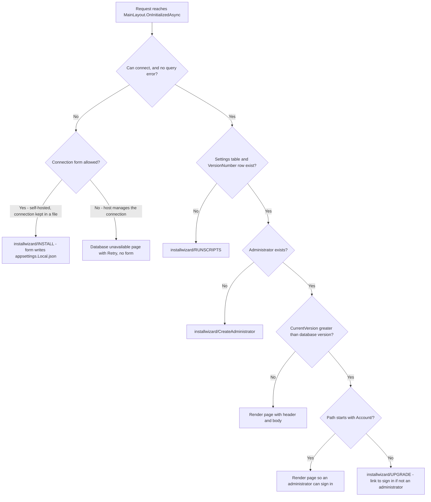

#### Connection string storage (D29, G11)

| Piece | Design |
|---|---|
| New file | `<ContentRootPath>/appsettings.Local.json`, containing only `ConnectionStrings:DefaultConnection`. Git-ignored, excluded from publish, absent from every package. |
| Load order | In `Program.cs`, add `AddJsonFile("appsettings.Local.json", optional: true, reloadOnChange: true)` between the existing `appsettings.json` line and `AddEnvironmentVariables()` ([Program.cs:33-34](../BlazorBlogs/Program.cs#L33-L34)). Result: environment (Aspire, App Service) wins over the local file, which wins over `appsettings.json`. |
| Shipped default | `appsettings.json` in the repository gets `"DefaultConnection": ""`. Developers use `aspire run`, or their own `appsettings.Local.json`. |
| Empty connection string | `BlazorBlogsDbOptions.Configure` must not throw when the string is empty: it registers SQL Server without a connection string **(assumed to be accepted by EF Core; if not, use a syntactically valid placeholder that cannot connect)**, so `CanConnect` fails and the layout sends the visitor to the wizard as today. |
| Wizard write | `UpdateConnectionStringAsync` writes (creating if needed) `appsettings.Local.json` under `IWebHostEnvironment.ContentRootPath`, then reloads configuration as today. It never touches `appsettings.json`. If the file cannot be written (read-only folder), show the exception text and the manual alternative: set an environment variable `ConnectionStrings__DefaultConnection`. |
| One-time migration | `ConnectionStringStore.MigrateFromAppSettings(builder.Environment.ContentRootPath)` runs immediately after `WebApplication.CreateBuilder(args)` ([Program.cs:26](../BlazorBlogs/Program.cs#L26)) and before the configuration sources are added at line 33: if `appsettings.Local.json` does not exist and `appsettings.json` holds a non-empty `DefaultConnection`, write that value to the new file. It never deletes or edits `appsettings.json` and never overwrites an existing local file. It does not throw. |
| Migration outcome is visible | The outcome is kept in `ConnectionStringStore.Status`: `HostManaged`, `LocalFile`, `MigratedNow`, `AppSettingsOnly` (migration not possible, with the reason: folder not writable, file not parseable) or `None`. After the host is built it is written to `ILogger`. When it is `AppSettingsOnly`, the Settings page shows administrators a warning: "The database connection is still stored in appsettings.json and will be lost if an update replaces that file. Reason: <reason>. To fix: make the application folder writable and restart, or set the environment variable `ConnectionStrings__DefaultConnection`." The Settings page also always shows "Connection source: environment / appsettings.Local.json / appsettings.json". |
| Changed precedence | Once the local file exists it outranks `appsettings.json`, so a later hand-edit of the connection string in `appsettings.json` is ignored. The "Connection source" line and the README upgrade section say so. |
| Unused writable options | The `IWritableOptions<ConnectionStrings>` registration is left as is; nothing calls `Update`. |

Every way a site can meet this change, and what must happen. This table is the acceptance test: T05 verifies the self-hosted and environment rows, T06 the Aspire run, and T10 the two button-site rows. The repository has no written upgrade procedure today ([README.md:40-50](../README.md#L40-L50) covers installation only), so S2 and S3 must be treated as equally likely.

| # | Site before the update | What the administrator does | Expected result |
|---|---|---|---|
| S1 | None (fresh self-hosted install) | Copies the files, browses to the site | `INSTALL` form → connection saved to `appsettings.Local.json` → scripts from `00.00.00` → restart → create administrator. |
| S2 | Self-hosted, connection string in `appsettings.json`, kept during the update | Copies new files except `appsettings.json` | Site starts; migration copies the value to the local file; `UPGRADE` runs new scripts after sign-in. |
| S3 | Self-hosted, `appsettings.json` overwritten by the update, no local file yet | Copies all new files | `INSTALL` form (database unreachable) → administrator re-enters the connection → runner finds the existing version row and runs only newer scripts → restart → site works with all data. No script is replayed against existing data. |
| S4 | Any self-hosted site already on this version or later | Copies all new files, including `appsettings.json` | Nothing changes; the local file still holds the connection string. This is the case D29 exists for. |
| S5a | Created with the "Deploy to Azure" button | Syncs the repository only (the usual way; the site's Azure settings do not change) | Site builds with .NET 11 **(assumed; T10 verifies)**. Environment value wins; the connection form is hidden by detection (D24); `UPGRADE` runs new scripts after sign-in. The site keeps its old settings: no Always On, user content stays in the app folder. Known limit: a shipped image that the owner replaced under the same name (`uploads/logo.png`) is removed by the sync and re-seeded with the default, which is no worse than today, when each sync overwrites it **(assumed)**. The README tells these owners to redeploy the template (S5b) or to upload their logo under a different name first. |
| S5b | Created with the button | Redeploys the updated template with their current plan SKU and database tier | As S5a, plus Always On (when the plan allows it), the user-content path outside the app folder, and the first-start copy of existing uploads. No database row or tier changes. |
| S8 | Self-hosted, connection string in `appsettings.json`, folder not writable by the app | Copies new files except `appsettings.json` | Site works as before from `appsettings.json`. Migration reports `AppSettingsOnly`; the Settings page warning appears. Nothing is lost, and the administrator is told the protection is not yet in place. |
| S6 | Aspire local or Aspire-deployed | `aspire run` / `aspire deploy` | Environment value wins; wizard form disabled; `RUNSCRIPTS` on first run, `UPGRADE` later. |
| S7 | Self-hosted, folder not writable by the app | Fresh install | Wizard shows the write error and the environment-variable alternative; after the variable is set and the site restarted, `RUNSCRIPTS` proceeds. |

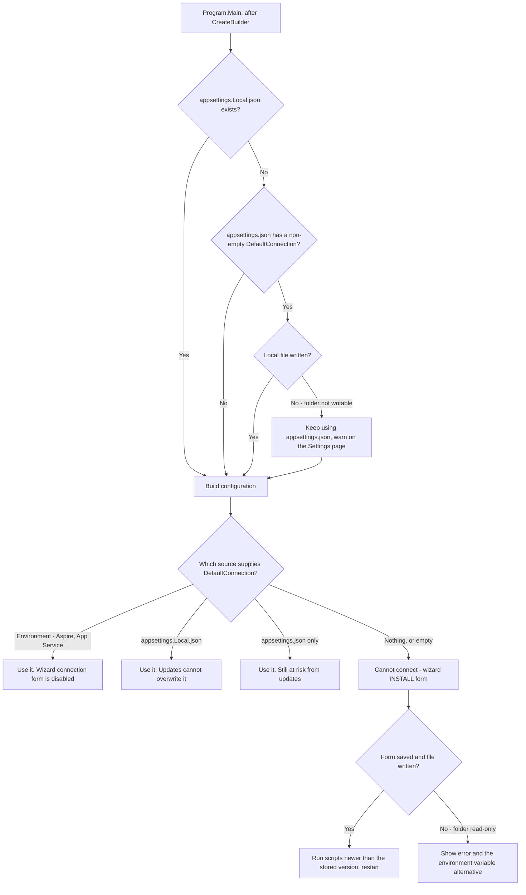

### 5.6 Workstream G: Google sign-in

| Piece | Design |
|---|---|
| Registration | In `Program.cs`, keep the result of `AddAuthentication(...)` ([Program.cs:45-50](../BlazorBlogs/Program.cs#L45-L50)) in a variable and call both `.AddGoogle("Google", o => { placeholders })` and `.AddIdentityCookies()` on it. Do not chain `AddGoogle` after `AddIdentityCookies()`; that call returns a different builder type **(assumed)**. Always registered. |
| Live options | `ExternalAuthOptionsStore` (singleton) implements `IPostConfigureOptions<GoogleOptions>`; `UpdateGoogle` stores new values and evicts the `IOptionsMonitorCache<GoogleOptions>` entry. In `PostConfigure` it also maps the verified-email flag to claim `urn:blazorblogs:google:email_verified` and sets `SaveTokens = false`, as the reference does. |
| Loading | After `builder.Build()`, a scope reads the three settings and calls `UpdateGoogle`, inside try/catch that logs and continues (the database may not exist yet). |
| Admin UI | New component `GoogleAuthSettingsPanel.razor` embedded in the Settings page: Enabled, Client ID, Client Secret (blank on load; blank keeps the stored value), read-only hint `<SiteBaseUrl>signin-google`. Save writes the rows and calls `UpdateGoogle`. |
| Login UI | Put `<ExternalLoginPicker />` on `Login.razor` and `Register.razor`. The picker shows the Google button only when `ExternalAuthOptionsStore.IsGoogleConfigured`, and prints nothing (not the stock "no external services" text) otherwise. |
| Challenge guards | Both challenge endpoints, `PerformExternalLogin` and `Manage/LinkExternalLogin` ([IdentityComponentsEndpointRouteBuilderExtensions.cs:55-70](../BlazorBlogs/Components/Account/IdentityComponentsEndpointRouteBuilderExtensions.cs#L55-L70)), redirect instead of challenging when Google is not configured. They are minimal endpoints and cannot use `IdentityRedirectManager`; write the status cookie directly (`IdentityRedirectManager.StatusCookieName`, same options: `SameSite=Strict`, `HttpOnly`, 5-second `MaxAge`) and return `TypedResults.LocalRedirect("~/Account/Login")` (or `~/Account/Manage/ExternalLogins`). |
| Account page | `Manage/ExternalLogins.razor` builds its "add another service" list from every registered scheme ([ExternalLogins.razor:90-92](../BlazorBlogs/Components/Account/Pages/Manage/ExternalLogins.razor#L90-L92)); filter Google out when it is not configured. |
| Email lookup | Do not use `FindByEmailAsync`: unique emails are not enforced ([Program.cs:62-65](../BlazorBlogs/Program.cs#L62-L65)) and it throws on duplicates. Query `UserManager.Users` by `NormalizedEmail` and branch on 0, 1 or more matches. |
| Closed registration | `Register.razor` redirects to `Account/Login` with status "Registration is closed" when `AllowRegistration` is `False`, so the rule is the same for passwords and Google. |
| Callback | Replace the "associate" form in `ExternalLogin.razor` with the flow below. |
| Password-less accounts | Created by `UserManager.CreateAsync(user)` without a password; the stock Set Password page lets the user add one. |
| Multi-instance | The store is per process. With more than one instance a save reaches the others only on restart. The site is single-instance today **(assumed)**. |

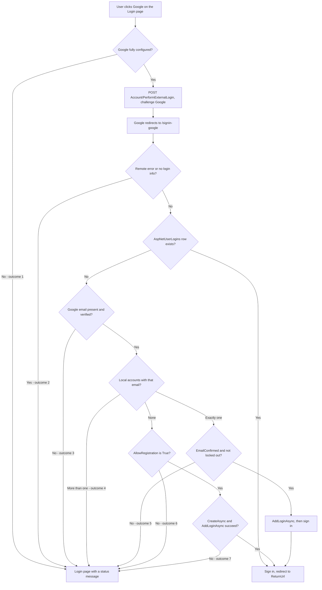

| Outcome | Status message shown on the Login page |
|---|---|
| 1 | Google sign-in is not available. |
| 2 | Error from external provider, or "Error loading external login information." (existing texts) |
| 3 | Google did not confirm your email address. |
| 4 | More than one account uses this email address. Contact the administrator. |
| 5 | This account is not confirmed or is locked. |
| 6 | Registration is closed. |
| 7 | The Identity error descriptions (for example, user name already taken). The half-created user is deleted if `AddLoginAsync` fails. |

The new user is created with `UserName = Email = <Google email>`, `EmailConfirmed = true`, `DisplayName` = the Google name claim, `NewsletterSubscriber = false`.

An unconfirmed local account is rejected rather than confirmed because administrators use `EmailConfirmed = False` to disable an account ([Administration.razor:254](../BlazorBlogs/Components/Pages/Administration.razor#L254)); the reference repo applies the same rule.

### 5.7 Workstream B: Application Header

| Problem (section 4.3) | Change |
|---|---|
| Header missing in prerendered and static pages | Load settings in `MainLayout.OnInitializedAsync`, after the three database checks. Keep only the Disqus JavaScript call in `OnAfterRenderAsync`. Three rules: **(1)** load through a private scope, not the layout's injected services: inject `IServiceScopeFactory`, create a scope, resolve `GeneralSettingsService`, read, dispose. The layout's injected `BlazorBlogsContext` is shared with every `@inject`-ing child, and an awaited query on it while children initialise causes "a second operation was started on this context". **(2)** The version check moves with the load but is skipped when `NavigationManager.ToBaseRelativePath(Uri)` starts with `Account/` (section 5.5). **(3)** Never call `NavigateTo` inside a `try` whose `catch` swallows the exception: in static rendering the redirect *is* a `NavigationException`. Set a local `redirectTo` variable inside the try/catch, then call `NavigateTo(redirectTo, true)` and `return` outside it. |
| Fixed 50 % width | Replace the inline style with class `site-header` in `MainLayout.razor.css`: `width:100%`, `max-width:1100px`, centred, and `::deep img { max-width:100%; height:auto; }`. |
| No on/off | New setting `ApplicationHeaderEnabled` (default `True`). Render only when enabled and not blank. |
| Blank detection | Blank when, after removing tags and `&nbsp;`, no text remains and the HTML contains no `` and the two toggle links are removed. New setting `ApplicationHeaderEditorMode` (`Rich` or `Raw`) records which view the editor opens in: `Rich` = design view, `Raw` = source view. Script default: `Raw` if a header already exists (so hand-written HTML is shown as written), else `Rich`. The mode is saved with the header. |
| Image needs a detour through File Manager | The editor's image tool opens `FileSelector` (section 5.11). Add a `RadzenUpload` (`Accept="image/*"`) to `FileSelector`, posting to the existing `api/upload/multiple?CurrentDirectory=<folder>` where `<folder>` is the currently selected folder relative to the uploads root, built exactly as [FileManager.razor:15](../BlazorBlogs/Components/Pages/FileManager.razor#L15) does; on completion call `LoadFiles()`. Every other use of the component gains the upload too. |
| No preview | "Preview" button renders the current editor content inside a `div.site-header` below the editor. |
| Reload needed after save | New scoped `GeneralSettingsState` with `event EventHandler StateChanged` (same pattern as `DisqusState`). `Settings.razor` calls `NotifyChanged(settings)` after a successful save; `MainLayout` and `NavMenu` subscribe (and unsubscribe in `Dispose`) and re-render with `InvokeAsync(StateHasChanged)`. The state object must be obtained with `@inject` in all three components so they share the circuit's instance; resolving it from `ScopedServices` would give `Settings.razor` a private copy. |
| Error shown as success | `toastService.ShowError(...)` in the catch block. |
| Logo | `alt="@ApplicationName"`, `max-height:3rem; max-width:100%` in `NavMenu.razor.css`, and a "Clear" link beside "[Select]". Also fix the `<ldivi>` typo at [NavMenu.razor:69](../BlazorBlogs/Components/Layout/NavMenu.razor#L69). |

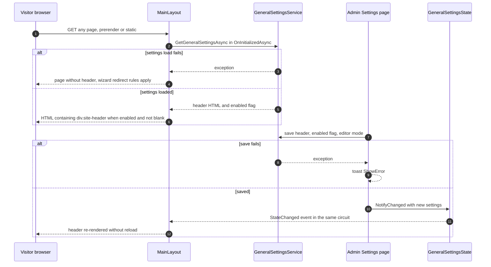

### 5.8 Workstream N: Newsletter

#### Subscribe, unsubscribe, resubscribe

| Entry point | Design |
|---|---|
| Registration | Unchecked checkbox "Email me the newsletter" on `Register.razor`; sets `user.NewsletterSubscriber` before `CreateAsync`. |
| Account | New static page `/Account/Manage/Newsletter` (inherits `[Authorize]` from [Manage/_Imports.razor](../BlazorBlogs/Components/Account/Pages/Manage/_Imports.razor)) with current status and one button; new item in `ManageNavMenu`. |
| Email link | New static page `/newsletter/preferences/{Token}`, anonymous, `[ExcludeFromInteractiveRouting]`. GET shows a masked address (`j***@example.com`) and the status. A form POST (`FormName="newsletter-preferences"`, hidden `action` = `unsubscribe` or `subscribe`, `<AntiforgeryToken />`) changes it and re-renders with the opposite button. |
| Mail-client button | `POST /api/Newsletter/Unsubscribe/{token}` (RFC 8058 one-click). `GET` on the same URL redirects to the preferences page. |
| Old links | `/NewsletterUnsubscribe/{UserId}` becomes a static page (`[ExcludeFromInteractiveRouting]`, scoped as in section 5.13) that looks up the user's existing token read-only and redirects to the preferences page (D18). Script `10.03.00` gives every existing user a token, so no write is needed here; if no token is found it shows the not-found page. |
| Administrator | The admin popup writes the flag only if the administrator changed the dropdown from the value it was loaded with. |

Token: `AspNetUsers.NewsletterToken nvarchar(64) NULL`, 32 random bytes as lower-case hex. Existing users get one from script `10.03.00`; users created later get one the first time `EnsureTokenAsync` or `GetRecipientsAsync` needs it (both run from POSTs or administrator actions, never from an anonymous GET). It is mapped only on the database-first `AspNetUsers` entity; the Identity `ApplicationUser` does not need the property. Every change writes a `Logs` row: `Newsletter {subscribed|unsubscribed} via {Registration|AccountPage|EmailLink|OneClick|Admin}`.

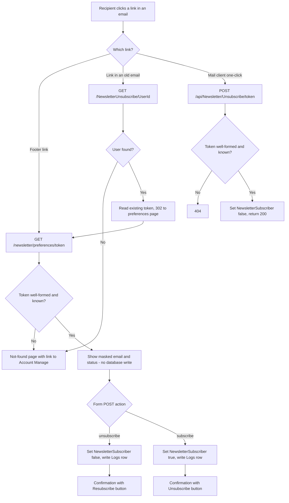

#### Send pipeline

| Problem (section 4.4) | Change |
|---|---|
| Recipients by user name | `NewsletterSubscriptionService.GetRecipientsAsync(campaignId)` returns `(UserId, Email, Token)` for confirmed subscribers with a non-empty `Email`, creating any missing tokens in one `SaveChanges`. Mail is addressed to `Email`; `NewslettersLogs.UserName` stores the lower-cased email. `BlogsService.SendNewslettersCampainEmailAsync` takes the recipient record (new signature in 6.5). |
| One bad image blocks every send | Today images are fetched over HTTP from the administrator's request host ([NewsletterCampainEdit.razor:140](../BlazorBlogs/Components/Pages/Newsletter/NewsletterCampainEdit.razor#L140), [153](../BlazorBlogs/Components/Pages/Newsletter/NewsletterCampainEdit.razor#L153)) and a failed download becomes a `null` image that makes `CreateEmailHTML` return `null` ([NewsletterParser.cs:292](../BlazorBlogs/Data/Models/NewsletterParser.cs#L292)). Change: load images whose `src` is a relative path from `UserContentPaths.PublicRoot` on disk (falling back to `WebRootPath` for files that ship with the app); skip any image that cannot be loaded and rewrite its `src` to `<base><src>` so it is linked instead of embedded. |
| Failures never retried | Only rows with `LogType == "Email Sent"` exclude a recipient. |
| Links use the admin's address | Base URL from `SiteUrlService`. The campaign popup shows a warning when the resolved host is `localhost`. |
| Raw user id in link | Footer link is `<base>newsletter/preferences/<token>`, text "Manage your subscription or unsubscribe". |
| Mail can go out without the link | If `CreateEmailHTML` still returns `null` (after the image change this should only happen on a genuine fault), do not send; log `Error:CreateEmailHTML`. |
| Text part lacks the link | Append the same sentence and URL to the plain-text body. |
| No headers | New `EmailService` overload accepting headers; send `List-Unsubscribe: <<base>api/Newsletter/Unsubscribe/<token>>` and `List-Unsubscribe-Post: List-Unsubscribe=One-Click`. |
| Test send pollutes the campaign | Test sends skip `NewslettersLogs`, do not change the counter, and show the real result. The test recipient is `NewsletterRecipient(UserId: the signed-in administrator's id, Email: the SMTPFromEmail setting (as today), Token: the administrator's token)`, so the links in the test message work and act on the administrator's own subscription. |
| Double click | Disable both buttons while sending; show "Sent N, failed M" at the end. |
| Cut off mid-send (D31, G12) | See "Resumable sending" below. |
| Labels | "Process Campain" → "Send Campaign", "Test Campain" → "Send Test" (labels only). |
| Page guard | `@attribute [Authorize(Roles = "Administrators")]` on `/newsletter`. Unauthenticated users are sent to login by [Routes.razor:4-8](../BlazorBlogs/Components/Routes.razor#L4-L8). |

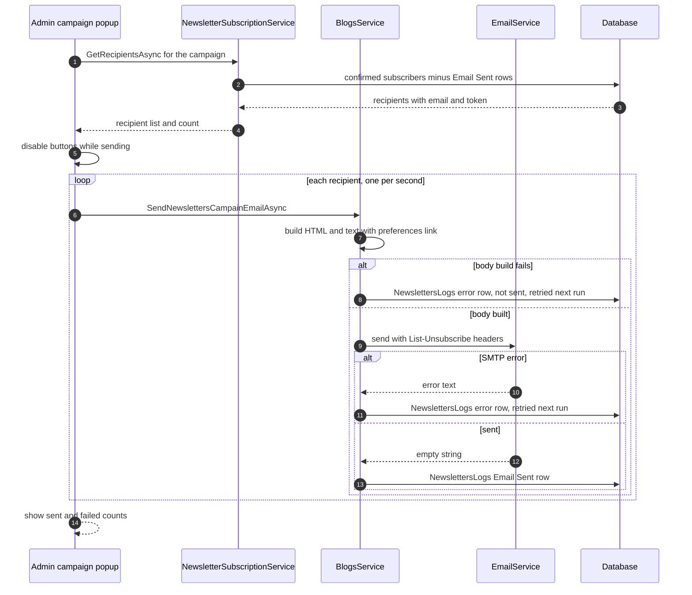

#### Resumable sending (D31, G12)

Sending runs in the administrator's Blazor circuit and stops when that circuit ends. Nothing is sent in the background. What makes it resumable is that every successful send is recorded before the next one starts.

| Piece | Design |
|---|---|
| What "remaining" means | Recipients from `GetRecipientsAsync` (subscribed, confirmed, no `Email Sent` row for this campaign). It is recomputed from the database every time the popup opens, so it is correct after any interruption, including an application restart. |
| Popup states | Nothing sent yet: "Send Campaign (N recipients)". Partly sent: "Resume sending (N remaining, M already sent)". Finished: "All M recipients have been sent this campaign." |
| Notice | While sending: "Keep this window open until sending finishes. If you are cut off, reopen this campaign and choose Resume." A `beforeunload` prompt is switched on while sending and off afterwards (one small script function in `App.razor`, called through `IJSRuntime`). |
| Clean stop | The component owns a `CancellationTokenSource`, cancelled in `Dispose`. The loop checks it before each recipient and passes it to the one-second delay, so it stops at a recipient boundary when the component is disposed. A closed tab disposes the component when the server discards the circuit, which may be some minutes later **(assumed framework behaviour)**; until then the loop keeps sending, which is harmless. |
| The loop owns its inputs | Today the loop reads the field `SelectedNewslettersCampain` on every iteration ([NewsletterCampainEdit.razor:169](../BlazorBlogs/Components/Pages/Newsletter/NewsletterCampainEdit.razor#L169)) and opening another campaign reassigns it ([lines 85-87](../BlazorBlogs/Components/Pages/Newsletter/NewsletterCampainEdit.razor#L85-L87)). The extracted loop class receives the campaign, the recipient list and the content as arguments when it starts and never reads component fields again. |
| Nothing else can happen while sending | The popup's close button only hides it ([lines 79-83](../BlazorBlogs/Components/Pages/Newsletter/NewsletterCampainEdit.razor#L79-L83)), and the popup lives inside a block the page removes while it reloads ([NewsletterHome.razor:28](../BlazorBlogs/Components/Pages/Newsletter/NewsletterHome.razor#L28), [65-66](../BlazorBlogs/Components/Pages/Newsletter/NewsletterHome.razor#L65-L66)), which would dispose it mid-send. While sending: the close button is hidden; the popup raises a new `SendingChanged` callback and `NewsletterHome` disables "Create Campaign", "Edit Campaign", the newsletter selector and the newsletter edit buttons until it reports finished. |
| No duplicates | Immediately before each send, check again that no `Email Sent` row exists for this campaign and email. This covers a second window, a reconnect, and a row written by another session. |
| One sender at a time | `CampaignSendRegistry` (singleton, in-memory): `TryBegin(campaignId)` returns a lease object, or `null` if the campaign is already being sent. Only the holder can release it, by disposing the lease in a `finally` and in the component's `Dispose`; a window that never got a lease has nothing to release. If `TryBegin` returns `null` the popup shows "This campaign is being sent from another window. N remaining." with a Refresh button and no Send button. The registry is lost on restart, which is correct: nothing is sending then. |
| Reconnect to the same circuit | If the browser reconnects before the server discards the circuit, the loop is still running and the counts keep updating **(assumed framework behaviour)**; no action needed. |
| Failures | Still retried on the next Send or Resume (only `Email Sent` rows exclude a recipient). `SendNewslettersCampainEmailAsync` returns a result with the error text; the loop keeps this run's failures in memory, and the final line lists up to ten failed addresses with their error text and says the rest are in `NewslettersLogs`. |

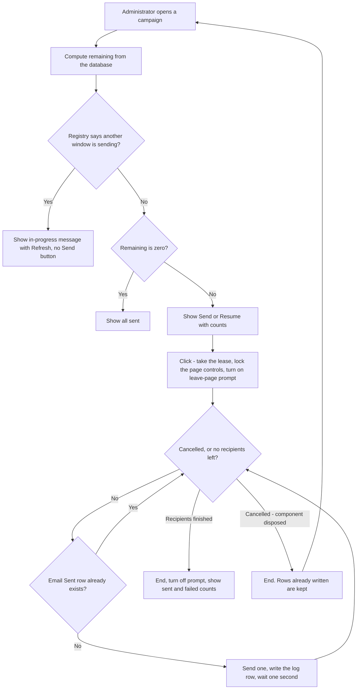

### 5.9 Workstream D: paid downloads

#### Storage and download

| Piece | Design |
|---|---|
| Location | `DownloadStorageService` stores files in `UserContentPaths.DownloadsPath` (section 5.10): `PrivateFiles` under the content root by default, `<root>\private\downloads` when a user-content root is configured. Either way the folder is outside `wwwroot`. Add `BlazorBlogs/PrivateFiles/` to `.gitignore`. |
| Legacy `FilePath` values | Some rows evidently hold a path rather than a bare name (the paged query strips a `\files` prefix, [BlogsService.cs:882](../BlazorBlogs/Data/BlogsService.cs#L882)). Everywhere a stored name is resolved, first reduce it with `Path.GetFileName(value.Replace('\\', '/'))`. |
| Migration | On start-up, `MigrateLegacyFiles()` moves every file directly inside `wwwroot/files` (not sub-folders), and inside `ContentRootPath\PrivateFiles` when a user-content root is configured, to `DownloadsPath`. Skip if the target exists; log each move with `ILogger`; never throws. |
| New uploads | `api/upload/single?FileTitle=<title>&Price=<decimal, invariant culture, default 0>`. Stored as `<guid>.zip`; `Files.FilePath` holds that name, new column `OriginalFileName` holds the uploaded name used for the download. Legacy rows have `OriginalFileName` null and use the reduced `FilePath`. Also check the `.zip` extension and the `PK` signature bytes, not only the client-reported type; return 400 with a message for a rejected file instead of today's silent 200. |
| Endpoint | `GET api/File/Download/{fileId:int}?t=<token>`; decision tree below. Streams with `PhysicalFile(..., "application/zip", downloadName, enableRangeProcessing: true)`. |
| Counting | A request counts as a download only if it has no `Range` header or its range starts at byte 0; resumed segments are served but not counted. Counting is one call, `RecordDownloadAsync(fileId, purchaseId)`, which runs `UPDATE Files SET DownloadCount = DownloadCount + 1` and, for a guest token, `UPDATE FilePurchases SET TokenDownloadCount = TokenDownloadCount + 1 WHERE Id = @id AND TokenDownloadCount < @max`. If that second statement affects no row the limit was reached by a parallel request: return the "link expired" redirect and do not stream. `UpdateFilesAsync` no longer writes `DownloadCount`. |
| Removed | `FileController.DownloadFile(string FileName)` and `DeleteFile`. `BlogsService.DeleteFilesAsync` stops deleting the physical file ([BlogsService.cs:970-972](../BlazorBlogs/Data/BlogsService.cs#L970-L972)); the page calls `DownloadStorageService.Delete(storedName)` after the row delete succeeds (D19). |
| Old URLs | Endpoint `GET /files/{**path}` → 302 `/filedownloads` so links in old posts do not 404. |
| Deleting | A file with any `Paid` or `Refunded` purchase cannot be deleted: the page checks first and shows "This file has purchases and cannot be deleted." Purchases in `Pending`, `Failed` or `Expired` are deleted with the file row. The page's delete handler ([FileDownloads.razor:309-323](../BlazorBlogs/Components/Pages/FileDownloads.razor#L309-L323)) gets a try/catch that shows an error toast, so a refused delete cannot end the circuit. |
| `?buy=` | `/filedownloads?buy=<fileId>` shows an information line "This download must be purchased" above the list and moves that file to the top of the first page. It does not start a checkout. |

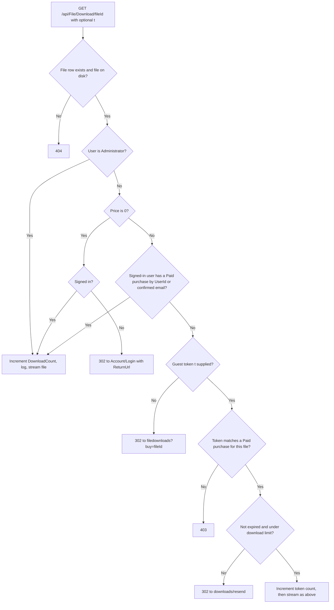

#### Stripe configuration

| Piece | Design |
|---|---|
| Settings | Rows listed in section 6.2, read and written by `StripeSettingsService` only. |
| UI | `StripeSettingsPanel.razor` embedded in the Settings page: Enabled; Secret key and Webhook signing secret as password inputs that are blank on load ("configured, ends in ••••xxxx" shown beside them; blank keeps the stored value); Currency; Automatic tax (on/off), Tax behaviour (exclusive/inclusive), Tax code (optional); guest link days; guest download limit; a "TEST MODE" badge when the key starts with `sk_test_` or `rk_test_`; the webhook URL `<SiteBaseUrl>api/StripeWebhook` and the event list to copy into the Stripe dashboard; a "Test connection" button. |
| Gateway | `IStripeGateway` wraps the official `Stripe.net` package (pin the latest stable version at implementation time). Use an instance `StripeClient` built from the stored key, not the static `StripeConfiguration.ApiKey`. SDK member names in this plan are **(assumed; check against the pinned version's documentation)**. |
| Amounts | `StripeAmount.ToMinorUnits(price, currency)`: multiply by 100, except zero-decimal currencies (`bif clp djf gnf jpy kmf krw mga pyg rwf ugx vnd vuv xaf xof xpf`) which use the whole number. Three-decimal currencies (`bhd jod kwd omr tnd`) are rejected when saving the currency. |

#### Checkout and fulfilment

| Piece | Design |
|---|---|
| Listing | `/filedownloads` shows, per file: free + signed in → Download; free + anonymous → name only (as today); paid + owned or administrator → Download; paid + not owned → price and Buy (shown to anonymous visitors too); paid while Stripe is disabled → "Not available". |
| Start | Buy calls `PaidDownloadService.StartCheckoutAsync`, which creates the Checkout Session and inserts a `Pending` purchase (`Amount` = the file's price before tax, `TaxAmount` = 0; both are replaced with what Stripe actually charged at fulfilment), then the page navigates to the returned URL with `forceLoad: true`. |
| Anonymous visitors before guest checkout exists | From T25 until T27, an anonymous visitor sees "Sign in to buy" (a link to `Account/Login` with a `ReturnUrl` of `filedownloads?buy=<fileId>`) instead of Buy. T27 replaces it with Buy. |
| Tax (D33) | When `StripeAutomaticTax` is `True` (the default) the session is created with `automatic_tax[enabled]=true`, `price_data.tax_behavior` from `StripeTaxBehavior` (`exclusive` adds tax on top of the price, `inclusive` treats the price as including tax), and `product_data.tax_code` from `StripeTaxCode` when that setting is not blank (blank uses the preset tax code chosen in the Stripe dashboard). `billing_address_collection` stays at its default `auto`, and no shipping address is requested, so Checkout asks only for the address details it needs **(docs)** <https://docs.stripe.com/tax/checkout/page>. Stripe collects tax only where the account has a tax registration, and only if Stripe Tax is activated **(docs)** <https://docs.stripe.com/tax/set-up>; both are done by the site owner in the Stripe dashboard. |
| Tax amounts | The session's `amount_total` (what the buyer paid) is stored in `Amount`; `total_details.amount_tax` is stored in the new column `TaxAmount`. The receipt email and `/purchases` show both. The listing shows the price followed by "+ tax" when behaviour is `exclusive`. |
| Tax not ready | If Stripe rejects session creation because Stripe Tax is not activated, the buyer sees "Payment is unavailable", the `Logs` row carries Stripe's message, and the Stripe panel's "Test connection" also reads the account's tax settings and reports "Stripe Tax is not active" **(assumed API: tax settings retrieve; needs read permission on a restricted key)**. |
| Session | `mode=payment`; one line item with `price_data` (currency, unit amount, product name = file title, tax fields above), quantity 1; `client_reference_id` = user id or empty; `metadata` = `fileId`, `userId`; `customer_email` for signed-in users; `success_url` = `<base>checkout/success?session_id={CHECKOUT_SESSION_ID}`; `cancel_url` = `<base>filedownloads`. |
| Success page | `/checkout/success` is a static page (`[ExcludeFromInteractiveRouting]`) so it runs once per request. It calls `ConfirmCheckoutAsync(sessionId)`. Paid → thank-you with a Download link (guest link includes `t`). Not yet paid → "Payment is processing; we will email you." Unknown session → generic error. |
| Fulfilment | The webhook and the success page call `FulfilAsync` concurrently by design, so it must be race-safe. Steps: **(1)** if no row has this `StripeSessionId`, insert a `Pending` one from the session metadata; a unique-key violation means the other caller inserted it, so ignore the exception and continue. **(2)** One statement does the whole transition: `UPDATE FilePurchases SET Status='Paid', BuyerEmail=@e, StripePaymentIntentId=@pi, Amount=@a, TaxAmount=@tax, Currency=@c, LiveMode=@l, PaidUtc=@now, DownloadToken=@t, TokenExpiresUtc=@x WHERE StripeSessionId=@s AND Status='Pending'` (`@t`, `@x` null for signed-in buyers). **(3)** If one row was affected, this caller won: send the receipt. **(4)** Both winner and loser then re-read the row and build the result from what is stored, so a guest's link always carries the stored token. Safe to call any number of times. |
| Receipt | `EmailService.SendMailAsync` to the buyer: file title, amount, and the link (`<base>filedownloads` for accounts, the tokenised link for guests). A send failure is logged and does not undo fulfilment. |
| Guests | Token: 32 random bytes hex in `DownloadToken`; `TokenExpiresUtc` = now + `StripeGuestLinkDays`; `TokenDownloadCount` limited by `StripeGuestMaxDownloads`. |
| Resend | `/downloads/resend`: static page (`[ExcludeFromInteractiveRouting]`) with a form with one email field. For every `Paid` guest purchase with that `BuyerEmail`, issue a new token and expiry, reset the count and email the links, unless `LastLinkSentUtc` is within 15 minutes. The page always shows the same message. |
| Claim | A signed-in user with a confirmed email owns guest purchases whose `BuyerEmail` equals their email (case-insensitive). No data change needed. |
| Refund | `charge.refunded` with the charge fully refunded → `Status='Refunded'`, token cleared. |
| Admin | New interactive page `/purchases` (`[Authorize(Roles = "Administrators")]`, `OwningComponentBase` like [Logs.razor:12](../BlazorBlogs/Components/Pages/Logs.razor#L12)): paged table (date, file, buyer, amount, status, live/test) and "Resend link". |
| Stripe panel warnings | The Stripe panel shows "SMTP is not configured; buyers will not receive receipts" when `SMTPServer` is blank, and treats Stripe as configured only when the secret key **and** the webhook secret are set. |
| Release unit | Tasks T23 – T28 form one feature. The integration branch stays installable after each because Stripe ships disabled, but Stripe must not be enabled on a live site until T26 (webhook) is merged; T30 is where enabling is documented. |

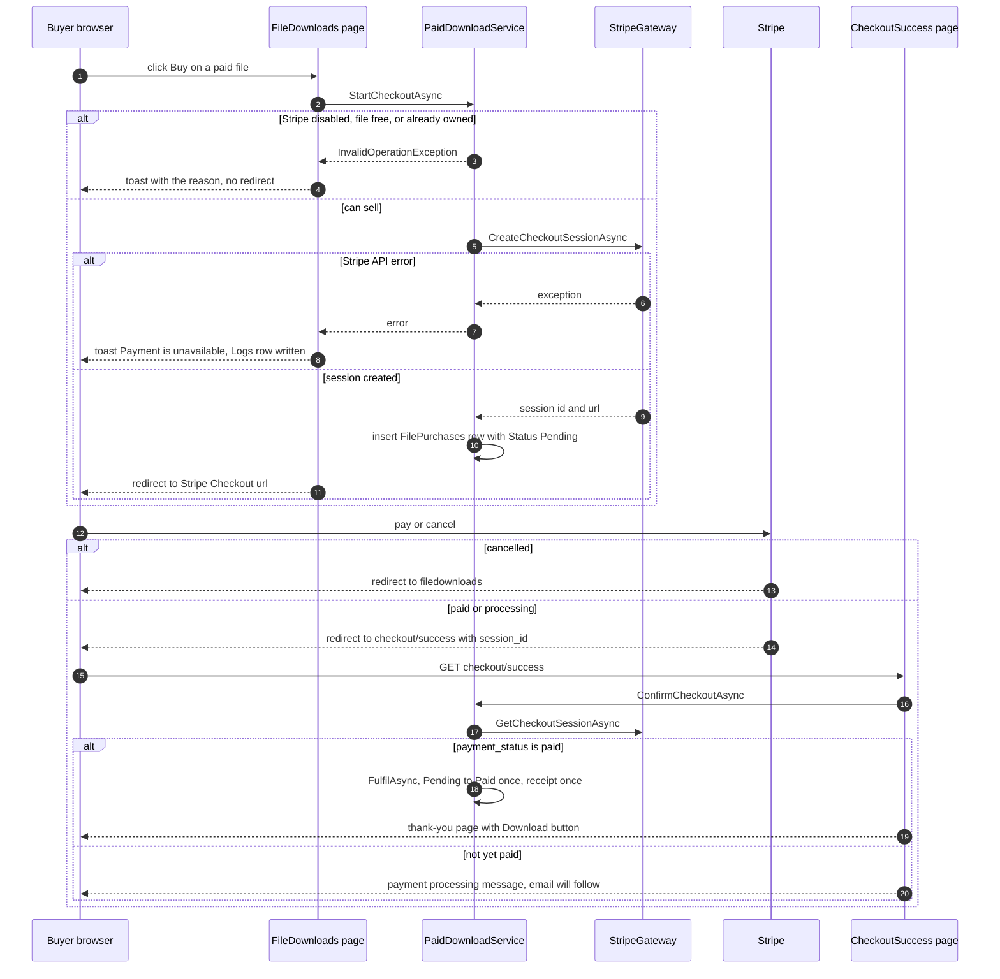

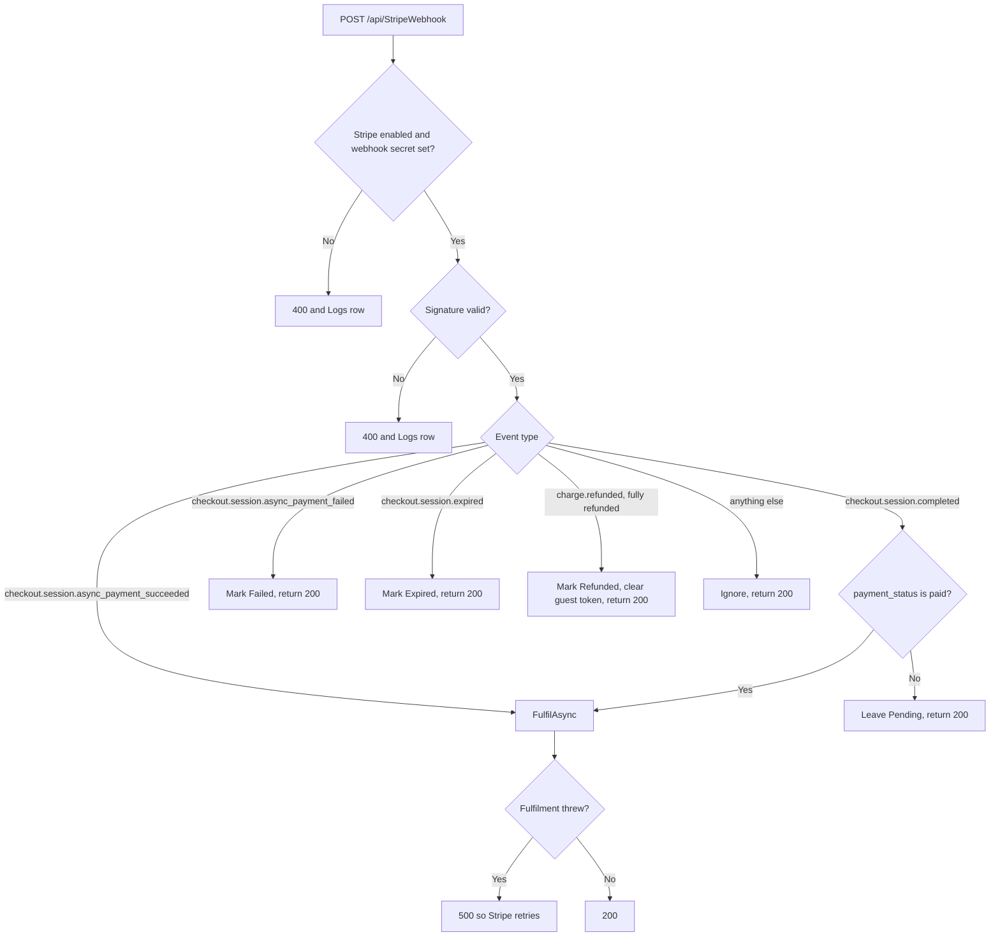

### 5.10 User content protection (G10, D25)

Three layers, each sufficient on its own for the threat it addresses:

| Layer | Mechanism | Stops |
|---|---|---|
| 1. Package is clean | `BlazorBlogs.csproj` excludes `wwwroot\uploads\**`, `wwwroot\blogs\**`, `wwwroot\files\**` and `PrivateFiles\**` from publish (`CopyToPublishDirectory="Never"`). The two tracked images move to `BlazorBlogs/SeedContent/uploads/`, which is published, and are copied into the uploads folder at start-up **only if the destination file does not exist**. A test publishes the project and fails if any file appears under those paths. | A deployment overwriting a same-named user file (today: the logo). |
| 2. Deploy never cleans | `Deploy-Website.ps1` repeats the layer-1 check on its publish output and stops on failure, then deploys with `--clean false`. | A deployment deleting files that are not in the package. |
| 3. Content lives elsewhere | When `Storage:UserContentPath` is set, uploads, blog images and download files are read and written under that root instead of the app folder. `website.bicep` sets it to `%HOME%\data\BlazorBlogs`. | Any deployment method, including ones that wipe the app folder. |

The database is protected separately: it is a different resource from the site, `aspire deploy` must not recreate it (U5), and scripts are additive only.

`UserContentPaths` (singleton) is the only place that knows the folders:

| Property | `Storage:UserContentPath` unset (self-hosted, local) | Set to `<root>` (Azure) |
|---|---|---|
| `PublicRoot` | `WebRootPath` | `<root>\public` |
| `UploadsPath` | `WebRootPath\uploads` | `<root>\public\uploads` |
| `BlogsPath` | `WebRootPath\blogs` | `<root>\public\blogs` |
| `DownloadsPath` | `ContentRootPath\PrivateFiles` | `<root>\private\downloads` |

| Piece | Design |
|---|---|
| Value handling | The configured value is passed through `Environment.ExpandEnvironmentVariables` so `%HOME%` works; folders are created on start-up. |
| Serving | When `PublicRoot` differs from `WebRootPath`, register `app.UseStaticFiles(new StaticFileOptions { FileProvider = new PhysicalFileProvider(paths.PublicRoot) })` before the existing `app.UseStaticFiles()` ([Program.cs:112](../BlazorBlogs/Program.cs#L112)). URLs do not change: `/uploads/x.png` and `/blogs/<id>/y.png` resolve under `PublicRoot`. |
| Relative URLs | `UserContentPaths.ToRelativeUrl(physicalPath)` returns the path relative to `PublicRoot` with forward slashes, replacing the `Replace(WebRootPath, "")` code in section 4.9. Existing stored values with backslashes (`uploads\logo.png`, the seeded default) are displayed today, so they are left as they are **(assumed that they keep resolving through the second static-file provider; T07a checks the default logo)**; do not rewrite stored data. |
| Code switched to the service | Five existing places in T07a: `FileManager.razor`, `FileSelector.razor`, `UploadController.MultipleAsync`, `MetaWeblogService`, `ImportBlogsEdit.razor`. Two later ones use it from the start: newsletter image loading (T18b) and `DownloadStorageService` (T22a). |
| In-app upgrade upload | `UploadController.UpgradeAsync` (section 4.9) would bypass all three layers and has no working UI. It is deleted in T07b, together with the dead upgrade markup and code in `Settings.razor`, `ReadManifest`, `DeleteFiles` and `Classes/Version.cs` if nothing else uses them. |
| First start after the root is set | For `uploads` and `blogs`: copy every file from the in-app folder to the new location when the destination does not exist; never overwrite; leave the source. For downloads: `MigrateLegacyFiles` (section 5.9) moves them. Then copy seed files that do not exist. Each step logs with `ILogger` and never throws. |
| Self-hosted `appsettings.json` | Not user content, but the same hazard (section 4.9). Solved by D29: the connection string moves to `appsettings.Local.json`, which no package contains (section 5.5). |

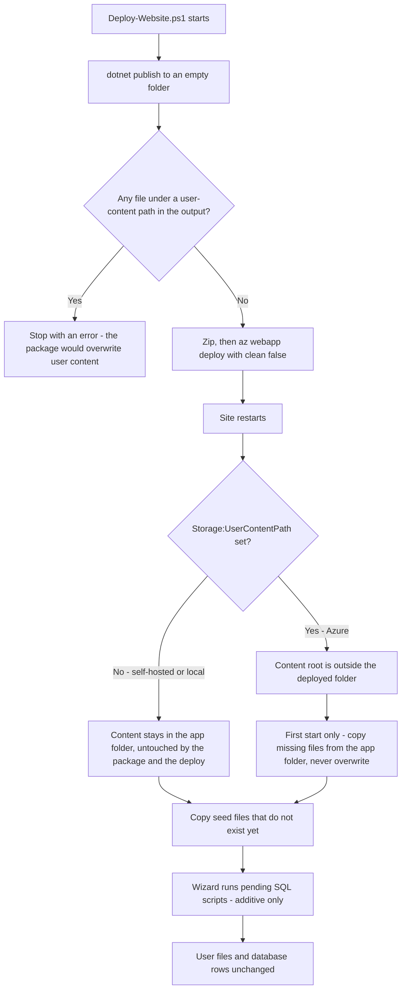

### 5.11 Workstream E: editor replacement (D32, G13)

One wrapper component, `Components/Pages/HtmlEditor.razor`, replaces all six `BlazoredTextEditor` instances and their raw-HTML textareas.

| Piece | Design |
|---|---|
| Wrapper | Contains a `RadzenHtmlEditor` bound to `Value`, an explicit tool list (undo, redo, bold, italic, underline, strike-through, text colour, background colour, ordered and bulleted lists, link, heading/format block, alignment, remove format, the custom image tool, and the source-view tool), and one private `FileSelector`. |
| Image tool | `RadzenHtmlEditorCustomTool` with `CommandName="InsertImageFromFiles"`. In the editor's `Execute` handler: `SaveSelectionAsync()`, show the `FileSelector`. In the selector's `ImageSelected` callback: hide it, `RestoreSelectionAsync()`, then `ExecuteCommandAsync(HtmlEditorCommands.InsertHtml, "\" alt=\"\">")` with backslashes in the URL changed to forward slashes. The built-in upload-by-`UploadUrl` image tool is not used; uploads go through `FileSelector` (section 5.7). |
| Source view | Radzen's source tool **(assumed to exist as `RadzenHtmlEditorSource`, with a bindable `Mode`; T14 verifies, and if it does not, the wrapper keeps a `<textarea>` toggle of its own)**. |
| Page changes | In each page: delete the `<textarea>`, the `BlazoredTextEditor` block, the toggle links, the `RichTextEditorMode*` flags, the `GetHTML()` calls and the `FileSelector` instances that served editor images (not the logo picker in Settings, [Settings.razor:221-222](../BlazorBlogs/Components/Pages/Settings.razor#L221-L222)); bind `<HtmlEditor @bind-Value="...">` to the same property the textarea used (for example `SelectedBlog.BlogContent`). Saving reads the bound property. |
| Empty content | Quill returned `<p><br></p>` for an untouched editor; a bound property stays `null`. A new post starts with null summary and content ([BlogAdministration.razor:236-243](../BlazorBlogs/Components/Pages/BlogAdministration.razor#L236-L243)), the columns are `NOT NULL` ([00.20.00.sql:28-29](../BlazorBlogs/SQLScripts/00.20.00.sql#L28-L29)), and the importer calls `.Replace` on the summary ([ImportBlogsEdit.razor:409](../BlazorBlogs/Components/Pages/Importer/ImportBlogsEdit.razor#L409)). Rule: the wrapper never passes or emits `null` (it uses `""`), and each page's save code coalesces summary and content with `?? ""` before use. |
| Editor inside a modal | The blog, importer and newsletter editors sit inside full-screen Bootstrap modals ([BlogAdministration.razor:14-15](../BlazorBlogs/Components/Pages/BlogAdministration.razor#L14-L15)), while Radzen renders its own popups (link dialog, colour pickers) through `<RadzenComponents>` in the layout ([MainLayout.razor:15](../BlazorBlogs/Components/Layout/MainLayout.razor#L15)). Whether those popups appear above the modal is **(assumed)**; T15's check uses the link and colour tools inside each modal, and if they are hidden, raises the popups' `z-index` in `app.css`. |
| Removal | `Blazored.TextEditor` package reference, the `@using` in `_Imports.razor`, the five Quill lines in `App.razor`, and `wwwroot/imageIcon.png` if nothing else uses it. |
| Stored content | Not rewritten. Existing posts, summaries, newsletters and headers are loaded as they are. Displayed pages do not change, because they never depended on Quill's stylesheet (section 4.11). T15's check compares posts that use alignment, indentation, colours, lists and images before and after; if anything differs, add the few needed rules to `wwwroot/app.css` rather than changing content. |
| Radzen version | Use the referenced version if it has the members above. If it does not, upgrading `Radzen.Blazor` is its own pull request before T14 (D23), with the Platform smoke checklist run again. |

### 5.12 Legacy "Deploy to Azure" template (D28)

`azuredeploy.json` keeps its shape (SQL authentication, source-control deployment from the repository) so the button and its published instructions still work. Changes:

| Item | From | To |
|---|---|---|
| `netFrameworkVersion` | `v9.0` | `v11.0` |
| `alwaysOn` | absent | `true` unless the chosen plan is `F1` or `D1`, which cannot use it **(docs, D26)** |
| Plan SKU list | includes `F1`, `D1`; default `B1` | unchanged, so existing Free and Shared sites can still redeploy. The parameter description says those two stop when idle. |
| Database | fixed Standard `S1` (two variables) | two parameters, `databaseEdition` and `databaseServiceObjective`, both defaulting to `Basic` (D26). A site on any other tier enters its current values. |
| Source branch | fixed `main` | parameter `repoBranch`, default `main` (lets T10 test the template against `release/10`) |
| App settings | none | `Storage__UserContentPath=%HOME%\data\BlazorBlogs`, `Install__AllowDatabaseConfiguration=false`, `PROJECT=BlazorBlogs/BlazorBlogs.csproj` |
| `clientAffinityEnabled`, `httpsOnly`, `minTlsVersion`, `ftpsState` | defaults | same values as `website.bicep` (section 6.7) |
| `contentVersion` | `1.0.0.2` | incremented |

| Piece | Design |
|---|---|
| Why `PROJECT` | The repository will contain an AppHost and a test project. The setting tells App Service's build to publish only the web project **(assumed setting name and behaviour; T10 verifies)**. |
| .NET 11 build | App Service's source-control build must have the .NET 11 SDK **(assumed; T10 verifies)**. If it does not yet, T10 still merges the template but the README button section says so and points to the Aspire deployment until it does. |
| Existing button sites | Most only sync the repository and never redeploy the template (scenario S5a, section 5.5), so the application must work without any of the new app settings; it does, because every new setting has a safe default. Redeploying (S5b) must not recreate the database or change its tier unless the owner chooses to: the README tells existing sites to enter their current plan SKU and database edition and objective. First start after a redeploy copies existing uploads to the new content root (section 5.10), never deleting the originals. |
| Same protections | After a redeploy, source-control deployments also benefit from layer 3 of section 5.10, because the content root is then outside the folder App Service synchronises **(assumed)**. |

### 5.14 Workstream R: visual redesign (D35, G14)

The target design is the canvas "Blazor Blogs Redesign" (five artboards: Home, Blog post, Downloads, Admin · Settings, Admin · Newsletter; link held by the repository owner). Where the canvas and this section differ, the canvas wins for look and this plan wins for behaviour. Text in `[square brackets]` on the canvas is placeholder, not copy.

| Token | Value | Use |
|---|---|---|
| `--bb-bg` | `#F7F7F9` (admin `#F4F5F8`) | page background |
| `--bb-surface` | `#FFFFFF` | cards, top bar |
| `--bb-border` | `#E4E6EC`; inputs `#D5D8E0` | card and field borders |
| `--bb-text` | `#14161C` | body text, dark banner, admin side menu |
| `--bb-muted` | `#4A4F5C`; meta `#5C6170` | secondary text (both pass 4.5:1 on white) |
| `--bb-accent` | `#3B5BDB` default, from setting `ThemeAccentColor` | primary buttons, logo mark, progress |
| `--bb-link` | `#3048C9`, hover `#1F338F` | links |
| `--bb-success` / `--bb-warning` / `--bb-danger` | `#0F766E` on `#E6F4F1` / `#6B3A06` on `#FDF1E3` / `#B42318` | badges, notices, destructive actions |
| Radius | cards 14 px, banner 16 px, buttons and inputs 8–10 px, pills 999 px | |
| Type | Inter 400–700 body 15–18 px; Space Grotesk 600–700 headings 19–44 px | |
| Controls | height 44 px minimum | buttons, inputs, selects |

| Area | Change |
|---|---|
| Layouts | Public: `MainLayout` loses the sidebar; new top bar (logo mark + site name, Blog, Downloads, Newsletter, sign-in/account), content max-width 1200 px, footer with RSS. Admin: new `AdminLayout` with a dark side menu (Posts, Categories, Users, Files, Newsletter, Purchases, Logs, Settings) that stacks above content below 768 px; admin pages declare `@layout AdminLayout`. `NavMenu.razor` is replaced by `TopBar.razor` and `AdminNav.razor`. |
| Banner | The Application Header renders inside `.site-header` as a dark rounded panel (5.7 keeps its rules). |
| Home | Post cards (image, category pill, date, title, summary, "Read more"), search field, Newer/Older pager; side column with newsletter sign-up and categories. |
| Post | 760 px reading column, meta row, large image, styled `pre`, newsletter prompt, comments slot. |
| Downloads | Card grid with Buy / Download / Free / Purchased states from 5.9; "Lost your download link?" link; Stripe note. |
| Admin Settings | Page header with Save and Send test email; cards for General, Site banner (editor + preview), Google sign-in, Payments; Test mode badge. Same fields as sections 5.6, 5.7, 5.9. |
| Admin Newsletter | Stat tiles, newsletter list, campaign panel with progress bar, keep-open notice and failed list (5.8). The current popup becomes this panel. |
| Other screens | Users, Categories, Files, Logs, Purchases, the install wizard and `/Account/*` adopt the same tokens, cards, tables and buttons; they are not drawn on the canvas and follow the Settings artboard's patterns. |
| Accessibility | Real buttons and labelled inputs (several pages use `<a>` or unlabeled inputs today), `aria-label` on icon buttons, focus outlines visible, inline SVG icons with `aria-hidden`; Open Iconic icons are replaced by inline SVG. |
| Not changed | Routes, data, behaviour, and the HTML stored in posts. |

### 5.13 Component and service scoping rules

These apply to every new or changed component in this plan. They exist because a `DbContext` cannot run two operations at once, and the layout and its children initialise concurrently.

| Component kind | Rule |
|---|---|
| `MainLayout` | Loads settings through a private scope created from `IServiceScopeFactory` (section 5.7). |
| Interactive page or panel that queries in `OnInitializedAsync` (`/purchases`, `GoogleAuthSettingsPanel`, `StripeSettingsPanel`, `FileDownloads`) | Inherit `OwningComponentBase`; resolve data services from `ScopedServices`, as [Settings.razor:301-302](../BlazorBlogs/Components/Pages/Settings.razor#L301-L302) does. |
| Static page with a form (`/newsletter/preferences/{Token}`, `/NewsletterUnsubscribe/{UserId}`, `/Account/Manage/Newsletter`, `/checkout/success`, `/downloads/resend`) | `[ExcludeFromInteractiveRouting]`; inherit `OwningComponentBase` and resolve `BlazorBlogsContext`-backed services from `ScopedServices`. Identity services (`UserManager`, `SignInManager`) are `@inject`ed as the stock pages do; they use `ApplicationDbContext`, a different context. |
| State objects (`GeneralSettingsState`, `DisqusState`) | `@inject` only, never `ScopedServices`. |
| Singletons (`ExternalAuthOptionsStore`, `UserContentPaths`, `DownloadStorageService`) | `@inject` or constructor injection. They must not depend on scoped services; they log with `ILogger`, not the `Logs` table. |
| Controllers and minimal endpoints | Constructor or parameter injection (request scope). |

---

## 6. Contracts

### 6.1 Configuration keys (appsettings or environment)

| Key | Type | Default | Set by | Purpose |
|---|---|---|---|---|
| `ConnectionStrings:DefaultConnection` | string | `""` in the shipped `appsettings.json` | Aspire reference (local), App Service connection string (Azure), wizard into `appsettings.Local.json` (self-hosted) | Both `DbContext`s. Precedence: environment, then `appsettings.Local.json`, then `appsettings.json`. |
| `Install:AllowDatabaseConfiguration` | bool | `true` | AppHost and `website.bicep` set `false` | Shows or hides the wizard's connection form. |
| `Storage:UserContentPath` | string | unset | `website.bicep` sets `%HOME%\data\BlazorBlogs`; optional elsewhere | Root for uploads, blog images and download files (section 5.10). Environment variables in the value are expanded. |
| `Database:CompatibilityLevel` | int | unset | optional | Passed to `UseCompatibilityLevel`. |
| `ASPNETCORE_FORWARDEDHEADERS_ENABLED` | bool | unset | `website.bicep` sets `true` | Correct scheme behind the App Service front end. |
| `AZURE_CLIENT_ID` | string | unset | `website.bicep` | Selects the user-assigned identity for SQL. |

### 6.2 `Settings` table rows

| SettingName | Value type | Default | Script | Read through |
|---|---|---|---|---|
| `SiteBaseUrl` | absolute URL or empty | `''` | 10.00.00 | `GeneralSettings.SiteBaseUrl` |
| `Authentication:Google:Enabled` | `True`/`False` | `False` | 10.01.00 | `GoogleAuthSettingsService` |
| `Authentication:Google:ClientId` | string | `''` | 10.01.00 | `GoogleAuthSettingsService` |
| `Authentication:Google:ClientSecret` | string | `''` | 10.01.00 | `GoogleAuthSettingsService` |
| `ApplicationHeaderEnabled` | `True`/`False` | `True` | 10.02.00 | `GeneralSettings.ApplicationHeaderEnabled` |
| `ApplicationHeaderEditorMode` | `Rich`/`Raw` | see 5.7 | 10.02.00 | `GeneralSettings.ApplicationHeaderEditorMode` |
| `StripeEnabled` | `True`/`False` | `False` | 10.04.00 | `StripeSettingsService` |
| `StripeSecretKey` | string | `''` | 10.04.00 | `StripeSettingsService` |
| `StripeWebhookSecret` | string | `''` | 10.04.00 | `StripeSettingsService` |
| `StripeCurrency` | ISO 4217, lower case | `usd` | 10.04.00 | `StripeSettingsService` |
| `StripeAutomaticTax` | `True`/`False` | `True` | 10.04.00 | `StripeSettingsService` |
| `StripeTaxBehavior` | `exclusive`/`inclusive` | `exclusive` | 10.04.00 | `StripeSettingsService` |
| `StripeTaxCode` | Stripe tax code or empty | `''` | 10.04.00 | `StripeSettingsService` |
| `ThemeAccentColor` | hex colour | `#3B5BDB` | 10.05.00 | `GeneralSettings.ThemeAccentColor` |
| `StripeGuestLinkDays` | int 1-365 | `7` | 10.04.00 | `StripeSettingsService` |
| `StripeGuestMaxDownloads` | int 1-100 | `5` | 10.04.00 | `StripeSettingsService` |

### 6.3 Schema scripts

Version numbers follow merge order (D20). If tasks merge in a different order, renumber so that the newest script has the highest number, and update the dictionary, the csproj entry and `CurrentVersion` to match. Each script ends with the `VersionNumber` update shown in [01.00.80.sql:10-12](../BlazorBlogs/SQLScripts/01.00.80.sql#L10-L12).

| Script | Task | Content |
|---|---|---|
| `10.00.00.sql` | T03 | Guarded insert of `SiteBaseUrl`. |
| `10.01.00.sql` | T11 | Guarded inserts of the three `Authentication:Google:*` rows. |
| `10.02.00.sql` | T13 | Guarded inserts of `ApplicationHeaderEnabled` **and** `ApplicationHeaderEditorMode`. T13 seeds both rows (the second with the Raw/Rich default from section 5.7) even though the editor that uses the mode arrives in T14, because a script cannot be extended after it has run (D20). |
| `10.03.00.sql` | T16 | `AspNetUsers`: backfill `NewsletterSubscriber` nulls to 0; add `NewsletterToken`; give every existing user a token; filtered unique index. |
| `10.05.00.sql` | T31 | Guarded insert of `ThemeAccentColor`. |
| `10.04.00.sql` | T21 | `Files`: add `Price`, `OriginalFileName`. Create `FilePurchases`. Guarded inserts of nine Stripe rows. |

Sketches (final scripts must follow the rules in section 4.2):

```sql
-- 10.03.00.sql
UPDATE [dbo].[AspNetUsers] SET [NewsletterSubscriber] = 0 WHERE [NewsletterSubscriber] IS NULL

IF COL_LENGTH('dbo.AspNetUsers', 'NewsletterToken') IS NULL
    ALTER TABLE [dbo].[AspNetUsers] ADD [NewsletterToken] [nvarchar](64) NULL

EXEC('UPDATE [dbo].[AspNetUsers] SET [NewsletterToken] = LOWER(CONVERT(varchar(64), CRYPT_GEN_RANDOM(32), 2)) WHERE [NewsletterToken] IS NULL')

IF NOT EXISTS (SELECT * FROM sys.indexes WHERE name = 'IX_AspNetUsers_NewsletterToken')
    EXEC('CREATE UNIQUE INDEX [IX_AspNetUsers_NewsletterToken] ON [dbo].[AspNetUsers]([NewsletterToken]) WHERE [NewsletterToken] IS NOT NULL')
```

`CRYPT_GEN_RANDOM` producing a different value for each row of the `UPDATE` is **(assumed)**. T16's check is that the script succeeds on a database with at least three users (the unique index fails otherwise). If it does not, build the value from two `NEWID()` calls with the hyphens removed.

```sql
-- 10.04.00.sql (table part)
IF COL_LENGTH('dbo.Files', 'Price') IS NULL
    ALTER TABLE [dbo].[Files] ADD [Price] [decimal](10,2) NOT NULL CONSTRAINT [DF_Files_Price] DEFAULT (0)
IF COL_LENGTH('dbo.Files', 'OriginalFileName') IS NULL
    ALTER TABLE [dbo].[Files] ADD [OriginalFileName] [nvarchar](260) NULL

IF NOT EXISTS (SELECT * FROM sys.objects WHERE object_id = OBJECT_ID(N'[dbo].[FilePurchases]') AND type in (N'U'))
CREATE TABLE [dbo].[FilePurchases](
    [Id] [int] IDENTITY(1,1) NOT NULL CONSTRAINT [PK_FilePurchases] PRIMARY KEY,
    [FileId] [int] NOT NULL CONSTRAINT [FK_FilePurchases_Files] REFERENCES [dbo].[Files]([FileId]),
    [UserId] [nvarchar](450) NULL,
    [BuyerEmail] [nvarchar](256) NULL,
    [Status] [nvarchar](20) NOT NULL,              -- Pending | Paid | Failed | Expired | Refunded
    [Amount] [decimal](10,2) NOT NULL,             -- total paid, tax included
    [TaxAmount] [decimal](10,2) NOT NULL CONSTRAINT [DF_FilePurchases_Tax] DEFAULT (0),
    [Currency] [nvarchar](3) NOT NULL,
    [StripeSessionId] [nvarchar](255) NOT NULL CONSTRAINT [UQ_FilePurchases_Session] UNIQUE,
    [StripePaymentIntentId] [nvarchar](255) NULL,
    [LiveMode] [bit] NOT NULL,
    [DownloadToken] [nvarchar](64) NULL,
    [TokenExpiresUtc] [datetime] NULL,
    [TokenDownloadCount] [int] NOT NULL CONSTRAINT [DF_FilePurchases_TokenCount] DEFAULT (0),
    [LastLinkSentUtc] [datetime] NULL,
    [CreatedUtc] [datetime] NOT NULL,
    [PaidUtc] [datetime] NULL,
    [RefundedUtc] [datetime] NULL)
```

Indexes on `FilePurchases`: `(UserId, FileId)`, `(BuyerEmail)`, `(StripePaymentIntentId)`, filtered unique on `(DownloadToken)`.

### 6.4 Model and context changes

| Type | Change |
|---|---|
| `GeneralSettings` | Add `string SiteBaseUrl`, `bool ApplicationHeaderEnabled`, `string ApplicationHeaderEditorMode`. |
| `AspNetUsers` | Add `string NewsletterToken`; `HasMaxLength(64)` in [BlazorBlogsContext.cs:105-124](../BlazorBlogs/Data/BlazorBlogsContext.cs#L105-L124). |
| `Files`, `FilesDTO` | Add `decimal Price`, `string OriginalFileName`. `FilesDTO` also gets `bool Owned` (set by the page). |
| `FilePurchases` (new) | Properties as the table; `DbSet<FilePurchases>` and entity configuration in `BlazorBlogsContext`. The context is database-first and hand-edited in this plan; do not re-scaffold. |

### 6.5 Service signatures

```csharp
// GeneralSettingsService (additions)
Task<string> GetSettingAsync(string settingName, string defaultValue = "");
Task SetSettingAsync(string settingName, string value);                 // insert or update

// SiteUrlService (new, scoped)
Task<string> GetBaseUrlAsync(string fallbackBaseUrl);                  // always ends with "/"

// GeneralSettingsState (new, scoped)
event EventHandler StateChanged;
GeneralSettings Current { get; }
void NotifyChanged(GeneralSettings settings);

// Google (new)
public class GoogleAuthSettings { bool Enabled; string ClientId; string ClientSecret; bool IsFullyConfigured; }
public class GoogleAuthSettingsService { Task<GoogleAuthSettings> GetAsync(); Task SaveAsync(GoogleAuthSettings s); } // blank secret keeps stored
public class ExternalAuthOptionsStore : IPostConfigureOptions<GoogleOptions>                                         // singleton
{ bool IsGoogleConfigured { get; } void UpdateGoogle(GoogleAuthSettings s); void PostConfigure(string name, GoogleOptions o); }

// NewsletterSubscriptionService (new, scoped; depends only on BlazorBlogsContext; adds Logs rows through the context itself)
Task<string> GetTokenByUserIdAsync(string userId);                     // read-only; null when the user or token is missing
Task<string> EnsureTokenAsync(string userId);                          // creates the token when missing
Task<NewsletterSubscriptionStatus> GetByTokenAsync(string token);      // null when unknown or malformed (not 64 hex characters)
Task<bool> SetSubscribedByTokenAsync(string token, bool subscribed, string source);
Task<bool> SetSubscribedByUserIdAsync(string userId, bool subscribed, string source);
Task<List<NewsletterRecipient>> GetRecipientsAsync(int campaignId);    // creates missing tokens
public record NewsletterSubscriptionStatus(string MaskedEmail, bool IsSubscribed);
public record NewsletterRecipient(string UserId, string Email, string Token);

// BlogsService (changed signature; today it takes `string paramUser` first, BlogsService.cs:665)
Task<CampaignSendResult> SendNewslettersCampainEmailAsync(NewsletterRecipient recipient, NewslettersCampain campaign,
    string emailContents, Dictionary<string, Image> colImages, string emailSubject, string emailSender,
    string baseUrl, bool isTest);                                      // isTest skips NewslettersLogs
public record CampaignSendResult(bool Sent, string Error);              // Error is "" when sent

// NewsletterParser (changed signature)
AlternateView CreateEmailHTML(string EmailContent, Dictionary<string, Image> colImages, string SiteURL,
    int NewsletterId, string PreferencesUrl);

// EmailService (addition)
Task<string> SendMailAlternateViewAsync(bool SendAsync, string MailTo, string MailToDisplayName, string Cc, string Bcc,
    string ReplyTo, string Subject, string Body, AlternateView objAlternateView, IDictionary<string, string> Headers);

// BlazorBlogsDbOptions (new, static)
static void Configure(DbContextOptionsBuilder builder, string connectionString, IConfiguration configuration);  // tolerates ""

// ConnectionStringStore (new, static; no DI, runs before the host is built)
const string FileName = "appsettings.Local.json";
static void MigrateFromAppSettings(string contentRootPath);            // never throws; sets Status and StatusReason
static void Save(string contentRootPath, string connectionString);      // create or update the local file; throws on IO failure
static ConnectionSource Status { get; }                                 // HostManaged | LocalFile | MigratedNow | AppSettingsOnly | None
static string StatusReason { get; }                                     // why migration was not possible, else ""
static bool IsHostManaged { get; }                                      // an environment variable supplies DefaultConnection

// SchemaVersionReader (new; extracted from InstallWizardExecuteScripts.razor)
Task<SchemaVersionResult> ReadAsync(string connectionString);           // Outcome: Fresh | Found(version) | UnexpectedState | Failed(error)

// HtmlEditor.razor (new component)
[Parameter] string Value;  [Parameter] EventCallback<string> ValueChanged;      // supports @bind-Value
[Parameter] string Height = "400px";
[Parameter] bool SourceView;  [Parameter] EventCallback<bool> SourceViewChanged; // supports @bind-SourceView

// CampaignSendRegistry (new, singleton, in-memory)
IDisposable TryBegin(int campaignId);                                  // a lease, or null when already being sent; dispose to release
bool IsSending(int campaignId);

// CampaignSender (new; the loop extracted from NewsletterCampainEdit.razor so it can be tested)
Task<CampaignSendSummary> RunAsync(NewslettersCampain campaign, IReadOnlyList<NewsletterRecipient> recipients,
    string emailContents, Dictionary<string, Image> colImages, string emailSubject, string emailSender, string baseUrl,
    Func<int, int, Task> onProgress, CancellationToken cancellationToken);
public record CampaignSendSummary(int Sent, int Failed, bool Cancelled, IReadOnlyList<(string Email, string Error)> Failures);

// UserContentPaths (new, singleton; depends on IWebHostEnvironment, IConfiguration)
string PublicRoot { get; }  string UploadsPath { get; }  string BlogsPath { get; }  string DownloadsPath { get; }
string ToRelativeUrl(string physicalPath);                             // "uploads/sub/x.png"
void EnsureFoldersAndSeed(ILogger logger);                             // create folders, first-start copy, seed files

// DownloadStorageService (new, singleton; depends on UserContentPaths, IWebHostEnvironment, ILogger)
string GetPhysicalPath(string storedName);                             // reduces to a bare file name; throws if outside DownloadsPath
Task<string> SaveAsync(IFormFile file);                                // returns stored name "<guid>.zip"; throws on a non-zip
void Delete(string storedName);
int MigrateLegacyFiles();                                              // returns number moved

// StripeSettingsService (new, scoped)
Task<StripeSettings> GetAsync();
Task SaveAsync(StripeSettings s);                                      // blank secrets keep stored values
public class StripeSettings { bool Enabled; string SecretKey; string WebhookSecret; string Currency;
                              bool AutomaticTax; string TaxBehavior; string TaxCode;
                              int GuestLinkDays; int GuestMaxDownloads; bool IsConfigured; bool IsTestMode; }

// IStripeGateway (new) and StripeGateway (scoped; depends on StripeSettingsService, reads the key per call)
Task<CheckoutSessionInfo> CreateCheckoutSessionAsync(CheckoutRequest request, CancellationToken ct = default);
Task<CheckoutSessionInfo> GetCheckoutSessionAsync(string sessionId, CancellationToken ct = default);
StripeWebhookEvent ParseWebhookEvent(string json, string signatureHeader);   // throws StripeSignatureException
Task<StripeConnectionResult> TestConnectionAsync();
public record StripeConnectionResult(bool Ok, string Error, bool TaxActive);   // Error is "" when Ok
public record CheckoutRequest(int FileId, string ProductName, long UnitAmount, string Currency,
                              string UserId, string CustomerEmail, string SuccessUrl, string CancelUrl,
                              bool AutomaticTax, string TaxBehavior, string TaxCode);
public record CheckoutSessionInfo(string SessionId, string Url, string PaymentStatus, string PaymentIntentId,
                                  string CustomerEmail, long? AmountTotal, long? AmountTax, string Currency,
                                  bool LiveMode, int? FileId, string UserId);
public record StripeWebhookEvent(string EventId, string Type, CheckoutSessionInfo Session, string RefundedPaymentIntentId);

// PaidDownloadService (new, scoped; depends on BlazorBlogsContext, IStripeGateway, StripeSettingsService,
//                      EmailService, DownloadStorageService)
Task<DownloadDecision> GetAccessAsync(int fileId, ClaimsPrincipal user, string guestToken);
Task<bool> RecordDownloadAsync(int fileId, int? purchaseId);           // false when a guest limit was reached concurrently
Task<bool> CanDeleteFileAsync(int fileId);                             // false when a Paid or Refunded purchase exists
Task<HashSet<int>> GetOwnedFileIdsAsync(ClaimsPrincipal user);
Task<string> StartCheckoutAsync(int fileId, ClaimsPrincipal user, string baseUrl);   // returns Stripe URL
Task<FulfilmentResult> ConfirmCheckoutAsync(string sessionId, string baseUrl);
Task<FulfilmentResult> FulfilAsync(CheckoutSessionInfo session, string baseUrl);     // idempotent
Task MarkStatusAsync(string sessionId, string status);                               // Failed | Expired
Task MarkRefundedAsync(string paymentIntentId);
Task ResendGuestLinksAsync(string email, string baseUrl);
Task<FilePurchasesPaged> GetPurchasesAsync(int page);                                // 10 per page
public enum DownloadAccess { Allowed, NotFound, LoginRequired, PaymentRequired, Forbidden, LinkExpired }
public record DownloadDecision(DownloadAccess Access, string PhysicalPath, string DownloadName, int? PurchaseId);
public record FulfilmentResult(bool Paid, int FileId, string FileTitle, string DownloadUrl, string Message);

public class FilePurchasesPaged { List<FilePurchaseDTO> Purchases; int Count; }
public class FilePurchaseDTO { int Id; DateTime CreatedUtc; string FileTitle; string BuyerEmail; decimal Amount;
                               decimal TaxAmount; string Currency; string Status; bool LiveMode; bool IsGuest; }

public static class StripeAmount { static long ToMinorUnits(decimal price, string currency);
                                   static decimal FromMinorUnits(long amount, string currency);
                                   static bool IsSupported(string currency); }
```

Dependency-injection lifetimes, registered next to [Program.cs:73-76](../BlazorBlogs/Program.cs#L73-L76):

| Lifetime | Services |
|---|---|
| Singleton | `ExternalAuthOptionsStore` (also registered as `IPostConfigureOptions<GoogleOptions>`), `UserContentPaths`, `DownloadStorageService`, `CampaignSendRegistry` |
| Scoped | `SiteUrlService`, `GeneralSettingsState`, `GoogleAuthSettingsService`, `NewsletterSubscriptionService`, `StripeSettingsService`, `IStripeGateway` → `StripeGateway`, `PaidDownloadService` |

No singleton depends on a scoped service. Scoping rules for components are in section 5.13.

### 6.6 HTTP endpoints and pages

| Method | Route | Auth | Antiforgery | Result |
|---|---|---|---|---|
| GET | `/api/File/Download/{fileId:int}?t=` | per decision tree | n/a | file, 302, 403 or 404 |
| GET | `/files/{**path}` | anonymous | n/a | 302 `/filedownloads` |
| POST | `/api/StripeWebhook` | anonymous; Stripe signature | explicitly ignored | 200, 400 or 500 |
| POST | `/api/Newsletter/Unsubscribe/{token}` | anonymous | explicitly ignored | 200 or 404 |
| GET | `/api/Newsletter/Unsubscribe/{token}` | anonymous | n/a | 302 preferences page |
| GET, POST | `/newsletter/preferences/{Token}` | anonymous | token in form | page |
| GET | `/NewsletterUnsubscribe/{UserId}` | anonymous | n/a | 302 or not-found page |
| GET, POST | `/Account/Manage/Newsletter` | signed in | token in form | page |
| GET | `/checkout/success?session_id=` | anonymous | n/a | page |
| GET, POST | `/downloads/resend` | anonymous | token in form | page |
| GET | `/purchases` | `Administrators` | n/a | page |
| GET | `/signin-google` | handled by the Google handler | n/a | 302 |
| POST | `/Account/PerformExternalLogin` (existing) | anonymous | existing | challenge or 302 |
| POST | `/Account/Manage/LinkExternalLogin` (existing) | signed in | existing | challenge or 302 |
| POST | `/api/upload/single?FileTitle=&Price=` (existing, changed) | `Administrators` | see 5.3 | 200 or 400 |

`api/File/DownloadFile?FileName=` is removed.

Render modes of the new and changed pages:

| Page | Mode |
|---|---|
| `/newsletter/preferences/{Token}`, `/NewsletterUnsubscribe/{UserId}`, `/checkout/success`, `/downloads/resend` | Static (`[ExcludeFromInteractiveRouting]`) |
| `/Account/Manage/Newsletter` | Static (inherits from the Account folder) |
| `/purchases`, `/filedownloads`, `/settings` and its panels | Interactive server (default) |

### 6.7 Deployment contracts

`infra/website.bicep`

| Parameter | Type | Default | Meaning |
|---|---|---|---|
| `location` | string | supplied by Aspire | Region. |
| `websiteName` | string | none | Globally unique site name. |
| `appServiceSku` | string | `B1` | Plan SKU. Always On needs a Basic or higher plan **(docs, D26)**. |
| `identityId` | string | none | Resource id of the user-assigned identity. |
| `identityClientId` | string | none | Its client id. |
| `sqlConnectionString` | string | none | From the Aspire database resource. |

| Output | Meaning |
|---|---|
| `websiteName` | Site name for the deploy script. |
| `defaultHostName` | Host to test after deployment. |

Site properties: Windows plan (`kind: 'app'`); `netFrameworkVersion: 'v11.0'`; `webSocketsEnabled: true`; `alwaysOn: true`; `clientAffinityEnabled: true` (Blazor Server); `httpsOnly: true`; `minTlsVersion: '1.2'`; `ftpsState: 'Disabled'`; user-assigned identity; connection string `DefaultConnection` (type `SQLAzure`); app settings from section 6.1. `WEBSITE_RUN_FROM_PACKAGE` must **not** be set: the app writes into its own folder.

AppHost parameters: `websiteName` (required at deploy), `appServiceSku` (optional, default `B1`). The database SKU (`Basic`) is set in `AppHost.cs`.

AppHost pipeline step: `deploy-website-code`, required by the deploy step, depends on the provisioning of `website`. It invokes `deploy/Deploy-Website.ps1` with the resource group and the template's `websiteName` output, and fails the deployment if the script exits non-zero.

`azuredeploy.json` parameters after T10:

| Parameter | Type | Default | Change |
|---|---|---|---|
| `sqlServerName`, `databaseName`, `sqlAdministratorLogin`, `sqlAdministratorLoginPassword`, `BlazorWebsiteName`, `BlazorWorkerSize`, `location` | as today | as today | none |
| `BlazorSKU` | string | `B1` | allowed values unchanged; description updated |
| `databaseEdition` | string | `Basic` | new; replaces the variable |
| `databaseServiceObjective` | string | `Basic` | new; replaces the variable |
| `repoBranch` | string | `main` | new |

`deploy/Deploy-Website.ps1`

| Parameter | Type | Default |
|---|---|---|
| `-ResourceGroup` | string | required |
| `-WebsiteName` | string | required |
| `-Configuration` | string | `Release` |
| `-SelfContained` | switch | off |
| `-ZipPath` | string | none; when given, skip publish and deploy this existing zip (rollback) |

The script exits non-zero, before uploading anything, if the publish output contains a file under `wwwroot/uploads`, `wwwroot/blogs`, `wwwroot/files` or `PrivateFiles`.

Commands a developer runs:

```text
aspire run                                   # local: SQL container + site
aspire publish                               # write generated Bicep to aspire-output for review
aspire deploy                                # one command: provision Azure SQL, identity, App Service, then deploy the code
./deploy/Deploy-Website.ps1 -ResourceGroup <rg> -WebsiteName <site>     # optional: code-only update or rollback (-ZipPath)
```

### 6.8 Samples

Newsletter footer (HTML part) and headers:

```text
<a href="https://<site>/newsletter/preferences/<token>">Manage your subscription or unsubscribe</a>

List-Unsubscribe: <https://<site>/api/Newsletter/Unsubscribe/<token>>
List-Unsubscribe-Post: List-Unsubscribe=One-Click
```

One-click request and response:

```text
POST /api/Newsletter/Unsubscribe/<token>
Content-Type: application/x-www-form-urlencoded

List-Unsubscribe=One-Click

HTTP/1.1 200 OK
```

Checkout Session request, expressed as the values sent:

```json
{
  "mode": "payment",
  "automatic_tax": { "enabled": true },
  "line_items": [{ "quantity": 1, "price_data": { "currency": "usd", "unit_amount": 1900,
                   "tax_behavior": "exclusive",
                   "product_data": { "name": "Sample Download", "tax_code": "<StripeTaxCode, omitted when blank>" } } }],
  "client_reference_id": "<userId or empty>",
  "customer_email": "<buyer email, signed-in only>",
  "metadata": { "fileId": "12", "userId": "<userId or empty>" },
  "success_url": "https://<site>/checkout/success?session_id={CHECKOUT_SESSION_ID}",
  "cancel_url": "https://<site>/filedownloads"
}
```

Webhook input (trimmed) and the resulting row change:

```json
{ "id": "evt_<id>", "type": "checkout.session.completed", "livemode": false,
  "data": { "object": { "id": "cs_test_<id>", "payment_status": "paid", "payment_intent": "pi_<id>",
            "amount_total": 2052, "currency": "usd", "total_details": { "amount_tax": 152 },
            "customer_details": { "email": "<buyer>" },
            "metadata": { "fileId": "12", "userId": "" } } } }
```

```text
FilePurchases WHERE StripeSessionId = 'cs_test_<id>':
  Status Pending -> Paid, BuyerEmail = <buyer>, StripePaymentIntentId = pi_<id>, Amount = 20.52, TaxAmount = 1.52, Currency = usd,
  PaidUtc = now, DownloadToken = <64 hex>, TokenExpiresUtc = now + 7 days        (guest purchase)
HTTP 200
```

Guest download link: `https://<site>/api/File/Download/12?t=<token>`

`StripeAmount.ToMinorUnits`: `(19.00, "usd") → 1900`; `(500, "jpy") → 500`; `(1.5, "bhd") → ArgumentException`.

---

## 7. File-by-file changes

| File | New/Modified | Change |
|---|---|---|
| `global.json` | New | SDK `11.0.100`, `rollForward: latestFeature`. |
| `BlazorBlogs.sln` | Modified | Add AppHost, ServiceDefaults, Tests. |
| `aspire.config.json` | New | AppHost path. |
| `BlazorBlogs.AppHost/*` | New | AppHost project and `AppHost.cs` (5.4). |
| `BlazorBlogs.ServiceDefaults/*` | New | Stock template. |
| `BlazorBlogs.Tests/*` | New | xUnit project and tests (section 10). |
| `infra/website.bicep` | New | Windows App Service (6.7). |
| `deploy/Deploy-Website.ps1` | New | Publish and zip-deploy. |
| `.github/workflows/ci.yml` | New | Build and test. |
| `README.md` | Modified | Requirements, `aspire run`, deployment, Google and Stripe setup. |
| `BlazorBlogs/BlazorBlogs.csproj` | Modified | `net11.0`; package versions; new packages (`Microsoft.Data.SqlClient.Extensions.Azure`, `Microsoft.AspNetCore.Authentication.Google`, `Stripe.net`); remove `Blazored.TextEditor`; ServiceDefaults reference; copy entries for five scripts; exclude user-content folders and `appsettings.Local.json` from publish; publish `SeedContent`. |
| `BlazorBlogs/Program.cs` | Modified | `ConnectionStringStore.MigrateFromAppSettings` first; `appsettings.Local.json` configuration source; ServiceDefaults; shared options helper for both contexts; `AddGoogle`; new service registrations; load Google settings after build; `UserContentPaths.EnsureFoldersAndSeed`; second static-file provider; `MigrateLegacyFiles`; `/files/{**path}` redirect. |
| `BlazorBlogs/SQLScripts/10.00.00.sql` … `10.04.00.sql` | New | Section 6.3. |
| `.gitignore` | Modified | `BlazorBlogs/PrivateFiles/`, `artifacts/`, `appsettings.Local.json`. |
| `azuredeploy.json` | Modified | Section 5.12. |
| `wwwroot/app.css`, `wwwroot/fonts/*` | Modified / New | Design tokens, base styles, self-hosted Inter and Space Grotesk (section 5.14). |
| `Components/Layout/MainLayout.razor`, `MainLayout.razor.css`, `TopBar.razor`, `AdminLayout.razor`, `AdminNav.razor` | Modified / New | New public and admin shells; `NavMenu.razor` removed. |
| `Components/Pages/*.razor`, `Components/Account/**`, `Components/Pages/InstallUpgrade/**` | Modified | Markup and classes restyled per 5.14; no behaviour change. |
| `BlazorBlogs/appsettings.json` | Modified | `DefaultConnection` becomes an empty string. |
| `Classes/ConnectionStringStore.cs` | New | Local connection-string file, migration status, host-managed detection (section 5.5). |
| `Classes/SchemaVersionReader.cs` | New | Version read extracted from the script runner. |
| `Data/CampaignSender.cs` | New | Send loop extracted from the campaign popup. |
| `Classes/Version.cs` | Deleted | Only used by the removed upgrade upload **(assumed; confirm with a search in T07b)**. |
| `Classes/CampaignSendRegistry.cs` | New | One sender per campaign (section 5.8). |
| `Components/Pages/HtmlEditor.razor` | New | Radzen editor wrapper (section 5.11). |
| `Components/Pages/BlogAdministration.razor`, `Components/Pages/Importer/ImportBlogsEdit.razor`, `Components/Pages/Newsletter/NewsletterEdit.razor` | Modified | Use `HtmlEditor`; remove Quill code. |
| `Components/App.razor` | Modified | Remove the five Quill lines; add the leave-page prompt function. |
| `Components/_Imports.razor` | Modified | Remove `@using Blazored.TextEditor`. |
| `BlazorBlogs/SeedContent/uploads/logo.png`, `BlazorHelpWebsite.png` | Moved | From `wwwroot/uploads` (section 5.10). |
| `Classes/UserContentPaths.cs` | New | Section 5.10. |
| `Classes/BlazorBlogsDbOptions.cs` | New | Shared `UseSqlServer` configuration (section 5.5). |
| `Components/Pages/FileManager.razor`, `Components/Pages/Importer/ImportBlogsEdit.razor`, `Controllers/MetaWeblogService .cs` | Modified | Use `UserContentPaths` instead of `WebRootPath`. |
| `Components/Pages/InstallUpgrade/InstallWizardExecuteScripts.razor` | Modified | Five dictionary entries; shared options helper; do not assume `00.00.00` on an unexpected error. |
| `Components/Pages/InstallUpgrade/InstallWizard.razor` | Modified | Honour `Install:AllowDatabaseConfiguration`; sign-in link in `UPGRADE` mode. |
| `Components/Pages/InstallUpgrade/InstallWizardLoginAdministrator.razor` | Deleted | Replaced by the sign-in link. |
| `Components/Pages/InstallUpgrade/InstallWizardDatabaseConfiguration.razor` | Modified | Shared options helper; write through `ConnectionStringStore.Save` to the content root; show the write error and the environment-variable alternative. |
| `Components/Account/Pages/Manage/ExternalLogins.razor` | Modified | Hide Google when not configured. |
| `Components/Layout/MainLayout.razor` | Modified | Load settings in `OnInitializedAsync`; `site-header`; subscribe to `GeneralSettingsState`; bump `CurrentVersion` in each schema task. |
| `Components/Layout/MainLayout.razor.css` | Modified | `.site-header` rules. |
| `Components/Layout/NavMenu.razor`, `NavMenu.razor.css` | Modified | Logo `alt` and size; subscribe to state; fix `<ldivi>`. |
| `Classes/GeneralSettingsState.cs` | New | Scoped state with event. |
| `Data/GeneralSettingsService.cs` | Modified | `GetSettingAsync`, `SetSettingAsync`; null-safe reads for three new properties. |
| `Data/Models/GeneralSettings.cs` | Modified | Three properties. |
| `Data/SiteUrlService.cs` | New | Base URL. |
| `Components/Pages/Settings.razor` | Modified | Site Base URL row; header enabled, mode, preview; logo clear; error toast; embed two panels; notify state. |
| `Components/Pages/FileSelector.razor` | Modified | Upload control. |
| `Components/Pages/GoogleAuthSettingsPanel.razor` | New | Google settings. |
| `Data/GoogleAuthSettingsService.cs`, `Classes/ExternalAuthOptionsStore.cs`, `Data/Models/GoogleAuthSettings.cs` | New | Section 5.6. |
| `Components/Account/Pages/Login.razor`, `Register.razor` | Modified | Picker; newsletter checkbox on Register. |
| `Components/Account/Shared/ExternalLoginPicker.razor` | Modified | Show only when configured. |
| `Components/Account/Pages/ExternalLogin.razor` | Modified | Link-or-create flow. |
| `Components/Account/IdentityComponentsEndpointRouteBuilderExtensions.cs` | Modified | Configured check. |
| `Components/Account/Pages/Manage/Newsletter.razor` | New | Account toggle. |
| `Components/Account/Shared/ManageNavMenu.razor` | Modified | Nav item. |
| `Components/Pages/Newsletter/NewsletterPreferences.razor` | New | Token page. |
| `Components/Pages/Newsletter/NewsletterUnsubscribe.razor` | Modified | Redirect only. |
| `Components/Pages/Newsletter/NewsletterCampainEdit.razor` | Modified | Recipients, guard, test send, labels, counts. |
| `Components/Pages/Newsletter/NewsletterHome.razor` | Modified | `[Authorize]`. |
| `Components/Pages/Administration.razor` | Modified | Write flag only when changed. |
| `Controllers/NewsletterController.cs` | New | One-click endpoints. |
| `Data/NewsletterSubscriptionService.cs` | New | Section 6.5. |
| `Data/Models/AspNetUsers.cs`, `Data/BlazorBlogsContext.cs` | Modified | `NewsletterToken`; `FilePurchases`; `Files` columns. |
| `Data/BlogsService.cs` | Modified | Newsletter send (new signature, token link, null view, text link, headers); files (no count overwrite, no physical delete, price fields); shared options helper in the two hand-built contexts; `IsDatabaseSetUpAsync` distinguishes "missing" from "failed". Constructor unchanged. |
| `Data/Models/NewsletterParser.cs` | Modified | `CreateEmailHTML` takes the preferences URL instead of a user id. |
| `Data/EmailService.cs` | Modified | Headers overload. |
| `Controllers/FileController.cs` | Modified | Replace both actions with `Download`. |
| `Controllers/UploadController.cs` | Modified | `MultipleAsync` uses `UserContentPaths`; `SingleAsync` uses storage service, validates, accepts price; `UpgradeAsync` and its helpers deleted. |
| `Components/Pages/Newsletter/NewsletterHome.razor` | Modified | `[Authorize]`; disable its controls while a send is running. |
| `Controllers/StripeWebhookController.cs` | New | Webhook. |
| `Data/DownloadStorageService.cs`, `Data/StripeSettingsService.cs`, `Data/IStripeGateway.cs`, `Data/StripeGateway.cs`, `Data/PaidDownloadService.cs`, `Classes/StripeAmount.cs` | New | Section 6.5. |
| `Data/Models/Files.cs`, `FilesDTO.cs`, `FilePurchases.cs`, `StripeSettings.cs` | Modified / New | Section 6.4. |
| `Components/Pages/FileDownloads.razor` | Modified | Price, Buy, Download link, price in popups. |
| `Components/Pages/StripeSettingsPanel.razor`, `CheckoutSuccess.razor`, `DownloadsResend.razor`, `Purchases.razor` | New | Section 5.9. |
| `Components/Layout/NavMenu.razor` | Modified | "Purchases" admin link. |

---

## 8. Security and privacy

| Topic | Treatment |
|---|---|
| Path traversal and anonymous file access | Removed with `DownloadFile(FileName)`; files leave `wwwroot`; `GetPhysicalPath` rejects any result outside the storage root. |
| Paywall bypass | Entitlement is decided on the server inside the endpoint, never in page markup. |
| Card data | Never handled; Stripe Checkout is hosted by Stripe. |
| Webhook | Signature verified against the stored secret before the body is trusted; raw body read once; unknown events ignored. |
| Double fulfilment | Unique `StripeSessionId` plus the conditional `Pending → Paid` update. |
| Stripe and Google secrets | Stored in `Settings` like `SMTPPassword` (D10, D8); never placed in `GeneralSettings`; never rendered back to the browser; never written to `Logs`. Recommend a Stripe restricted key limited to Checkout Sessions (write) and Tax settings (read; needed by "Test connection"). |
| Tokens | 256-bit random, compared by database lookup; guest tokens expire and are download-limited; newsletter tokens only allow changing one subscription flag. |
| GET side effects | None: preference changes and unsubscribes are POSTs. |
| Email enumeration | `/downloads/resend` returns the same message whether or not purchases exist, and throttles per purchase. |
| Google account linking | Only when Google reports the email as verified and the local account is confirmed and not locked. Auto-create only when registration is open. |
| Database credentials | None in Aspire-deployed Azure: managed identity. Local `sa` password lives in AppHost user secrets. Self-hosted: in `appsettings.Local.json`, which is git-ignored and never packaged; the repository's `appsettings.json` no longer carries any connection string. The legacy template keeps SQL authentication in an App Service connection string, as today. |
| Tax data | Stripe collects the buyer's billing address for tax; the site stores only the tax amount. |
| Wizard exposure | Connection form disabled when the host manages the database (D24). |
| Antiforgery | Form pages include the token; the two machine-to-machine POST endpoints explicitly opt out and rely on signature or token. |
| Personal data stored | New: `FilePurchases.BuyerEmail`, amount, Stripe ids. `Logs` rows for purchases and subscription changes contain email addresses, as existing log rows do ([EmailService.cs:301-315](../BlazorBlogs/Data/EmailService.cs#L301-L315)). Display in `/purchases` is administrator-only. |
| Header HTML | Still unsanitised administrator input (non-goal); unchanged risk. |
| Transport | `httpsOnly`, TLS 1.2 minimum, FTPS disabled on the site. |

---

## 9. Risks and mitigations

| # | Risk | Likelihood | Impact | Mitigation |
|---|---|---|---|---|
| R1 | The custom-site Aspire deployment (D5) does not work end to end. | Medium | High | T08 is a proof of concept with six explicit checks; fallback D5-F is defined. |
| R2 | A deployment deletes or overwrites user content (G10). | Low after D25 | High | Three layers in section 5.10; automated publish-content test; T08 check U4 with both clean modes; README tells administrators to back up the content root and database before the first update that includes T07. |
| R18 | The connection-string change breaks install or upgrade on one of the many existing sites (G11). | Medium | High | The scenario table S1 – S8 is the acceptance test (T05, T06, T10); the migration only adds a file and never edits or deletes `appsettings.json`; when the local file cannot be written, the site keeps working and both the wizard and the Settings page say so and what to do. |
| R19 | The script runner's version read changes fresh-install behaviour. | Low | High | Covered by S1 and S3; unit test for the three outcomes (missing table, row found, other failure). |
| R20 | The Radzen editor changes existing HTML when a post is opened and saved. | Medium | Medium | T15 round-trip check on real posts (open, save without editing, compare); source view available; content is never rewritten in bulk. |
| R21 | Aspire's pipeline API is experimental and changes between versions. | Medium | Low | The step only calls the script; U6 fallback is a wrapper script; pin the Aspire version in the AppHost. |
| R22 | Stripe Tax is not activated, or has no registrations, on a site owner's account. | High | Medium | Panel check and warning; README steps; with no registration Stripe charges zero tax rather than failing **(docs)** <https://docs.stripe.com/tax/set-up>. |
| R23 | Azure SQL `Basic` is too small or slow for a large site. | Low | Medium | One-line SKU change; edition and objective parameters in the legacy template. |
| R24 | Redeploying the updated legacy template lowers an existing site's database tier. | Medium | Medium | Edition and objective parameters; README warning for existing sites. |
| R25 | `main` is broken for button-created sites part-way through the plan. | High without D34 | High | D34: one merge to `main` after T30; T10 tests the template against `release/10` through `repoBranch`. |
| R26 | The in-app upgrade upload endpoint overwrites user content or configuration. | Low | High | Deleted in T07b. |
| R16 | The first deployment that includes T07a runs before the content has been copied to the new root, or the copy is interrupted. | Low | High | The copy never deletes or overwrites; it is repeated on every start until every file exists at the destination; sources are left in place. |
| R17 | A self-hosted administrator copies a new `appsettings.json` over the one holding their connection string during the very update that introduces D29, before the migration has run. | Medium | Medium | Scenario S3: the wizard asks for the connection again and keeps all data; release notes say to keep `appsettings.json` for this one update. After it, the hazard is gone (S4). |
| R3 | .NET 11 is one day old: App Service runtime, third-party packages or docs lag. | Medium | Medium | Self-contained publish switch; D23; T01 smoke checklist. |
| R4 | .NET 11 antiforgery change breaks uploads or webhooks. | Medium | Medium | Tested in T01; explicit opt-outs on the two endpoints. |
| R5 | Aspire's default Azure SQL database is the serverless free offer with auto-pause **(docs, section 4.8 Azure SQL page)**; if the SKU override (D26) is lost, the first request after a pause fails. | Low after D26 | Low | `EnableRetryOnFailure`; "database unavailable" page instead of the wizard form. |
| R6 | A version script is merged out of order and skipped on some databases. | Medium | High | D20 renumbering rule; each schema task's "done when" includes upgrading from the previous version. |
| R7 | Quill alters hand-written header HTML. | Medium | Medium | Editor mode setting defaults to `Raw` for existing headers; confirm before switching. |
| R8 | `Stripe.net` rejects webhooks whose API version differs from the SDK's. | Medium | Medium | Create the webhook endpoint in Stripe with the SDK's API version, or disable the version check in `ParseWebhookEvent`; covered by T26's manual test. |
| R9 | Receipt email fails (SMTP not configured) and a guest loses the link. | Medium | Medium | Link is shown on the success page; `/downloads/resend`; `/purchases` "Resend link"; warning in the Stripe panel when SMTP is not set. |
| R10 | Guests share download links. | Medium | Low | Expiry and download limit. |
| R11 | `SiteBaseUrl` left blank and a campaign is sent from `localhost`. | Medium | Medium | Warning in the campaign popup; fallback to the request address. |
| R12 | Existing partially sent campaigns resend to users whose user name differs from their email. | Low | Low | Only affects administrator-created users with a non-email user name; noted in the README upgrade section by T18a. |
| R13 | Google options cache is per process. | Low | Low | Single instance; documented. |
| R14 | Mail providers ignore `List-Unsubscribe` because the sending domain lacks DKIM. | Medium | Low | Footer link always works; note in README. |
| R15 | Moving settings load into `OnInitializedAsync` doubles the query during prerender. | High | Low | One small query; acceptable. |

---

## 10. Test plan

### Automated (`BlazorBlogs.Tests`)

| Area | Cases |
|---|---|
| `StripeAmount` | Two-decimal, zero-decimal, rejected three-decimal, upper/lower-case currency. |
| `GeneralSettingsService` | `GetSettingAsync` returns default when the row is missing; `SetSettingAsync` inserts then updates; `GetGeneralSettingsAsync` succeeds without the new rows. |
| Header blank detection | `<p><br></p>`, whitespace, `&nbsp;`, text, image only. |
| `NewsletterSubscriptionService` | Token created once and reused; malformed and unknown tokens; unsubscribe then resubscribe; recipients exclude unconfirmed, unsubscribed, empty email, and those with an `Email Sent` row, but include those with only error rows. |
| Email masking | Short local part, long local part, no `@`. |
| `PaidDownloadService.GetAccessAsync` | Every leaf of the decision tree in 5.9, including claim by confirmed email, refunded purchase, expired token, limit reached, administrator. |
| `FulfilAsync` (fake `IStripeGateway`, fake email) | First call marks `Paid` and sends one receipt; second call changes nothing and sends nothing; missing `Pending` row is created; guest gets a token, signed-in user does not. |
| Refund | Marks `Refunded`, clears token, access denied afterwards. |
| `ResendGuestLinksAsync` | New token; throttled within 15 minutes; no purchases → no email, no error. |
| `DownloadStorageService` | Rejects `..` and absolute names; reduces legacy `\files\x.zip` values to `x.zip`; migration moves files and is repeatable. |
| `UserContentPaths` | Default and configured roots; environment-variable expansion; `ToRelativeUrl`; first-start copy never overwrites an existing destination file; seed copy skips existing files. |
| Publish content | Run `dotnet publish` to a temporary folder; assert no file under `wwwroot/uploads`, `wwwroot/blogs`, `wwwroot/files`, `PrivateFiles`; assert `SeedContent/uploads/logo.png` exists. |
| `FulfilAsync` concurrency | Two parallel calls for one session: exactly one receipt, both results carry the same stored token. |
| `RecordDownloadAsync` | Parallel calls cannot exceed the guest limit. |
| `IsDatabaseSetUpAsync` | Missing table → `false`; missing row → `false`; other failure → exception. |
| `ConnectionStringStore` | Migration creates the local file from a non-empty `appsettings.json` value; does nothing when the value is empty; never overwrites an existing local file; leaves `appsettings.json` byte-identical; `Save` creates and updates; configuration precedence environment > local > base. |
| Script-runner version read | Missing table → `00.00.00`; row found → its value; other failure → error, nothing run. |
| Publish content (extended) | `appsettings.Local.json` is absent; the packaged `appsettings.json` has an empty `DefaultConnection`. |
| `CampaignSendRegistry` | Second `TryBegin` fails until `End`; `End` is idempotent. |
| Campaign loop (extract into a testable class) | Cancellation stops at a recipient boundary; a recipient with an existing `Email Sent` row is skipped; resuming after cancellation sends only the rest. |
| Tax | `CheckoutRequest` carries the three tax settings; `FulfilAsync` stores `Amount` and `TaxAmount` from the session; tax off → no `automatic_tax` sent. |
| Google flow decision (extract the branch logic into a testable method) | Sign-in, link, create, and the seven error outcomes in section 5.6. |

### Manual

| Area | Script |
|---|---|
| Platform | Smoke checklist: sign in, create and edit a post with an image, upload an image in File Manager, upload a zip, send the SMTP test email, RSS feed, Live Writer endpoint responds. |
| Aspire local | Fresh clone, `aspire run`: wizard runs scripts and creates an administrator; restart keeps data; stop the SQL container and reload: "database unavailable" page, no form. |
| Upgrade | Restore a `09.00.00` database, run the build **while signed out**: `/` goes to the wizard, the sign-in link leads to `/Account/Login`, which renders (no redirect loop); after signing in as an administrator `UPGRADE` runs each new script once; run again: nothing to do. |
| Install and upgrade scenarios | The scenarios in section 5.5, each on a clean copy: S1 fresh; S2 and S3 from a real `09.00.00` backup with posts and users; S4 by copying the package over the result of S2; S6 with `aspire run`; S7 and S8 with the application folder made read-only. S5a and S5b need Azure and are run in T10. For S2 – S4 and S8, compare post, user and settings row counts before and after. Also "new code, old schema, signed out": with a `09.00.00` database, browse to `/` and `/filedownloads`; both must reach the upgrade wizard, never an error page. |
| Editor | Create a new post with an empty summary and save it (no error). Import a post that has no summary. Use the link and colour tools inside each modal and confirm their popups are visible. For each of the six editors: open existing content, save without editing, confirm the stored HTML still renders the same on the public page; insert an image through the picker at the caret; switch to source view and back; for the header, confirm it opens in the stored view. Compare five existing posts (alignment, lists, colours, images) before and after the Quill removal. |
| Campaign resume | Start a send to at least ten test recipients; after about three, stop the application (the reliable way to cut a send off); start it and reopen the campaign: "Resume sending (N remaining, M already sent)" with N + M = 10 and M at least 3; resume; confirm ten mails, no duplicates. Separately: close the browser tab mid-send and reopen later; whatever the counts show, resuming ends with exactly one mail per recipient. Open the campaign in a second window while the first is sending: no Send button. While sending, confirm the close button, the campaign and newsletter controls are unavailable. |
| Tax | With Stripe Tax active in test mode and one registration: buy from an address inside the registration (tax added, stored, shown on receipt and `/purchases`) and outside it (zero tax); switch behaviour to inclusive; switch automatic tax off; deactivate Stripe Tax and confirm the panel warning. |
| Legacy template | Deploy `azuredeploy.json` to an empty resource group: site builds, wizard completes, Always On is on, user-content path is set; upload an image, sync the repository again, image still there. Redeploy the template over the site with the same parameters: data intact. |
| One-command deploy | `aspire deploy` on an empty resource group ends with a working site; a second run with a code change updates the site; a deliberately failing package check stops the deployment before upload. |
| Deployment and user content | Section 5.4 flow in a test resource group. Create a blog post, upload an image in File Manager, post an image through the importer or Live Writer, upload a download file, replace `logo.png` with a different image of the same name. Record a hash of each file. Redeploy the code, rerun `aspire deploy`, redeploy once with `--clean true`. After each: the post exists, every hash is unchanged, the replaced logo is still the replacement. |
| Google | Matrix: not configured (no button); configured, new visitor, registration open and closed; existing confirmed account; existing unconfirmed account; second sign-in. Change the client id in Settings and confirm it takes effect without restart. |
| Header | Empty, text, image; view on `/`, a post, `/Account/Login`, a phone-width window; toggle off; save and watch the header change without reload. |
| Newsletter | Register with and without the box; toggle in account; send a campaign to two test users; open the footer link in a private window: unsubscribe, resubscribe; fetch the link with a GET-only tool and confirm nothing changes; POST the one-click URL; open an old-format link. |
| Stripe | With test keys and the Stripe CLI forwarding to `api/StripeWebhook`: buy as a signed-in user; buy as a guest; cancel; close the tab before the success page (webhook still fulfils); replay the webhook event; refund in the dashboard; use Stripe's published test cards for success and decline. |
| Downloads | `/files/<name>.zip` no longer serves the file; `api/File/DownloadFile` is 404; anonymous free download redirects to login. |

---

## 11. Flows index

| Flow | Section |
|---|---|
| Structure | 5.1 |
| Deployment | 5.4 |
| Start-up and wizard | 5.5 |
| Google sign-in | 5.6 |
| Header render and save | 5.7 |
| Newsletter preferences | 5.8 |
| Newsletter send | 5.8 |
| Download authorisation | 5.9 |
| Checkout | 5.9 |
| Stripe webhook | 5.9 |
| Update deployment and user content | 5.10 |
| Connection string source and wizard | 5.5 |
| Resumable campaign sending | 5.8 |

---

## 12. Rollout notes

- Tasks merge into `release/10` (D34) and are ordered so that this branch builds, passes its tests and can be installed after each one. `main` is not touched until T30 is complete, because button-created sites deploy from it.
- "Release notes" below means the README section "Upgrading from 09.00.00". Each task named here adds its own paragraph to that section in the same pull request, so the section is complete when `main` is merged.
- T05 changes where the connection string is stored. Release notes must describe scenarios S2 and S3 (section 5.5) in plain words for self-hosted administrators.
- T07a and T07b change what the published package contains and, on Azure, where user content lives. Release notes must tell administrators to back up the database and the content folders before the first update that includes it.
- T15 removes the old editor. Release notes say that existing content is unchanged and that raw HTML is now under the editor's source view.
- T22a changes where download files live. Release notes must tell self-hosted administrators that `wwwroot/files` is emptied on first start and that the private folder must be included in backups.
- Stripe and Google stay off until an administrator enables them; both ship disabled by script defaults.

---

## 13. Dependencies between tasks

| Task | Needs | Schema script |
|---|---|---|
| T01 | none | |
| T02 | T01 | |
| T03 | T02 | `10.00.00` |
| T04a | T03 | |
| T04b | T04a | |
| T04c | T04b | |
| T05 | T04b | |
| T06 | T05 | |
| T07a | T02 | |
| T07b | T07a | |
| T08 | T06, T07b | |
| T09 | T08 | |
| T10 | T05, T07b | |
| T11 | T03 | `10.01.00` |
| T12 | T11 | |
| T13 | T03, T04c | `10.02.00` |
| T14 | T13, T07a | |
| T15 | T14 | |
| T16 | T13 | `10.03.00` |
| T17 | T16 | |
| T18a | T16 | |
| T18b | T18a, T07a | |
| T18c | T18b | |
| T19 | T18c | |
| T20 | T18b | |
| T21 | T16 | `10.04.00` |
| T22a | T21, T07a | |
| T22b | T22a | |
| T23 | T21 | |
| T24 | T22b, T23 | |
| T25 | T24 | |
| T26 | T25 | |
| T27 | T25 | |
| T28 | T27 | |
| T29 | T27 | |
| T31 | T13, T21 | `10.05.00` |
| T32 | T31, T24 | |
| T33 | T31, T14, T19, T23 | |
| T30 | all | |

Schema tasks (T03, T11, T13, T16, T21, T31) must merge in that order, or be renumbered (D20). T16 and T21 come after T13 because they map new columns on existing entities and rely on T13's rule that the layout finishes its checks before a page starts (section 5.5). Work inside different workstreams can otherwise proceed in parallel.

### Prerequisites that someone must supply

| Needed for | What | Who supplies it |
|---|---|---|
| T01, T03, T04a – T04c, T05, T13 | A backup of a real `09.00.00` database with posts and users (or a script that creates one), and an IIS or Kestrel folder install to copy packages over. | Repository owner supplies the backup |
| T02 onward | SQL Server LocalDB (installed with Visual Studio) or any SQL Server the tests may create databases on, named in `BLAZORBLOGS_TEST_CONNECTION`. | Developer |
| T06 | A container runtime (Docker Desktop or Podman) on the developer machine. | Developer |
| T08, T09, T10, AC3, AC15, AC18, AC21 | An Azure subscription, a region, empty resource groups the developer can deploy to, and globally unique site and SQL server names. On the machine that deploys: .NET 11 SDK, Aspire CLI, PowerShell 7, and Azure CLI signed in (`az login`) to that subscription. | Repository owner |
| T09 | A second person to follow the README from scratch. | Repository owner |
| T12 | A Google OAuth client (client id and secret) with redirect URIs `https://localhost:<port>/signin-google` and `https://<site>/signin-google`. | Repository owner |
| T23 – T29, AC24 | A Stripe account in test mode (restricted or secret test key) with Stripe Tax activated and at least one test tax registration, and the Stripe CLI for forwarding webhooks locally. | Repository owner |
| T18a – T20, T25 | A working SMTP server in Settings and at least ten mailboxes or aliases the tester can read. | Developer |

Secrets from this table are entered in the running application or in user secrets. They are never committed and never written into this document.

---

## 14. Implementation tasks

Each entry is one pull request into `release/10` (D34). Lettered entries are parts of one task, merged in order.

### Platform and hosting

- [ ] **T01 Retarget to .NET 11.** Changes in 5.3; add `global.json`.
  *Done when:* solution builds with SDK 11.0.100 without new warnings-as-errors; the Platform smoke checklist passes against an existing `09.00.00` database; both uploads return 200.
- [ ] **T02 Test project and CI.** `BlazorBlogs.Tests` with one passing test; `ci.yml`.
  *Done when:* `dotnet test` passes locally and in the workflow run of the PR.
- [ ] **T03 Settings foundation.** `GetSettingAsync`/`SetSettingAsync`; `SiteBaseUrl` (script `10.00.00`, model property, Settings row, `SiteUrlService`); register the script (dictionary, csproj, `CurrentVersion`); tests.
  *Done when:* an administrator who is already signed in upgrades a `09.00.00` database and the script runs once; `GetGeneralSettingsAsync` does not throw on a database without the new row; tests pass.
- [ ] **T04a Shared database options.** `BlazorBlogsDbOptions` (retry limits, compatibility level, `retry: false` for probes) used by the two registrations and the four hand-built application-database contexts; non-retrying probe in the layout and the wizard.
  *Done when:* a search shows no other `UseSqlServer` call for the application database; the Platform smoke checklist passes; with the database stopped, the first page responds within a few seconds instead of hanging on retries.
- [ ] **T04b Wizard semantics.** Host-managed detection and `Install:AllowDatabaseConfiguration`; the unavailable page; `IsDatabaseSetUpAsync` distinguishes missing from failed; `SchemaVersionReader` extracted and used by the script runner with its four outcomes; tests.
  *Done when:* with an environment-supplied connection and the database stopped, `/` shows the unavailable page and no form; with a file-supplied connection the form still appears; the `IsDatabaseSetUpAsync` and `SchemaVersionReader` tests pass (the transient case uses an unresolvable server name); a fresh self-hosted install still completes from the form to "create administrator".
- [ ] **T04c Upgrade sign-in.** Sign-in link in `UPGRADE` mode; delete `InstallWizardLoginAdministrator`.
  *Done when:* with a database one version behind and nobody signed in, an interactive page goes to the wizard, the link leads to `/Account/Login`, and after an administrator signs in the upgrade runs. (`/Account/Login` already renders in this situation today; T13 must keep it so.)
- [ ] **T05 Connection-string storage.** `ConnectionStringStore`; `appsettings.Local.json` configuration source; start-up migration; wizard writes through the store to the content root; empty connection string in the shipped `appsettings.json` and tolerance for it in `BlazorBlogsDbOptions`; `.gitignore` and publish exclusion; tests.
  *Done when:* scenarios S1 – S4, S6 (web project started with an environment-supplied connection; the Aspire run itself is T06), S7 and S8 in section 5.5 give their expected results, with row counts unchanged in S2 – S4 and S8; the Settings page shows the connection source and, in S8, the warning; the automated `ConnectionStringStore` tests pass; AC20's `git grep` finds no literal connection string. S5a and S5b are verified in T10.
- [ ] **T06 Aspire local.** AppHost (with the Basic SKU override), ServiceDefaults, `aspire.config.json`, run-mode wiring.
  *Done when:* on a machine with a container runtime, `aspire run` from a fresh clone reaches the "create administrator" step with no manual configuration; data survives stopping and restarting the AppHost; running the web project alone with an `appsettings.Local.json` still works.
- [ ] **T07a User-content paths.** `UserContentPaths`; switch the five existing code locations named in section 5.10 to it; second static-file provider; first-start copy.
  *Done when:* with `Storage:UserContentPath` set to a temporary folder locally, existing images (including the default logo stored as `uploads\logo.png`) still display, a new upload lands under the new root, and the File Manager and image picker list it; with it unset, behaviour is unchanged; the `UserContentPaths` tests pass.
- [ ] **T07b Clean package.** Move the two tracked images to `SeedContent` and seed-if-missing; exclude user-content folders from publish; publish-content test; `.gitignore`; delete `UploadController.UpgradeAsync` and the dead upgrade code in `Settings.razor` (section 5.10).
  *Done when:* the publish-content test passes; a fresh install shows the default logo; replacing `logo.png` and restarting keeps the replacement; `POST api/upload/upgrade` returns 404.
- [ ] **T08 Deployment proof of concept.** Publish-mode AppHost branch, minimal `website.bicep`, a first version of the `deploy-website-code` step, deployment to a throw-away resource group; record the result of U1 – U6 in the PR description.
  *Done when:* each of U1 – U6 is marked pass or fail with evidence, and the PR states "proceed with D5" or "switch to D5-F". If D5-F, T09 is re-scoped accordingly before it starts. If U4 fails, stop and raise it with the owner.
- [ ] **T09 Deployment hardening and one-command deploy.** Final `website.bicep` (6.7), `Deploy-Website.ps1` with the package check and `-ZipPath`, final pipeline step (or the U6 fallback script), README deployment section explaining both ways to deploy, README backup section.
  *Done when:* following only the README, a second person runs one command against an empty resource group and completes the wizard; the "One-command deploy" and "Deployment and user content" manual scripts pass in full; the resource group contains a `B1` plan with Always On and a `Basic` database, and no container registry.
- [ ] **T10 Legacy template update.** `azuredeploy.json` changes in section 5.12; README button section.
  *Done when:* deployed with `repoBranch=release/10`, the "Legacy template" manual script passes; scenarios S5a (an existing `09.00.00` button site synced to the new code without redeploying the template) and S5b (the same site after redeploying the template with its current SKU and tier) give their expected results; the template validates with `az deployment group validate`; if App Service cannot yet build .NET 11 from source, the README says so, the PR records the evidence, and the final merge to `main` (T30) waits until it can.

### Google sign-in

- [ ] **T11 Google configuration.** Package, `AddGoogle`, options store, settings service, script `10.01.00`, settings panel, start-up load.
  *Done when:* saving valid credentials makes `IsGoogleConfigured` true without restart; clearing "Enabled" makes it false; the secret never appears in page HTML.
- [ ] **T12 Google sign-in flow.** Picker on Login and Register; guards on both challenge endpoints and on `Manage/ExternalLogins`; link-or-create callback with the seven error outcomes; `Register.razor` honours `AllowRegistration`; tests for the decision method.
  *Done when:* the Google manual matrix passes; with Google unconfigured the account page offers no Google button and a hand-made POST to either challenge endpoint redirects with a status message; password sign-in is unchanged.

### Application Header

- [ ] **T13 Header rendering.** Layout load move with its three rules (5.7) and the "checks finish before the page starts" rule (5.5), `site-header` CSS, script `10.02.00` (both rows), enabled flag in Settings, blank detection, logo `alt` and size, `<ldivi>` fix.
  *Done when:* with JavaScript disabled, the header is present in the HTML of `/` and `/Account/Login`; an image wider than the window scales down; toggling off removes it; the manual Upgrade script passes end to end while signed out.
- [ ] **T14 Header editing with the new editor.** `HtmlEditor` wrapper (section 5.11) with the image tool and source view; use it for the header in Settings with the stored editor mode; preview; upload in `FileSelector` (current folder); `GeneralSettingsState`; logo clear; error toast. If the wrapper needs a newer `Radzen.Blazor`, that upgrade is a separate pull request merged first.
  *Done when:* an administrator can go from an empty header to a saved image header using only the Settings page, and sees it appear above the page without reloading; a hand-written HTML header opens in source view unchanged; an image uploaded while a sub-folder is selected appears in that folder; a forced save failure shows an error toast.

### Editor

- [ ] **T15 Editor migration.** Replace the five remaining `BlazoredTextEditor` instances (blog summary and content, importer summary and content, newsletter content) with `HtmlEditor`; remove the package, the `@using`, the Quill lines in `App.razor`, and the unused toggle code.
  *Done when:* the "Editor" manual script passes for all six editors; a search of the repository for `Blazored.TextEditor`, `QuillHtml` and `quilljs` returns nothing; five existing posts look the same before and after.

### Newsletter

- [ ] **T16 Subscription service and preferences page.** Script `10.03.00`, model, service, `/newsletter/preferences/{Token}`, legacy redirect page, tests.
  *Done when:* with the new code on a database that has not run the script, a signed-out visit to `/` reaches the upgrade wizard, not an error page; the script succeeds on a database with at least three users and gives them distinct tokens; GET of a valid link, and GET of an old-format link, change nothing in the database; the two buttons toggle the flag and write `Logs` rows; unknown tokens show the not-found page.
- [ ] **T17 Subscribe entry points.** Register checkbox, `/Account/Manage/Newsletter`, nav item, admin lost-update fix.
  *Done when:* a new user who ticks the box is a subscriber after confirming email; the account page toggles; saving a user in admin without touching the dropdown leaves a changed flag intact.
- [ ] **T18a Recipients.** `GetRecipientsAsync` in the popup; new `SendNewslettersCampainEmailAsync` signature and result; mail addressed to `Email`; only `Email Sent` rows exclude a recipient; README upgrade note (R12).
  *Done when:* a campaign reaches an administrator-created user whose user name is not an email address; a forced SMTP failure is retried on the next send.
- [ ] **T18b Message content.** Images loaded from disk with skip-on-failure; preferences link in the HTML and text parts built from `SiteUrlService`; `CreateEmailHTML` takes the preferences URL; no send when the HTML view is null.
  *Done when:* a received message has the footer link in both parts and the link opens the preferences page; a newsletter containing one missing image still sends; with a user-content root configured, embedded images still appear.
- [ ] **T18c Campaign popup.** Test send (no log rows, real result, defined test recipient); buttons disabled while sending; sent and failed counts; `localhost` warning; label fixes; `[Authorize]` on `/newsletter`.
  *Done when:* a test send leaves `NewslettersLogs` unchanged and reports failure when SMTP is misconfigured; a double click sends once; a signed-out request for `/newsletter` goes to login.
- [ ] **T19 Resumable sending.** Section 5.8 "Resumable sending": `CampaignSender` extracted from the popup; popup states and counts; notice and leave-page prompt; cancellation on dispose; per-recipient re-check; `CampaignSendRegistry` leases; close button hidden and `NewsletterHome` controls disabled while sending; failed-address summary; tests.
  *Done when:* the "Campaign resume" manual script passes, including the application restart case; the `CampaignSender` and registry tests pass.
- [ ] **T20 List-Unsubscribe.** `EmailService` headers overload; both headers on campaign mail; `NewsletterController` (POST and GET).
  *Done when:* a received message carries both headers; POST to the one-click URL unsubscribes and returns 200; GET redirects to the preferences page and changes nothing.

### Paid downloads

- [ ] **T21 Paid-download schema.** Script `10.04.00` (all of it, including `TaxAmount` and the nine Stripe rows), `Files`/`FilesDTO` properties, `FilePurchases` entity and context configuration, registration of the script. No behaviour change.
  *Done when:* with the new code on a database that has not run the script, signed-out visits to `/` and `/filedownloads` reach the upgrade wizard, not an error page; upgrade from the previous version runs the script once; the existing downloads page still works; a test inserts and reads a `FilePurchases` row.
- [ ] **T22a Private storage.** `DownloadStorageService`; start-up migration of legacy files; `SingleAsync` rewrite (stored name, validation, 400 on rejection); the existing download action reads from the new location (by `FileId`) so downloads keep working; physical delete moved to the page with try/catch; `.gitignore`; tests.
  *Done when:* existing files are moved on first start and still download with their original names; `/files/<name>.zip` no longer serves a file; a file uploaded after the change downloads without restarting; a non-zip upload is refused with a message.
- [ ] **T22b Download endpoint.** `GET api/File/Download/{fileId}` with administrator and free-file rules, `RecordDownloadAsync` for the file count, range handling; remove `DownloadFile(FileName)`; `/files` redirect; the page uses a link instead of `NavigateTo`; tests.
  *Done when:* the Downloads manual script passes; the count rises by exactly one per full download and not for a ranged continuation; `api/File/DownloadFile` returns 404.
- [ ] **T23 Stripe settings and gateway.** Package, `StripeSettingsService` (including the three tax settings), `IStripeGateway`, `StripeGateway`, `StripeAmount`, settings panel with the SMTP and Stripe Tax warnings, test connection.
  *Done when:* valid test keys give "Connection OK", invalid keys give Stripe's message; a panel test with a fake gateway returning `TaxActive = false` shows the tax warning; secrets are write-only in the UI; tests for `StripeAmount` pass.
- [ ] **T24 Pricing and listing.** `Price` in the upload and edit popups (and `Price` on `api/upload/single`), listing states from section 5.9 (with "+ tax" when exclusive) and Buy disabled ("Not available") until T25, `?buy=` handling, endpoint returns the payment-required redirect for paid files.
  *Done when:* an administrator can set and change a price; a non-administrator cannot download a priced file by any URL; free files behave as before.
- [ ] **T25 Checkout and fulfilment (signed-in).** Buy for signed-in users and "Sign in to buy" for anonymous visitors; `StartCheckoutAsync` with automatic tax, static success page, race-safe `FulfilAsync` storing `Amount` and `TaxAmount`, `GetOwnedFileIdsAsync` and entitlement in the endpoint, receipt showing tax, file-delete rule (`CanDeleteFileAsync`), tests including the concurrency test.
  *Done when:* a signed-in test purchase ends on the thank-you page, the file downloads, a second visit shows Download instead of Buy, reloading the success page sends no second email, a file with a paid purchase cannot be deleted, and the "Tax" manual script passes.
- [ ] **T26 Webhook.** Controller, event handling, refund.
  *Done when:* with the Stripe CLI, a purchase is fulfilled when the success page is never opened; replaying the event changes nothing; a dashboard refund removes access; a request with a bad signature gets 400.
- [ ] **T27 Guest purchase.** Buy for anonymous visitors, guest token in `FulfilAsync`, tokenised download with expiry and the atomic limit, receipt with the link, tests.
  *Done when:* a guest purchase delivers a working emailed link and the same link on the thank-you page; the link stops after the limit, including under parallel requests in a test.
- [ ] **T28 Resend and claim.** `/downloads/resend`, throttle, claim by confirmed email, tests.
  *Done when:* resend issues a new working link and the old one stops; a second request within 15 minutes sends nothing; registering with the buyer's email shows the file as owned.
- [ ] **T29 Purchases page.** `/purchases` (with the tax column), nav link, resend action.
  *Done when:* an administrator sees test purchases with correct status, amount and tax, and can resend a guest link; a non-administrator is refused.

### Redesign

Done after the feature tasks so screens are restyled once, in their final form.

- [ ] **T31 Design foundation.** Tokens and base styles in `app.css`; self-hosted fonts; `TopBar`, public `MainLayout`, `AdminLayout`, `AdminNav`; `ThemeAccentColor` (script `10.05.00`, Settings field); remove `NavMenu` and Open Iconic.
  *Done when:* every page renders in the new shell with no layout breakage at 375 px and 1440 px; the accent setting changes buttons without reload; the Platform smoke checklist passes.
- [ ] **T32 Public pages.** Home, Blog post, Downloads, newsletter preferences, checkout success, resend, and `/Account/*` restyled per 5.14.
  *Done when:* Home, Blog post and Downloads match the canvas artboards side by side; every state in 5.9's listing renders; contrast checked with a browser accessibility checker shows no AA failures.
- [ ] **T33 Admin pages.** Settings, Newsletter (campaign panel replaces the popup), Users, Categories, Files, Logs, Purchases and the install wizard restyled per 5.14.
  *Done when:* Settings and Newsletter match their artboards; the "Campaign resume", "Editor" and Settings manual scripts still pass; all admin pages work at 375 px.

### Wrap-up

- [ ] **T30 Documentation and acceptance checklist.** README sections for Google, Stripe (dashboard steps, Stripe Tax activation and registrations, events to subscribe, test mode, "do not enable before the webhook is configured"), newsletter (keep the window open; resume), header, the new editor, connection-string storage and upgrading an existing site, user-content locations and backup; a checklist in the PR description with one line per acceptance criterion and who verified it.
  *Done when:* the README sections exist, including a complete "Upgrading from 09.00.00" section; the checklist is complete, and includes one cross-feature check: an account created by Google sign-in opts in on the account page and receives a campaign. Criteria that need live Azure, Google or Stripe (AC3, AC5, AC12, AC13, AC15, AC18, AC21, AC24) are signed off by the repository owner; the rest by the developer. Only then is `release/10` merged to `main` (D34).

---

## 15. Acceptance criteria

| # | Criterion |
|---|---|
| AC1 | Every project in the solution targets `net11.0`; CI is green. |
| AC2 | `aspire run` on a clean machine produces a working site after the wizard, with no hand-edited configuration. |
| AC3 | The deployed site is a Windows App Service running published code (no container registry in the resource group) and the database is Azure SQL Database. |
| AC4 | Upgrading a `09.00.00` database through the wizard applies `10.00.00` – `10.04.00` exactly once. |
| AC5 | With Google configured, a new visitor reaches a signed-in state in one consent; with it disabled, no Google button is shown and password sign-in works. |
| AC6 | The header appears on `/`, on a post and on `/Account/Login`, in the first HTML response. |
| AC7 | An administrator adds an image header without leaving the Settings page and without typing HTML. |
| AC8 | From a received newsletter, unsubscribe takes at most two clicks and no sign-in; the same page resubscribes. |
| AC9 | A GET of any newsletter link changes no data. |
| AC10 | Messages carry `List-Unsubscribe` and `List-Unsubscribe-Post`. |
| AC11 | A paid file cannot be obtained by URL guessing, by the old endpoint, or by a signed-in user who has not paid. |
| AC12 | A signed-in buyer and a guest buyer each complete a Stripe test payment and download the file. |
| AC13 | A refunded purchase can no longer download. |
| AC14 | Stripe and Google secrets are never present in rendered HTML, logs or source control. |
| AC15 | After a code update, an infrastructure redeploy and a deliberately "clean" code update, every blog post, uploaded image, blog-post image and download file that existed before is still present and byte-identical, and a logo replaced under the name `logo.png` is still the replacement. |
| AC16 | The published package contains no file under `wwwroot/uploads`, `wwwroot/blogs`, `wwwroot/files` or `PrivateFiles`. |
| AC17 | A signed-out administrator can complete a version upgrade (no redirect loop on `/Account/Login`). |
| AC18 | One documented command takes an empty resource group to a working site on a `B1` plan with Always On and a `Basic` database. The command is `aspire deploy`; if T08 records that U6 failed it is `deploy/Deploy-All.ps1`, and if fallback D5-F was taken it is `azd up`. |
| AC19 | Install and upgrade scenarios S1 – S8 (including S5a and S5b) all give their expected results; in S2 – S5b and S8 no post, user or setting is lost, and copying a full package over an upgraded site (S4) leaves it connected. |
| AC20 | The repository and the published package contain no literal connection string value: `git grep -i "initial catalog\|data source="` finds only the legacy template's expression that builds one from parameters at deployment time. |
| AC21 | The "Deploy to Azure" button produces a working .NET 11 site, or the README states why not yet. |
| AC22 | A campaign interrupted by closing the browser can be resumed and every recipient receives exactly one message. |
| AC23 | No reference to `Blazored.TextEditor` or Quill remains; all six editors load and save existing content, and existing posts look the same. |
| AC25 | Home, Blog post, Downloads, Admin Settings and Admin Newsletter match the redesign canvas; every other screen uses the same tokens and components; all screens pass WCAG 2.1 AA contrast and work at 375 px width. |
| AC24 | A test purchase from an address inside a Stripe tax registration is charged tax, and the amount of tax is stored and shown on the receipt and the purchases page. |

---

## 16. Open questions

| # | Question | Default if unanswered |
|---|---|---|
| Q5 | Is a visitor "dismiss" button wanted on the header? | No. |
| Q6 | Should Google-created accounts be offered the newsletter at first sign-in? | No; they opt in on the account page. |
| Q8 | Guest link lifetime and download limit defaults (7 days, 5 downloads). | As stated; both are settings. |
| Q14 | Default tax behaviour: is the listed price before tax (`exclusive`) or does it include tax (`inclusive`)? | `exclusive`; it is a setting. |
| Q15 | Should a default Stripe tax code for digital downloads be pre-filled, or left to the preset in the Stripe dashboard? | Left blank (dashboard preset applies). |
| Q16 | Should the legacy template move from SQL authentication to a managed identity, like the Aspire deployment? | No; keep SQL authentication so existing instructions still apply. |
| Q17 | For the legacy template, if App Service cannot yet build .NET 11 from source, should the template deploy a release zip instead? | No; wait and note it in the README. |
| Q11 | Replace the stale `Toolbelt.Blazor.HeadElement` with the built-in `PageTitle` and `HeadContent`? | Separate future plan, unless the .NET 11 build forces it in T01. |
| Q12 | Should free downloads stay sign-in-only (D15)? | Yes. |
