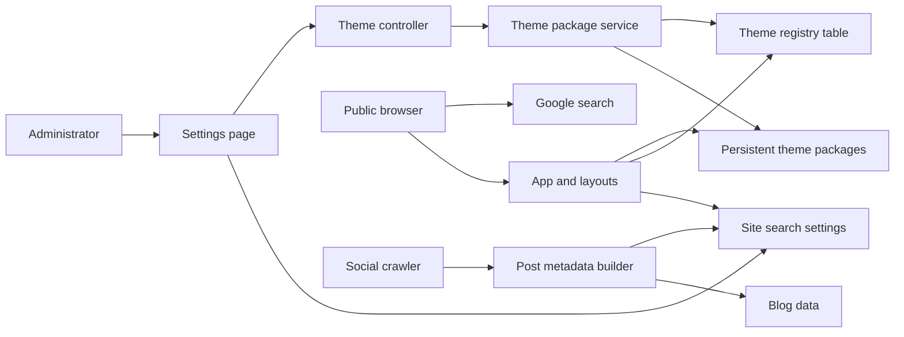
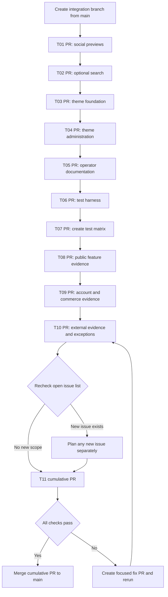
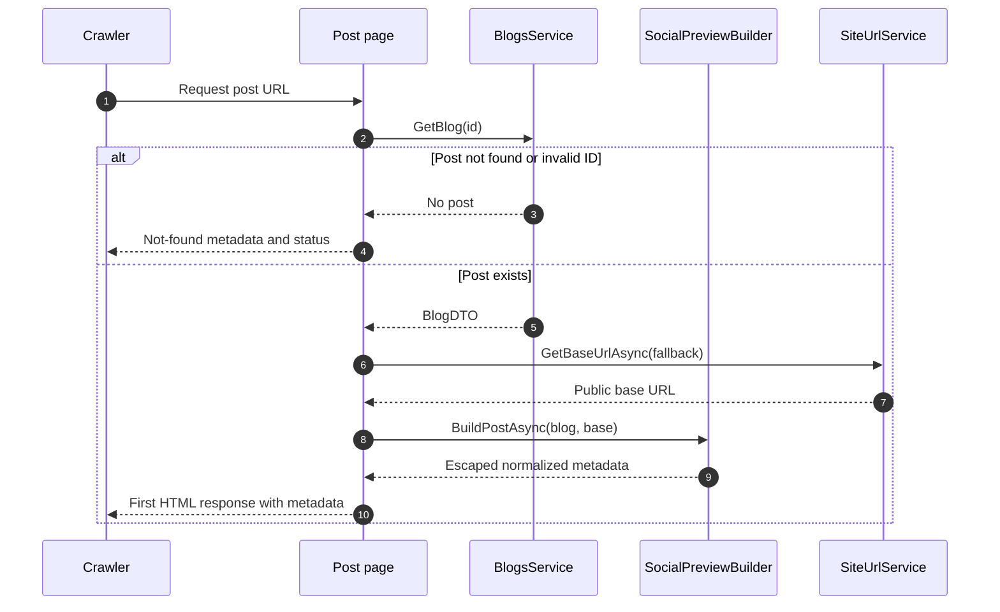
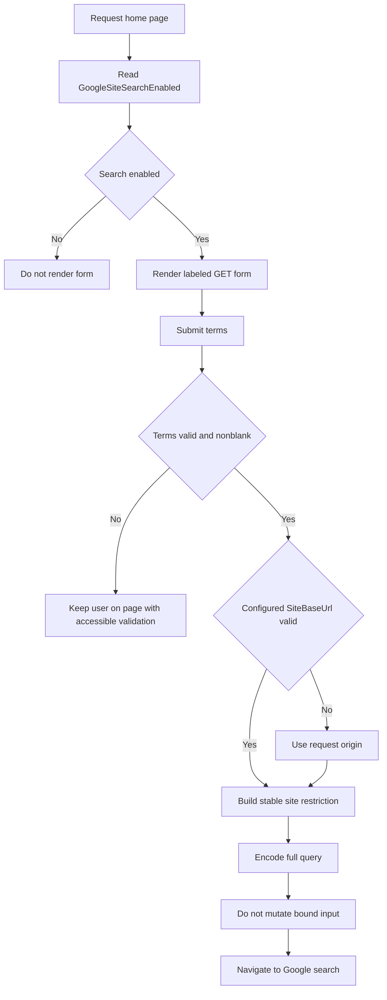
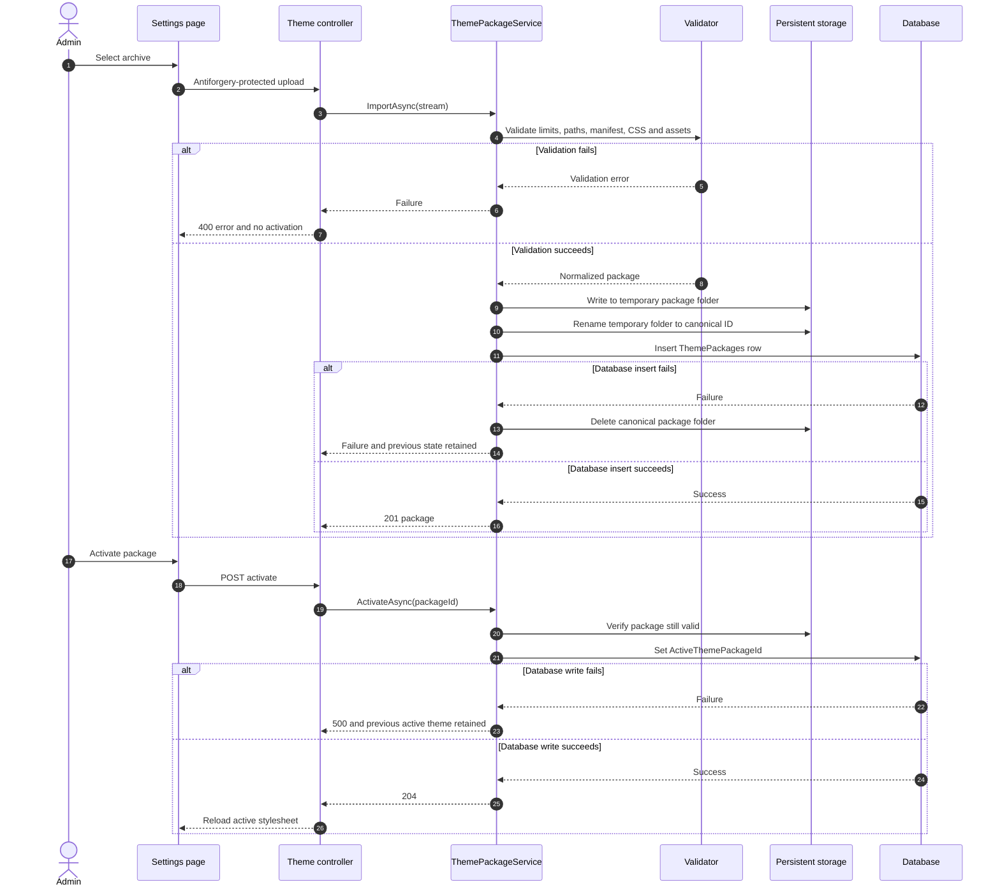
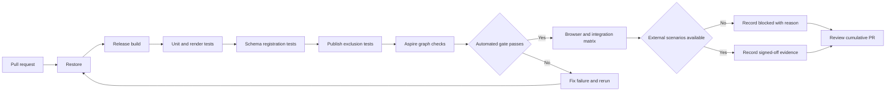

# Open Issues and Feature Testing Plan

| | |
|---|---|
| **Status** | Draft for implementation |
| **Date** | 2026-11-19 |
| **Audience** | A developer or agent that has not seen the planning discussion |
| **Scope** | Resolve the three issues open on 2026-11-19, then verify all documented application features |
| **Delivery** | A reviewed PR stack on an integration branch, culminating in one cumulative PR to `main` |
| **Source version** | 10.06.00 |

Conventions:

- Every existing-code statement links to the file that proves it. Line links are relative to this document.
- **(assumed)** identifies a requirement not established by code or an issue; each assumption has an implementation task that verifies or supplies a safe default.
- Placeholders such as `<site>`, `<resource-group>`, and `<token>` must be used in examples and test evidence. Do not add secrets, connection strings, real deployment hostnames, IP addresses, or personal data.
- The three issue titles and requirements are established by their GitHub issue pages: [#55](https://github.com/ADefWebserver/Blazor-Blogs/issues/55), [#49](https://github.com/ADefWebserver/Blazor-Blogs/issues/49), and [#43](https://github.com/ADefWebserver/Blazor-Blogs/issues/43).

---

## 1. Summary

Resolve all three currently open issues:

| Issue | Outcome |
|---|---|
| [#55](https://github.com/ADefWebserver/Blazor-Blogs/issues/55) | Blog posts produce complete, crawler-visible Open Graph and X/Twitter preview metadata in the first HTML response. |
| [#49](https://github.com/ADefWebserver/Blazor-Blogs/issues/49) | Administrators can enable or disable a Google site-search box; enabled searches are safely encoded and restricted to the configured site. |
| [#43](https://github.com/ADefWebserver/Blazor-Blogs/issues/43) | Administrators can upload, preview, activate, deactivate, and delete validated non-executable CSS/asset theme packages. |

Then execute a feature-wide test program covering the documented capabilities in [README.md](../README.md#L21-L51), not merely the new issue work. Automated tests cover deterministic logic, validation, rendering, storage, and security boundaries; a repeatable manual matrix covers browser, SMTP, Google, Stripe, social-crawler, and Azure flows that cannot be truthfully verified without their external services.

The owner selected the **Balanced** delivery profile during planning: one combined plan; CSS/asset themes rather than executable plugins; a PR stack with a final cumulative integration PR; social images selected from the first eligible post image, then the configured application logo, then a repository-owned default; and mixed automated/manual feature verification.

---

## 2. Goals and non-goals

### Goals

| ID | Goal |
|---|---|
| G1 | Close #55, #49, and #43 with observable acceptance evidence. |
| G2 | Preserve fresh installs and incremental schema upgrades from the current `10.06.00` version. |
| G3 | Keep each issue reviewable and independently releasable through the PR stack. |
| G4 | Keep uploaded themes outside the publish package and persistent across application updates. |
| G5 | Reject malicious or invalid theme archives without changing the active theme. |
| G6 | Make the social preview, search, and theme behavior testable without requiring live social networks. |
| G7 | Test every feature advertised in [README.md](../README.md#L21-L51) through automation or a named manual scenario. |
| G8 | Leave `main` releasable after every merged integration PR. |

### Non-goals

| Area | Not included |
|---|---|
| Themes | Compiling Razor, loading DLLs/components, remote theme catalogs, per-user themes, scheduled themes, or arbitrary JavaScript. |
| Social previews | Per-post override fields, an authoring UI for preview text/images, or live guarantees about every scraper's cache. |
| Search | Replacing the existing page/category filtering with a database search engine; indexing private or authenticated content. |
| Testing | Treating third-party availability as an application bug; storing production credentials in tests; claiming deployment coverage without running the external scenario. |
| Issue inventory | Work unrelated to the three issues that were open when this plan was written. Re-query open issues before the final PR. |

---

## 3. Decisions

Decisions marked **Owner** were selected during planning. Other decisions are planner defaults and may be revisited before implementation.

| # | Decision | Rejected alternative | Why |
|---|---|---|---|
| D1 | Use one combined plan because all work shares settings, schema, layout, persistent content, CI, and one integration gate. | Separate unrelated documents. | One document gives the fresh developer the complete dependency and acceptance model. **Owner** |
| D2 | Implement independently focused issue PRs, shared hardening/documentation/test PRs, and one final cumulative PR. | One monolithic PR. | Each issue is independently reviewable, with #43 split because archive security and UI are different review surfaces; the final PR still satisfies the requested single PR that addresses all open issues. **Owner** |
| D3 | Theme packages contain CSS plus allow-listed static assets only. They are never executable code. | Razor/component or DLL plugins. | #43 is large and security-sensitive; static themes meet “look and feel” without plugin loading or arbitrary code execution. **Owner** |
| D4 | Preview image order is first eligible `` in post content, then `ApplicationLogo`, then repository-owned `social-preview.png`. | Logo only; administrator override field. | It gives content posts useful previews without a schema/editor change and retains a safe fallback. **Owner** |
| D5 | Description order is normalized `BlogSummary`, then normalized text from `BlogContent`, then application name. Maximum 200 Unicode code points. | Raw HTML; unlimited text. | Card parsers need plain bounded text and do not define one standard maximum. |
| D6 | Metadata uses `SiteUrlService` with the request base only as fallback. | `NavigationManager.Uri` as the source of truth. | A configured public base already exists and is validated by the Settings page; current per-post code derives directly from the current navigation host ([ViewBlogPost.razor:59](../BlazorBlogs/Components/Pages/ViewBlogPost.razor#L59), [SiteUrlService.cs:3-15](../BlazorBlogs/Data/SiteUrlService.cs#L3-L15)). |
| D7 | Google search is an optional administrator setting, default `False`. | Default enabled; always enabled. | Safe upgrade behavior and explicit administrator choice. |
| D8 | Search uses a normal HTML GET form with a hidden `site` term or a computed `q` value, not JavaScript navigation. | Current `window.open` call with an unencoded string. | It works without JavaScript, preserves Back-button behavior, and prevents delimiter injection ([Index.razor:251-258](../BlazorBlogs/Components/Pages/Index.razor#L251-L258)). |
| D9 | Theme upload, activation, deactivation, and delete happen through a dedicated administrator-only service/controller. | Reuse `UploadController.MultipleAsync`. | The current generic upload endpoint accepts files into public storage and is image-manager oriented, not an archive-security boundary ([UploadController.cs:23-76](../BlazorBlogs/Controllers/UploadController.cs#L23-L76)). |
| D10 | Uploaded themes live under persistent user content and are served read-only; package output does not contain uploaded themes. | Store under tracked `wwwroot`. | Existing content can live outside the web root, is provisioned and served by `Program`, and is excluded from clean publish checks ([UserContentPaths.cs:8-27](../BlazorBlogs/Classes/UserContentPaths.cs#L8-L27), [Program.cs:177-192](../BlazorBlogs/Program.cs#L177-L192), [BlazorBlogs.csproj:127-142](../BlazorBlogs/BlazorBlogs.csproj#L127-L142)). |
| D11 | Upload does not activate. Activation is a separate explicit step with atomic setting update after package validation. | Activate immediately after upload. | A bad or incompatible package cannot replace a working site merely by being uploaded. |
| D12 | “Test all features” means every feature in README has an owner, evidence type, expected result, and pass/fail record. Not every external integration must be automated. | Browser/E2E automation for every feature regardless of cost. | SMTP, identity providers, payment, social scrapers, and cloud deployment need controlled external systems; unit tests alone are not sufficient evidence. **Owner** |
| D13 | Version scripts remain additive and are registered in the runner, project, and layout version invariant. | EF migrations; editing an already shipped script. | This is the established upgrade mechanism ([InstallWizardExecuteScripts.razor:52-82](../BlazorBlogs/Components/Pages/InstallUpgrade/InstallWizardExecuteScripts.razor#L52-L82), [InstallWizardExecuteScripts.razor:150-180](../BlazorBlogs/Components/Pages/InstallUpgrade/InstallWizardExecuteScripts.razor#L150-L180)). |
| D14 | New theme CSS cannot define executable content and may reference only relative files declared in the manifest. | Trust administrator CSS completely. | Administrators may upload third-party theme archives; active CSS should not silently contact arbitrary hosts or load unreviewed content. |

---

## 4. Current state

### 4.1 Open issue inventory

The GitHub repository has three open issues at the planning date: #55, #49, and #43. Re-query the issue list immediately before T11 because new issues are not in this plan.

| Issue | Current evidence |
|---|---|
| #55 | The post page emits only `og:url` and `og:title`; the home page emits only `og:title` ([ViewBlogPost.razor:14-18](../BlazorBlogs/Components/Pages/ViewBlogPost.razor#L14-L18), [Index.razor:18-19](../BlazorBlogs/Components/Pages/Index.razor#L18-L19)). `BlogDTO` already carries title, summary, and content but no separate social fields ([BlogDTO.cs:10-20](../BlazorBlogs/Data/Models/BlogDTO.cs#L10-L20)). |
| #49 | The home page always renders the search controls ([Index.razor:28-49](../BlazorBlogs/Components/Pages/Index.razor#L28-L49)). `Search()` directly appends a host and calls JavaScript with an unencoded URL ([Index.razor:251-258](../BlazorBlogs/Components/Pages/Index.razor#L251-L258)). |
| #43 | Appearance settings currently expose one validated accent color and a header/logo ([Settings.razor:91-140](../BlazorBlogs/Components/Pages/Settings.razor#L91-L140), [Settings.razor:377-447](../BlazorBlogs/Components/Pages/Settings.razor#L377-L447)). `MainLayout` applies the accent as a CSS variable ([MainLayout.razor:18-33](../BlazorBlogs/Components/Layout/MainLayout.razor#L18-L33), [MainLayout.razor:66-69](../BlazorBlogs/Components/Layout/MainLayout.razor#L66-L69)). |

### 4.2 Reusable foundations

| Fact | Evidence |
|---|---|
| The app is a Blazor Server project with interactive server rendering and `HeadOutlet` in the document head. | [App.razor:1-21](../BlazorBlogs/Components/App.razor#L1-L21), [Program.cs:29-32](../BlazorBlogs/Program.cs#L29-L32) |
| Head-element server prerendering is enabled. | [Program.cs:143-144](../BlazorBlogs/Program.cs#L143-L144) |
| `GeneralSettingsService` reads missing rows safely with fallbacks and can insert/update an individual setting. | [GeneralSettingsService.cs:20-51](../BlazorBlogs/Data/GeneralSettingsService.cs#L20-L51), [GeneralSettingsService.cs:53-75](../BlazorBlogs/Data/GeneralSettingsService.cs#L53-L75) |
| Administrator settings already require the Administrators role and re-check that role before save. | [Settings.razor:1-2](../BlazorBlogs/Components/Pages/Settings.razor#L1-L2), [Settings.razor:361-375](../BlazorBlogs/Components/Pages/Settings.razor#L361-L375), [Settings.razor:490-496](../BlazorBlogs/Components/Pages/Settings.razor#L490-L496) |
| The default CSS already centralizes visual values as custom properties. | [app.css:14-38](../BlazorBlogs/wwwroot/app.css#L14-L38) |
| Persistent user content has a public root, public subfolders, a private download folder, and path-containment logic. | [UserContentPaths.cs:3-52](../BlazorBlogs/Classes/UserContentPaths.cs#L3-L52) |
| Additional persistent public files are served by a physical file provider. | [Program.cs:177-192](../BlazorBlogs/Program.cs#L177-L192) |
| CI restores, Release-builds, tests, validates Aspire graphs, and checks protected content is absent from publish output. | [.github/workflows/ci.yml](../.github/workflows/ci.yml) |
| Existing tests use xUnit, repository-root discovery, temporary folders, and source/project invariants. | [BlazorBlogs.Tests.csproj](../BlazorBlogs.Tests/BlazorBlogs.Tests.csproj), [SchemaRegistrationTests.cs](../BlazorBlogs.Tests/SchemaRegistrationTests.cs), [UserContentPathsTests.cs](../BlazorBlogs.Tests/UserContentPathsTests.cs) |

### 4.3 Test coverage boundary

The current solution contains one web project, one AppHost, ServiceDefaults, and one test project ([BlazorBlogs.sln:1-24](../BlazorBlogs.sln#L1-L24)). The visible automated suite focuses on connection-string behavior, user-content paths, and schema/publish invariants ([BlazorBlogs.Tests](../BlazorBlogs.Tests)); it does not exercise every advertised feature.

The advertised feature inventory is the README list plus the routes and services it names: blogs, categories/tags, rich editing/uploads, Live Writer, Disqus, identity/administration, Google sign-in, branding/settings, downloads/payments, newsletters, RSS, logs, DNN import, install/upgrade, local Aspire, and deployment ([README.md:21-51](../README.md#L21-L51)).

---

## 5. Design

### 5.1 Structure



### 5.2 Social metadata

Create a pure `SocialPreviewBuilder` that takes blog data, application settings, and absolute base URL data and returns one normalized model. Razor code emits the model through head components; it does not contain parsing rules.

Metadata emitted for a valid post:

| Field | Source |
|---|---|
| `title` / `og:title` / `twitter:title` | `BlogTitle`, normalized as text |
| canonical / `og:url` | `new Uri(baseUrl, "ViewBlogPost/{id}")` |
| `og:type` | `article` |
| `og:site_name` | `ApplicationName` |
| description fields | summary, else post text, else application name |
| image fields | first safe post image, then application logo, then default asset |
| `twitter:card` | `summary_large_image` when a usable image exists, otherwise `summary` |

For image extraction, accept only absolute HTTP/HTTPS URLs and application-relative paths that resolve under the public site base. Reject `javascript:`, `data:`, protocol-relative, fragments, and malformed URLs. Do not fetch remote images.

### 5.3 Optional Google site search

- Add `GoogleSiteSearchEnabled` to `GeneralSettings`.
- Read the setting with default `False`.
- Render a native form only when enabled.
- Query `https://www.google.com/search` with:
  - `q=<user text>`
  - an additional `site:` clause derived from configured `SiteBaseUrl`, or the current origin.
- Do not mutate the user's bound text.
- Keep the existing category filter separate.
- The form and submit control have explicit labels and work with keyboard and no JavaScript.

### 5.4 Theme package format and lifecycle

A theme archive has:

```text
theme.json
theme.css
assets/
  <allow-listed-static-files>
```

Rules:

| Rule | Contract |
|---|---|
| Archive maximum | 10 MiB compressed; 20 MiB expanded; maximum 250 entries |
| Stylesheet | One `theme.css`, UTF-8, maximum 1 MiB |
| Assets | Relative `.avif`, `.gif`, `.jpeg`, `.jpg`, `.png`, `.webp`, `.woff`, `.woff2` files only; SVG is not accepted |
| Manifest | UTF-8 JSON, maximum 32 KiB |
| Slug | `^[a-z0-9]+(?:-[a-z0-9]+)*$`, maximum 50 characters |
| CSS scope | No `@import`, `javascript:`, `data:`, protocol-relative URLs, remote `url(...)`, embedded `<style>`, HTML, or JavaScript |
| Archive paths | No absolute path, `..`, backslash, duplicate normalized path, drive prefix, symlink, or device name |
| Version | SemVer-like `major.minor.patch` string |

Themes are stored at `<Storage:UserContentPath>/public/themes/<slug>/<package-id>/`. The active setting stores the package ID, not a path supplied by the client. `App.razor` loads the active validated CSS URL after base/Radzen styles, so a theme can override tokens while Bootstrap/Radzen dependencies remain stable.

The built-in appearance remains the default. Preview is administrator-only and temporary: `/settings/themes/preview/{id}` renders the normal application with the selected package stylesheet appended for that request only. Preview never changes `ActiveThemePackageId`, has `noindex`, and is not served to anonymous users. Deactivation clears the active setting and restores the current built-in accent/header behavior. An active package cannot be deleted; deactivate it first. Delete is idempotent for stale entries but never follows a path outside the theme root.

### 5.5 Full-feature test model

Every README feature receives a test-record row:

| Field | Meaning |
|---|---|
| `Area` | Feature family from the README |
| `Level` | Unit, component/render, browser, integration, or manual external |
| `Preconditions` | Local database, fixture, account, provider test account, or cloud resource |
| `Steps` | Repeatable numbered steps |
| `Expected` | Observable pass condition |
| `Evidence` | CI link, test result, screenshot, raw response, log reference, or signed-off checklist |
| `Owner` | Developer or repository owner |

Ownership defaults are executable:

| Scenario class | Accountable owner |
|---|---|
| Unit, component, storage, schema, raw HTTP, and browser scenarios that can run with local/synthetic data | Implementing developer |
| SMTP, Google, Stripe, and cloud scenarios requiring externally provisioned credentials/resources | Repository owner |
| Review of pass/block/exception evidence on the cumulative PR | Repository owner |

Before T10, the repository owner must provide access to test-only provider accounts and a throwaway resource group, or explicitly mark a row with a dated scope exception. The plan's placeholders are not proof of access. The developer must never request production credentials through source control or PR comments.

External manual runs are marked `Blocked`, not `Pass`, when credentials or infrastructure are unavailable.

---

## 6. Contracts

### 6.1 Configuration and settings

No new environment keys are required. Existing `Storage:UserContentPath` is used.

| `SettingName` | Type | Default | Script | Purpose |
|---|---|---|---:|---|
| `SiteBaseUrl` | absolute HTTP/HTTPS URL or empty string | `""` | existing | Public canonical base |
| `ApplicationName` | string | existing value | existing | Site name metadata |
| `ApplicationLogo` | relative/public or absolute HTTP/HTTPS URL | `""` | existing | Secondary social-image fallback |
| `GoogleSiteSearchEnabled` | `True` / `False` | `False` | `10.07.00` | Show or hide the public search form |
| `ActiveThemePackageId` | canonical lowercase GUID or empty string | `""` | `10.08.00` | Select the active uploaded package |

The version values are proposed. If PR merge order changes, renumber them so every version is higher than the current highest, and update all three registration points proven by [SchemaRegistrationTests.cs](../BlazorBlogs.Tests/SchemaRegistrationTests.cs).

### 6.2 Models

```csharp
public sealed class SocialPreview
{
    public required string Title { get; init; }
    public required string Description { get; init; }
    public required Uri CanonicalUrl { get; init; }
    public Uri? ImageUrl { get; init; }
    public string? ImageAlt { get; init; }
    public string TwitterCard => ImageUrl is null ? "summary" : "summary_large_image";
}

public sealed class GeneralSettings
{
    // Existing members remain.
    public bool GoogleSiteSearchEnabled { get; set; }
}

public sealed record ThemeManifest(
    string Name,
    string Slug,
    string Version,
    string Stylesheet,
    IReadOnlyList<string> Assets);

public sealed class ThemePackage
{
    public Guid ThemePackageId { get; set; }
    public string Name { get; set; }
    public string Slug { get; set; }
    public string Version { get; set; }
    public string ManifestJson { get; set; }
    public string StylesheetUrl { get; set; }
    public DateTime CreatedUtc { get; set; }
}
```

`ThemePackage` is a proposed EF entity backed by a `ThemePackages` table. The table stores no uploaded file bytes, CSS, or untrusted archive path. The physical package is keyed by canonical ID.

### 6.3 Service signatures

```csharp
public interface ISocialPreviewBuilder
{
    Task<SocialPreview> BuildPostAsync(
        BlogDTO post,
        Uri fallbackBaseUrl,
        CancellationToken cancellationToken = default);
}

public sealed record GoogleSiteSearchQuery(string Terms, string Site);

public interface IGoogleSiteSearchService
{
    GoogleSiteSearchQuery BuildQuery(string terms, Uri baseUrl);
    Uri BuildDestination(GoogleSiteSearchQuery query);
}

public interface IThemePackageService
{
    Task<ThemePackage> ImportAsync(Stream archive, string fileName, CancellationToken cancellationToken);
    Task<IReadOnlyList<ThemePackage>> ListAsync(CancellationToken cancellationToken);
    Task<ThemePackage?> GetAsync(Guid packageId, CancellationToken cancellationToken);
    Task ActivateAsync(Guid packageId, CancellationToken cancellationToken);
    Task DeactivateAsync(CancellationToken cancellationToken);
    Task DeleteAsync(Guid packageId, CancellationToken cancellationToken);
    Task<string?> GetActiveStylesheetUrlAsync(CancellationToken cancellationToken);
}
```

The builder and search service must be pure around input/output except for existing settings reads. The theme service owns all archive, path, database, and active-setting operations.

### 6.4 HTTP and page contracts

| Method | Route | Auth | Antiforgery | Result |
|---|---|---|---|---|
| GET | `/ViewBlogPost/{id:int}` | anonymous | n/a | Complete first-response head metadata; not-found state for invalid ID |
| GET | `/` search form action | anonymous | n/a | Redirect/navigation to Google when enabled |
| GET | `/settings/themes/preview/{id:guid}` | `Administrators` | n/a | Preview stylesheet for one request; `404`, or `403` for non-admin |
| POST | `/api/themes/import` | `Administrators` | required | `201` package model, `400` validation error, `413` archive too large |
| POST | `/api/themes/{id}/activate` | `Administrators` | required | `204` or `404`; active setting changes after validation |
| POST | `/api/themes/deactivate` | `Administrators` | required | `204` |
| DELETE | `/api/themes/{id}` | `Administrators` | required | `204`, `404`, or `409` when active |

Browser-origin form submissions must not disable antiforgery. If the settings page calls the endpoints through JavaScript, obtain the framework token through the established form/header mechanism; do not add a bearer secret to page markup.

### 6.5 SQL schema

`10.07.00.sql`:

```sql
IF NOT EXISTS (
    SELECT 1 FROM [dbo].[Settings]
    WHERE [SettingName] = N'GoogleSiteSearchEnabled')
    INSERT INTO [dbo].[Settings] ([SettingName], [SettingValue])
    VALUES (N'GoogleSiteSearchEnabled', N'False')

UPDATE [dbo].[Settings]
SET [SettingValue] = '10.07.00'
WHERE [SettingName] = 'VersionNumber'
```

`10.08.00.sql`:

```sql
IF OBJECT_ID(N'dbo.ThemePackages', N'U') IS NULL
BEGIN
    CREATE TABLE [dbo].[ThemePackages] (
        [ThemePackageId] uniqueidentifier NOT NULL
            CONSTRAINT [PK_ThemePackages] PRIMARY KEY,
        [Name] nvarchar(100) NOT NULL,
        [Slug] nvarchar(50) NOT NULL,
        [Version] nvarchar(32) NOT NULL,
        [ManifestJson] nvarchar(max) NOT NULL,
        [StylesheetUrl] nvarchar(500) NOT NULL,
        [CreatedUtc] datetime2 NOT NULL,
        CONSTRAINT [UQ_ThemePackages_Package] UNIQUE ([Slug], [Version])
    )
END

IF NOT EXISTS (
    SELECT 1 FROM [dbo].[Settings]
    WHERE [SettingName] = N'ActiveThemePackageId')
    INSERT INTO [dbo].[Settings] ([SettingName], [SettingValue])
    VALUES (N'ActiveThemePackageId', N'')

UPDATE [dbo].[Settings]
SET [SettingValue] = '10.08.00'
WHERE [SettingName] = 'VersionNumber'
```

### 6.6 CLI and sample input/output

No production CLI parameters are added.

Verification commands:

```text
dotnet restore BlazorBlogs.sln
dotnet build BlazorBlogs.sln -c Release --no-restore --nologo
dotnet test BlazorBlogs.sln -c Release --no-build --nologo
aspire publish --list-steps --non-interactive
aspire deploy --list-steps --non-interactive
```

Sample search input:

```text
Terms: garden & "new year"
SiteBaseUrl: https://<site>/
```

Expected destination query:

```text
q=garden+%26+%22new+year%22+site%3A<site>
```

The exact host serializer is proven by `Uri` tests; the text above is illustrative and uses a placeholder.

Sample theme manifest:

```json
{
  "name": "Example Theme",
  "slug": "example-theme",
  "version": "1.0.0",
  "stylesheet": "theme.css",
  "assets": [
    "assets/example.webp"
  ]
}
```

Successful import response:

```json
{
  "themePackageId": "00000000-0000-0000-0000-000000000000",
  "name": "Example Theme",
  "slug": "example-theme",
  "version": "1.0.0",
  "stylesheetUrl": "/themes/example-theme/00000000-0000-0000-0000-000000000000/theme.css"
}
```

The all-zero ID is a non-production placeholder.

---

## 7. Flows

### 7.1 PR delivery



### 7.2 Social preview request



Failure paths include database failure, invalid base URL fallback, missing summary/content, malformed image URL, and an image that is absent. None may produce scriptable metadata or a blank canonical URL.

### 7.3 Optional site search



### 7.4 Theme import and activation



If the stylesheet becomes unavailable after activation, `App.razor` must fall back to built-in styles rather than render an error page. Missing files are logged with the non-secret package ID and the site remains usable.

On start-up, reconcile an orphan package folder that has no registry row after a one-hour grace period: delete it only when it is fully beneath `ThemesPath`. A registry row whose final folder is missing remains non-activatable and is reported to the administrator; it is not silently recreated from manifest JSON. Tests cover process termination boundaries before/after final rename, before/after database insert, and cleanup/restart.

### 7.5 CI and feature verification



The cumulative PR cannot merge while required external scenarios are merely `Blocked`; only an explicit scope exception from the owner can defer one, and that exception must be linked in the PR.

---

## 8. File-by-file change table

| File | New/Modified | Change |
|---|---|---|
| `BlazorBlogs/Components/Pages/ViewBlogPost.razor` | Modified | Load/call social preview service and render complete head tags; handle missing posts without stale metadata. |
| `BlazorBlogs/Components/Pages/Index.razor` | Modified | Conditionally render an accessible GET search form; use search-query service. |
| `BlazorBlogs/Data/BlogsService.cs` | Modified | Preserve needed blog fields; expose image/summary data only through existing DTO reads, without unrelated query broadening. |
| `BlazorBlogs/Data/Models/GeneralSettings.cs` | Modified | Add `GoogleSiteSearchEnabled`; do not put active CSS into the page-cached settings object. |
| `BlazorBlogs/Data/GeneralSettingsService.cs` | Modified | Read/search setting with `False` fallback; use existing `SetSettingAsync` for saves. |
| `BlazorBlogs/Data/SocialPreviewBuilder.cs` | New | Pure metadata normalization, canonical URL, safe image selection, and description truncation. |
| `BlazorBlogs/Data/GoogleSiteSearchService.cs` | New | Build terms, stable site restriction, and encoded destination URL. |
| `BlazorBlogs/Data/SiteUrlService.cs` | Modified only if needed | Expose or reuse a validated public base; keep existing fallback behavior. |
| `BlazorBlogs/Components/Pages/Settings.razor` | Modified | Add search toggle and theme-management section; keep operations administrator-only. |
| `BlazorBlogs/Components/ThemeManager.razor` | New | List/import/preview-link/activate/deactivate/delete UX and non-sensitive error display. |
| `BlazorBlogs/Data/ThemePackageService.cs` | New | Archive validation, extraction, registry, activation, deactivation, and deletion. |
| `BlazorBlogs/Data/ThemePackageValidator.cs` | New | Path, manifest, type, size, CSS URL, and static-asset validation. |
| `BlazorBlogs/Data/Models/ThemePackage.cs` | New | EF entity for uploaded theme metadata. |
| `BlazorBlogs/Data/BlazorBlogsContext.cs` | Modified | Add `DbSet<ThemePackage>` and constraints/indexes. |
| `BlazorBlogs/Controllers/ThemeController.cs` | New | Administrator-only HTTP boundary with antiforgery and upload size handling. |
| `BlazorBlogs/Classes/UserContentPaths.cs` | Modified | Add `ThemesPath`, containment, and folder creation. |
| `BlazorBlogs/Program.cs` | Modified | Register services/controller, provision persistent theme root/static provider, and load active stylesheet URL in page model. |
| `BlazorBlogs/Components/App.razor` | Modified | Render validated active theme stylesheet link after base styles. |
| `BlazorBlogs/wwwroot/images/social-preview.png` | New | Repository-owned default social image; fixed and suitable for public sharing. |
| `BlazorBlogs/SQLScripts/10.07.00.sql` | New | Guarded Google search setting and version update. |
| `BlazorBlogs/SQLScripts/10.08.00.sql` | New | Theme table, active setting, and version update. |
| `BlazorBlogs/Components/Pages/InstallUpgrade/InstallWizardExecuteScripts.razor` | Modified | Register each new ordered script. |
| `BlazorBlogs/Components/Layout/MainLayout.razor` | Modified | Advance `CurrentVersion` after the final schema PR; preserve accent fallback. |
| `BlazorBlogs/BlazorBlogs.csproj` | Modified | Copy SQL scripts; ensure uploaded themes cannot be included in publish. |
| `BlazorBlogs.Tests/*.cs` | New/Modified | Metadata, query encoding, package security, persistence, and UI/render tests. |
| `.github/workflows/ci.yml` | Modified only if needed | Add browser render/integration command after a repeatable test harness exists. Do not weaken gates. |
| `Docs/Feature-Test-Matrix.md` | New | Detailed feature ownership and evidence checklist consumed by T07–T10. |
| `README.md` | Modified | Document theme package format, security limits, activation/rollback, search setting, and test matrix entry point. |

Paths above are expected changes, not current files. A fresh agent must inspect the named files before editing.

---

## 9. Security and privacy

| Concern | Required treatment |
|---|---|
| Theme archive traversal | Extract no entries with absolute, drive, `..`, backslash, duplicate normalized paths, symlinks, or reparse point-like metadata. Resolve every destination under a canonical package directory. |
| Theme code execution | Accept CSS/static assets only; reject HTML, Razor, JavaScript, DLL, EXE, scriptable config, `@import`, remote/data URLs, and executable MIME/content mismatches. |
| CSS privacy leak | Reject remote `url(...)` in active CSS so a theme cannot send visitor fingerprints or tokens to a third party. Permit only assets listed in the same manifest. |
| Upload availability | Enforce request, compressed, expanded, entry-count, asset-count, CSS, and manifest limits before and during extraction. Use cancellation tokens and delete partial folders on failure. |
| Theme path storage | Client requests contain package IDs only. The server recomputes physical paths and never accepts a path from the browser. |
| Admin authorization | Page, controller, service entry points, and destructive operations require the Administrators role. The controller validates antiforgery. |
| Active-theme failure | Verify package integrity before activation; keep the previous active setting on failure; a missing active file falls back to built-in styles and logs a non-sensitive package ID. |
| Metadata injection | Encode Razor attributes and normalize content to text; never emit raw summary/content into metadata. |
| Query injection | Encode the search query once. Never concatenate an already-mutated `SearchText` or trust a `site:` term supplied by the visitor. |
| Search privacy | Only user-entered public search terms are sent to Google. Do not append identity, email, cookies, post-private state, or database content. |
| Social image fetch | Build URLs only. Do not perform a server-side fetch, DNS lookup, or scrape of user-controlled image hosts. |
| Personal data in docs/tests | Use `<site>` and synthetic data. Do not capture real emails, payment details, tokens, connection strings, account IDs, or cloud subscription values in the repository. |
| Third-party credentials | CI uses no real Google/Stripe/SMTP credentials. Manual external scenarios use local/owner-managed test credentials and report only pass/fail evidence. |

---

## 10. Test plan

### 10.1 Automated

| Area | Required cases |
|---|---|
| `SocialPreviewBuilder` | Summary fallback; HTML entity decoding; whitespace; exactly 200 code points; title escaping; missing image; relative image; absolute HTTP/HTTPS; rejected protocol-relative/data/javascript; logo fallback; default fallback. |
| Canonical URL | Configured `SiteBaseUrl`, request fallback, trailing slash, path base, invalid configured value, Unicode host, query/fragment removed. |
| Post render | Raw initial HTML contains canonical/Open Graph/X metadata; interactive navigation updates rather than retains the old post metadata; invalid post produces not-found metadata. |
| Search query | Disabled hides form; blank terms; spaces, `+`, `&`, `#`, `/`, quotes, Unicode, long input; repeated calls do not append a second `site:` clause; configured and fallback origin. |
| Settings | Missing search row defaults `False`; valid `True` loads and saves; direct non-admin calls are rejected. |
| Theme manifest | Missing/unknown fields, invalid UTF-8/JSON, invalid slug, invalid version, duplicate slug/version, stylesheet path, asset declaration. |
| Theme archive | Empty, too large, too many entries, ZIP bomb ratio, `../`, absolute, drive, duplicate, symlink-like entry, executable files, mislabeled signature, malformed archive. |
| Theme CSS | Remote/data/protocol-relative URLs, `@import`, safe relative packaged URL, comments and casing obfuscation. |
| Theme assets | SVG/scriptable types are rejected; mismatched MIME/signature; asset not declared in the manifest; external references. |
| Theme persistence | Configured/default roots; never overwrite an existing package; failure at each final-folder/database step leaves no active change; orphan reconciliation after restart; publish has no runtime uploaded themes. |
| Theme lifecycle | Import inactive; activate valid; activate missing file; deactivate; delete inactive; active delete returns conflict; DB and filesystem rollback. |
| Theme rendering | Active CSS link present, invalid/missing theme falls back, deactivation removes link, accent remains valid, 375 px and 1440 px smoke render. |
| Existing invariants | Current `SchemaRegistrationTests`, `UserContentPathsTests`, and connection-string tests continue to pass. |
| Schema | Upgrade from `10.06.00`, idempotent guarded inserts, exact final version, runner/project/layout registration. |
| Publish | No user content under uploads, blogs, files, private downloads, or themes. |

Use xUnit for pure/service/storage tests. Add a component or HTTP test dependency only if the selected renderer can exercise Blazor prerendered HTML and antiforgery without starting a live browser. If no reliable renderer exists, T06 may add Playwright-based browser tests as a single repeatable CI command, but document the added package/runtime explicitly.

### 10.2 Feature-wide matrix

T07 creates `Docs/Feature-Test-Matrix.md` with one row for each family below and links its evidence. T08–T10 execute focused subsets and update only their assigned evidence rows:

| Family | Minimum scenarios |
|---|---|
| Install and upgrade | Fresh install, upgrade from `10.06.00`, retry/failed script, data and settings preserved. |
| Blogs | Anonymous list/read, category/page navigation, create/edit/delete, summary/content rendering, image upload, authorization. |
| Tags and import | Category/tag use, DNN sample import, rich content retained. |
| Rich editor | Summary/content/header/newsletter edit; insert/upload image; source/round trip; keyboard labels. |
| Live Writer/MetaWeblog | Endpoint responds and one synthetic publish/edit/delete round trip. |
| Comments/analytics | Disqus configured/unconfigured; tracking ID behavior; no third-party call when disabled. |
| Identity | Register, verify, login, logout, lockout, recovery, roles, user administration, password and Google flows. |
| Google sign-in | Disabled, configured, canceled provider, account link/create, settings change, failure state. |
| Search and branding | Disabled/enabled search, query safety, logo/header/accent/site URL/theme behavior. |
| Newsletter | Subscribe, email confirmation boundaries, preferences, unsubscribe/resubscribe, campaign resume, SMTP failure, link headers. |
| Downloads and purchases | Free/paid/guest, checkout, cancel, webhook, replay, refund, protected path, link expiry/limit, resend. |
| RSS/logs | Feed parse/content, log write/read, administrator-only access. |
| User content | Default and configured roots, migration/copy without overwrite, restart and publish preservation. |
| Local Aspire | Fresh `aspire run`, persistent SQL data after restart, graph validation. |
| Azure | Provision and second deployment, persistent content, clean publish, rollback package; only with owner-approved throwaway resources. |
| Accessibility/browser | Keyboard, labels, focus, zoom, 375 px/1440 px, light form behavior, no critical automated accessibility findings. |

### 10.3 Issue-specific manual checks

1. **#55:** Request a blog page with JavaScript disabled and save the raw HTML. Confirm title/description/canonical/Open Graph/X tags, correct absolute URLs, safe escaping, and no stale metadata after client navigation. Run the URLs through local fixture parsers; do not call a production scraper with personal data.
2. **#49:** With the setting off, confirm no search form in HTML. Turn it on, search terms containing `&`, `+`, `#`, quotes, and Unicode, and confirm the destination has exactly one `site:` scope.
3. **#43:** Upload a valid package, a bad path archive, an executable file, a remote CSS import, and an oversized archive. Confirm only the valid package appears; preview, activate, reload, deactivate, and delete; verify an application update/publish does not include it or erase it.

### 10.4 Baseline commands

Run the smallest relevant xUnit filter while iterating, then run:

```text
dotnet restore BlazorBlogs.sln
dotnet build BlazorBlogs.sln -c Release --no-restore --nologo
dotnet test BlazorBlogs.sln -c Release --no-build --nologo
dotnet publish BlazorBlogs/BlazorBlogs.csproj -c Release -o <temporary-output>
aspire publish --apphost BlazorBlogs.AppHost/BlazorBlogs.AppHost.csproj --list-steps --non-interactive
aspire deploy --apphost BlazorBlogs.AppHost/BlazorBlogs.AppHost.csproj --list-steps --non-interactive
```

Record the exact SDK version from CI and do not copy production values into command output.

---

## 11. Risks and mitigations

| # | Risk | Likelihood | Impact | Mitigation |
|---|---|---|---|---|
| R1 | `HeadOutlet` content differs between prerender and interactive navigation. | Medium | High | Raw SSR and client-navigation tests; keep builder pure; do not rely on `OnAfterRenderAsync`. |
| R2 | A post with no summary or image produces weak or invalid metadata. | High | Medium | Explicit content/default fallback chain and table-driven tests. |
| R3 | Social networks cache an old preview. | High outside code | Medium | Acceptance is valid crawler-visible HTML; cache refresh is provider-specific and not a code guarantee. |
| R4 | Search becomes a privacy leak or query injection surface. | Low | Medium | Public terms only, one `site:` clause, encoded once, no account data. |
| R5 | Theme upload exposes traversal or arbitrary code. | Medium | Critical | Dedicated validator/service, allow list, no executable files, containment, antiforgery, size/entry limits, failure tests. |
| R6 | External CSS `url()` or active SVG exfiltrates client data or runs content. | Medium | High | Disallow remote URLs, disallow SVG, and require every local asset to be manifest-listed. |
| R7 | Theme CSS breaks usability or hides controls. | Medium | High | Preview/activate separately; built-in deactivation; CSS validation; responsive/browser checks. |
| R8 | Active package disappears after deployment. | Medium | High | Persistent user-content root, static provider, publish exclusion tests, and fallback. |
| R9 | Theme files and registry diverge. | Medium | Medium | Atomic staged folder flow, cleanup on DB failure, integrity check on activation/startup. |
| R10 | `ThemePackages` schema script conflicts with future scripts. | Medium | Medium | Merge-order numbering rule and schema invariant tests. |
| R11 | “All features” expands into unbounded test work. | High | High | Use README as the authoritative inventory and external scenario definitions; new capabilities need explicit scope. |
| R12 | External credentials are absent from CI. | High | Medium | Deterministic mocks/fakes for logic; owner-controlled manual runs for provider/cloud behavior; never weaken gate silently. |
| R13 | One cumulative PR is difficult to review. | Medium | Medium | Ship independently tested stacked PRs into the integration branch; cumulative PR contains no unreviewed changes and points to each child result. |
| R14 | New open issues appear before merge. | Medium | Medium | Re-query at T11, document inventory delta, and plan new scope separately instead of silently including it. |

---

## 12. Implementation tasks

Each entry is sized for one PR. T01–T04 merge into an integration branch in dependency order, T05–T10 supply documentation and focused verification, and T11 is the final cumulative PR to `main`.

- [ ] **T01 — Social preview builder and post metadata.**
  Implement `SocialPreviewBuilder`, post/home metadata behavior, safe image/description fallbacks, and raw-render tests.
  *Done when:* #55 acceptance cases pass; first HTML contains complete escaped metadata; invalid/missing data uses the documented fallbacks; client navigation does not retain an old post's tags.
- [ ] **T02 — Optional Google site search.**
  Add `10.07.00`/registration, setting, Settings control, native GET form, query builder, authorization, and encoding tests.
  *Done when:* disabled means absent; enabled searches navigate to one correctly scoped Google query; input is not mutated; upgrade from `10.06.00` passes.
- [ ] **T03 — Theme storage, registry, and validator.**
  Add `ThemesPath`, schema/entity, package service, archive/CSS validator, rollback behavior, security tests, and static serving.
  *Done when:* valid packages import inactive; every malformed-path/code/size case is rejected without partial state; build and publish gates pass.
- [ ] **T04 — Theme administration and rendering.**
  Add the dedicated controller, Settings UI, import/preview/activate/deactivate/delete flows, active stylesheet in `App.razor`, fallback behavior, browser tests, and update `CurrentVersion` after final schema.
  *Done when:* #43 works end to end for an administrator; a normal user/anonymous caller cannot mutate themes; missing active assets fall back; themes survive restart without entering publish output.
- [ ] **T05 — README and operator contract.**
  Document search and theme behavior, package format, limits, rollback, storage, and external test evidence requirements.
  *Done when:* a second person can create, upload, activate, deactivate, and recover a theme from the README without reading source.
- [ ] **T06 — Regression and issue integration harness.**
  Add HTTP/component/browser tests needed for SSR and antiforgery, issue-specific manual scripts, and any minimal test dependency not already present.
  *Done when:* all new deterministic paths run in CI and CI's existing publish/graph gates remain intact.
- [ ] **T07 — Create feature matrix and evidence format.**
  Create `Docs/Feature-Test-Matrix.md`; assign every README capability an owner, test level, preconditions, expected result, evidence location, and T08/T09/T10 work bucket.
  *Done when:* matrix coverage is complete, all placeholders are synthetic, and no row lacks an owner or execution bucket; this task does not run or fix unrelated feature failures.
- [ ] **T08 — Verify public/content browser features.**
  Execute and record the blogs, categories/tags/import, editor/upload, social metadata, search, themes, RSS/logs, branding, and accessibility rows using local/synthetic data.
  *Done when:* its assigned rows are `Pass`; a failure creates a separately numbered focused fix PR rather than expanding T08 into cross-feature repair.
- [ ] **T09 — Verify account and local workflow features.**
  Execute and record install/upgrade, role administration, password identity, newsletter state/messaging with fake SMTP, download authorization, and payment logic with a fake gateway.
  *Done when:* its assigned deterministic/local rows are `Pass`; provider-specific rows remain explicitly pending T10; failures are separately triaged and linked.
- [ ] **T10 — Verify external and cloud scenarios.**
  Run or obtain repository-owner sign-off for SMTP, Google, Stripe, Aspire, and Azure scenarios; update the matrix and record any dated explicit exception.
  *Done when:* each assigned external row is `Pass` or has a linked owner exception; no committed evidence contains credentials, personal data, or real infrastructure identifiers; failures produce a separate focused PR or exception.
- [ ] **T11 — Re-check inventory and create cumulative integration PR.**
  Re-query all open issues, confirm #55/#49/#43 are still the complete scope, verify the stacked branch is current, complete the acceptance checklist, and open the single PR to `main`.
  *Done when:* the PR description maps each acceptance criterion to evidence, all required checks pass, review comments are resolved, no unrelated changes are present, and all three issues close on merge.

### Dependency order

T03 must precede T04. T01 and T02 may run in parallel before T03 merges, but each schema-bearing PR must be rebased and renumbered before merge. T05 depends on T01–T04 behavior. T06 must add the issue harness before T07. T07 defines evidence buckets before T08–T10 execute them. T10 depends on owner-provided external access or explicit exceptions. T11 depends on all earlier tasks and any focused fix PRs created from their failures.

---

## 13. Acceptance criteria

| ID | Criterion |
|---|---|
| AC1 | GitHub lists no additional unplanned issue in the cumulative PR's scope check, and #55, #49, and #43 are linked as closed by the cumulative PR. |
| AC2 | A crawler-style GET for a valid post returns canonical, Open Graph, description, and X/Twitter metadata in the initial HTML. |
| AC3 | Missing/invalid post metadata does not leak an exception, stale values, scriptable content, or a previous post's tags. |
| AC4 | The search UI is absent when disabled and works as a no-JavaScript GET form when enabled. |
| AC5 | Search delimiters are encoded and the destination contains exactly one trusted `site:` restriction. |
| AC6 | Only administrators can import, activate, deactivate, or delete theme packages. |
| AC7 | Valid CSS/asset packages upload inactive, survive restart/deployment, and activate after explicit confirmation. |
| AC8 | Invalid/malicious archives, remote CSS references, and executable content are rejected without changing active state or leaving partial files. |
| AC9 | Deactivation and a missing active package both restore the usable built-in appearance. |
| AC10 | Theme files are outside the deployable source package and protected from publish inclusion. |
| AC11 | A database at `10.06.00` runs the new schema scripts once and ends at the final version without losing settings or content. |
| AC12 | Existing CI restore/build/test/Aspire/publish checks remain green. |
| AC13 | Every README feature has a row in the full-feature matrix with required evidence and a final `Pass` or owner-approved exception. |
| AC14 | External provider and cloud scenarios never expose credentials, personal data, or real hostnames/IPs in committed artifacts. |
| AC15 | The cumulative PR has no unrelated files, a reviewable issue-to-change mapping, resolved failures, and all required reviews/checks. |

---

## 14. Open questions

No blocking question remains for implementation. The following are explicitly resolved by the selected Balanced profile unless the owner changes them:

| Topic | Default |
|---|---|
| Uploaded theme capability | CSS and static assets only; no Razor, DLL, or JavaScript |
| Delivery shape | Three reviewable issue PRs plus integration/feature-verification PRs and one cumulative PR to `main` |
| Social image | First safe post image, then logo, then default |
| Search availability | Disabled until an administrator enables it |
| Automated external integrations | Logic/failure paths mocked in CI; live Google/Stripe/SMTP/Azure behavior manually verified with approved test systems |
