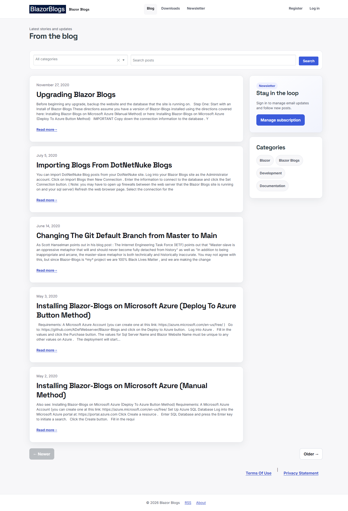
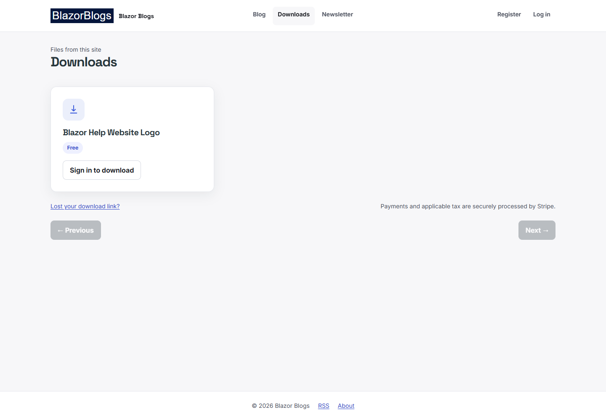
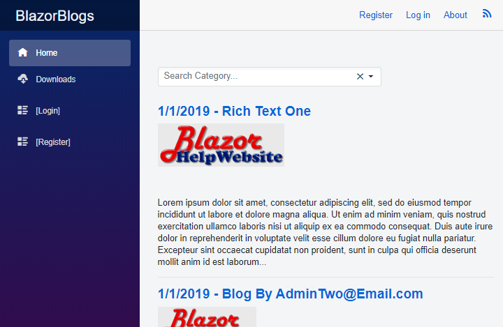
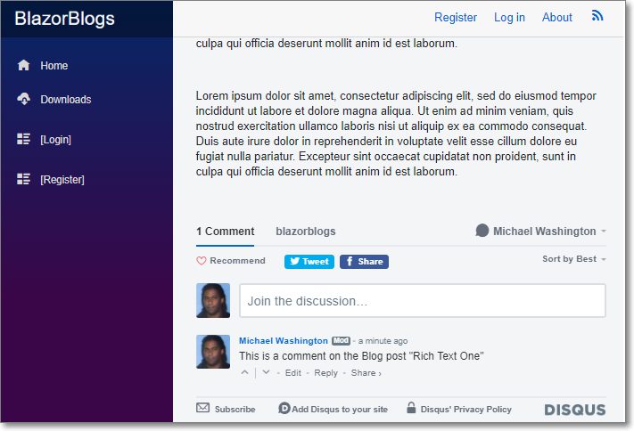
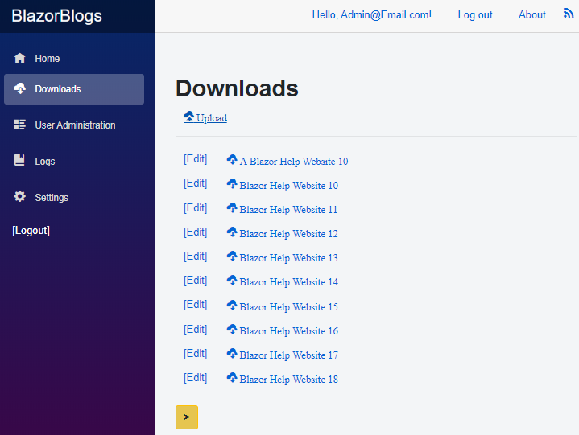
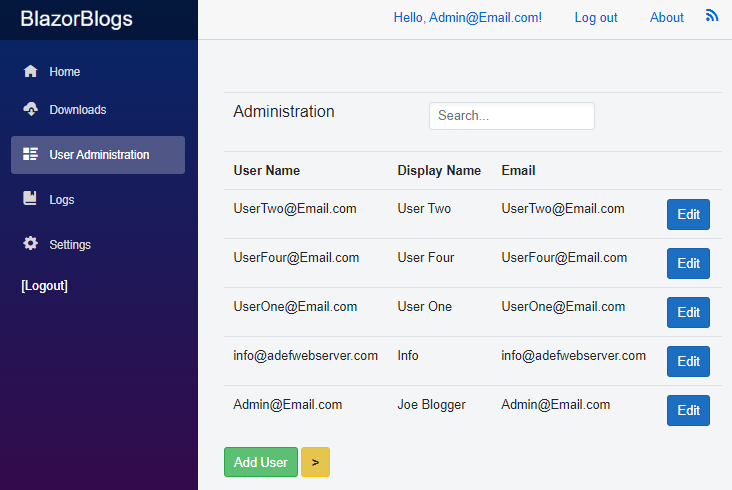
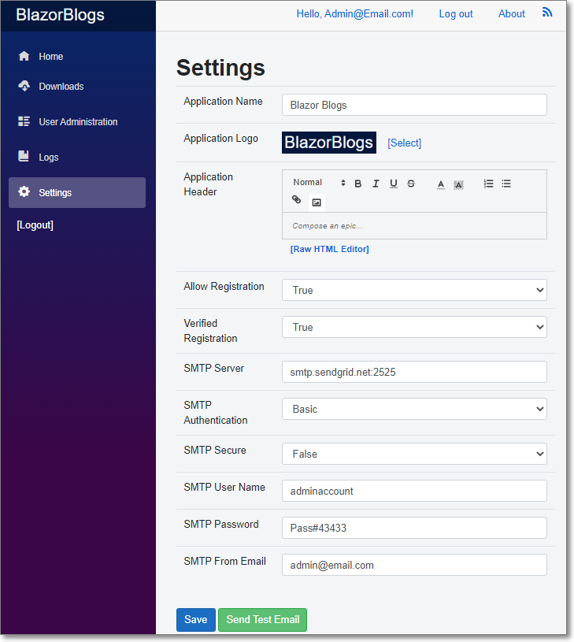

# Blazor-Blogs
#### Simple blogging application written in Microsoft Server Side Blazor

[](https://portal.azure.com/#create/Microsoft.Template/uri/https%3A%2F%2Fraw.githubusercontent.com%2FADefWebserver%2FBlazor-Blogs%2Fmain%2Fazuredeploy.json)

See: [Installing Blazor-Blogs on Microsoft Azure (Deploy To Azure Button Method)](https://blazorblogs.azurewebsites.net/ViewBlogPost/1008 "Installing Blazor-Blogs on Microsoft Azure")

## Live example site: https://blazorblogs.azurewebsites.net
#### Also see: [Installing Blazor-Blogs on Microsoft Azure (Manual Method)](https://blazorblogs.azurewebsites.net/ViewBlogPost/1007 "Installing Blazor-Blogs on Microsoft Azure")

## Blazor Blogs 10.06.00

[Read the 10.06.00 release announcement](https://blazorblogs.azurewebsites.net/ViewBlogPost/1014)

















### Features

#### 10.06.00 highlights

* Upgraded to .NET 11 with Aspire-based local development and Azure deployment.
* Responsive blog, article, administration, account, newsletter, and download pages.
* Search and category filters, configurable accent colors, custom header content,
  dynamic branding, and locally hosted variable fonts.
* Radzen HTML editing for rich posts, summaries, newsletters, and site headers.
* Google sign-in configured from the administration settings.
* Self-service newsletter subscriptions, preferences, unsubscribe/resubscribe, and
  resumable campaign delivery.
* Free and paid downloads with protected files, Stripe Checkout, guest purchases,
  Stripe Tax, purchase history, refunds, and download-link resend support.
* 10.00.00 through 10.06.00 database scripts, including newsletter, Stripe,
  appearance, and file-description updates.
* Safe connection-string migration to `appsettings.Local.json`, incremental schema
  upgrades, and persistent user-content paths.
* Deployment scripts, Aspire infrastructure, CI, and focused automated tests.

#### Core capabilities

* Supports unlimited bloggers, posts, tags, and categories.
* Rich text editing with image uploads.
* [Open Live Writer and Windows Live Writer support](https://blazorblogs.azurewebsites.net/ViewBlogPost/1005).
* [Disqus integration for blog comments](https://blazorblogs.azurewebsites.net/ViewBlogPost/1004).
* User administration, roles, registration, email verification, account recovery,
  and account lockout.
* Custom privacy, terms, logos, site URLs, application headers, and accent colors.
* Downloads, purchases, newsletters, RSS feeds, application logs, and DotNetNuke
  blog import.

### Installing

1) Create a Database
2) Deploy the code to Azure or IIS
3) Run the application by navigating to the root page in the web browser
4) The Install Wizard will show and guide you though installing the application

### Local development with Aspire

Requirements: .NET 11, Aspire CLI 13.6.5, and Docker Desktop or another compatible container runtime.

```powershell
aspire run
```

The AppHost starts a persistent SQL Server container and the `BlazorBlogs` website. The
connection string is injected by Aspire; the install wizard goes directly to database
script setup without asking for a connection string. SQL data survives AppHost restarts
through its named data volume. To verify the deployment graph without connecting to
Azure:

```powershell
aspire publish --list-steps --non-interactive
aspire deploy --list-steps --non-interactive
```

The normal web project remains independently runnable with an
`appsettings.Local.json` file. That file is local-only, excluded from Git and publish,
and is never overwritten by a later application update.

### Deploying with Aspire

The Aspire deployment model provisions Azure SQL Database on the non-pausing `Basic`
SKU, a user-assigned managed identity, and a Windows App Service plan/site on `B1`.
The site uses Always On, a managed-identity SQL connection, and persistent
`%HOME%\data\BlazorBlogs` storage. It intentionally does not deploy a container or
create a container registry.

Prerequisites are Azure CLI, PowerShell 7, an Azure sign-in with permission to deploy
the resources, and Aspire Azure subscription/resource-group/location configuration.
Review the graph first:

```powershell
aspire publish --non-interactive
```

Then run:

```powershell
aspire deploy
```

Supply a globally unique `websiteName` and `B1` (the default) when prompted. The
`deploy-website-code` pipeline step runs after `website` provisioning and deploys a
clean zip produced from the website project. The first visit completes the same SQL
script wizard as a self-hosted installation; later updates run only newer schema
scripts.

For a code-only update or rollback:

```powershell
./deploy/Deploy-Website.ps1 -ResourceGroup <resource-group> -WebsiteName <site>
./deploy/Deploy-Website.ps1 -WebsiteName <site> -ZipPath ./artifacts/site-<timestamp>.zip
```

`-ZipPath` skips publishing and deploys the existing package. Before every newly
published package is uploaded, the script refuses content under `wwwroot/uploads`,
`wwwroot/blogs`, `wwwroot/files`, or `PrivateFiles`. Azure zip deployment uses
`--clean false`, so user content already present in the site folder is not wiped.

The Windows .NET 11 production path, managed-identity SQL design, repeat deployment,
upgrade wizard, protected user-content preservation, and rollback package flow have
been verified against a live Azure deployment. Existing installations remain
responsible for backing up their database and persistent user content.

### Deploy to Azure button and existing button sites

The button uses `azuredeploy.json`, SQL authentication, and repository source
deployment. It now targets .NET 11, defaults to a `B1` plan and `Basic` Azure SQL,
sets the persistent user-content path, and accepts a `repoBranch` parameter for
release validation. The App Service source build for .NET 11 still requires live
Azure proof; use Aspire deployment if the platform has not enabled that SDK yet.

Existing button sites that only sync source do not need to redeploy the template.
Their App Service settings and SQL tier remain unchanged, and the application has safe
defaults. If you redeploy the template, enter the site's current plan SKU, database
edition, and service objective so an existing database is not unintentionally
re-tiered. After enabling the external content path, first start copies missing
existing uploads but never replaces files already in the persistent root.

### Backups and user content

Back up the database and the configured `Storage:UserContentPath` separately. Azure
Aspire/button deployments store that content in:

```text
%HOME%\data\BlazorBlogs\public\uploads
%HOME%\data\BlazorBlogs\public\blogs
%HOME%\data\BlazorBlogs\private\downloads
```

Self-hosted installations without `Storage:UserContentPath` retain the existing
`wwwroot\uploads`, `wwwroot\blogs`, and `PrivateFiles` layout. Restore files and
database rows together to a matching point in time; publishing or zip deployment is
not a database backup and must not be used as one. The Aspire deployment keeps the
database in Azure SQL and performs only incremental schema-script upgrades.

### Upgrading an existing installation

1. Back up the database and all user-content folders.
2. Deploy the new application files without deleting the site folder or local
   `appsettings.Local.json`.
3. An existing `appsettings.json` connection is migrated once into
   `appsettings.Local.json` when the content folder is writable. Environment-provided
   connection strings take precedence and do not create a local file.
4. Browse to the site, sign in as an administrator, and allow the install/upgrade
   wizard to run the next numbered SQL scripts.

If an older self-hosted deployment overwrites `appsettings.json` before local-file
migration was established, enter the old connection once in the install form. The
upgrade runner detects the stored `VersionNumber` and applies only newer scripts, so
existing rows are retained.

### Helpful Articles

* [Installing Blazor-Blogs on Microsoft Azure (Deploy To Azure Button Method)](https://blazorblogs.azurewebsites.net/ViewBlogPost/1008 "Installing Blazor-Blogs on Microsoft Azure")
* [Installing Blazor-Blogs on Microsoft Azure (Manual Method)](https://blazorblogs.azurewebsites.net/ViewBlogPost/1007 "Installing Blazor-Blogs on Microsoft Azure")
* [Upgrading Blazor Blogs](https://blazorblogs.azurewebsites.net/ViewBlogPost/1013)
* [Uploading Images With The Blazor Rich Text Editor](https://blazorhelpwebsite.com/ViewBlogPost/7 "Uploading Images With The Blazor Rich Text Editor")
* [Creating Reusable Custom Blazor Controls](https://blazorhelpwebsite.com/ViewBlogPost/11 "Creating Reusable Custom Blazor Controls")
* [Creating A Rich Text Editor In Blazor Using Quill](https://blazorhelpwebsite.com/ViewBlogPost/12 "Creating A Rich Text Editor In Blazor Using Quill")
* [Importing Blogs From DotNetNuke Blogs](https://blazorblogs.azurewebsites.net/ViewBlogPost/1012 "Importing Blogs From DotNetNuke Blogs")

### Newsletter upgrade note

After upgrading, partially sent campaigns use the recipient's email address rather than the user name. A recipient created by an administrator with a non-email user name can therefore receive the campaign again if only an older user-name log row exists.

Uses the Radzen HTML editor for rich text editing.
